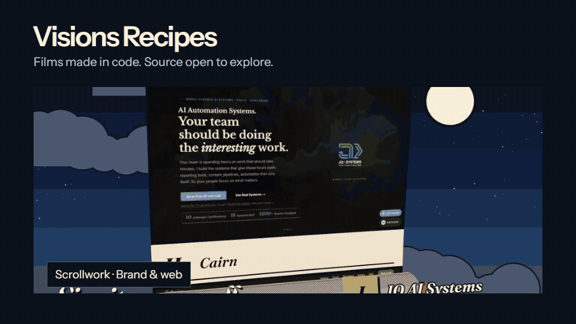
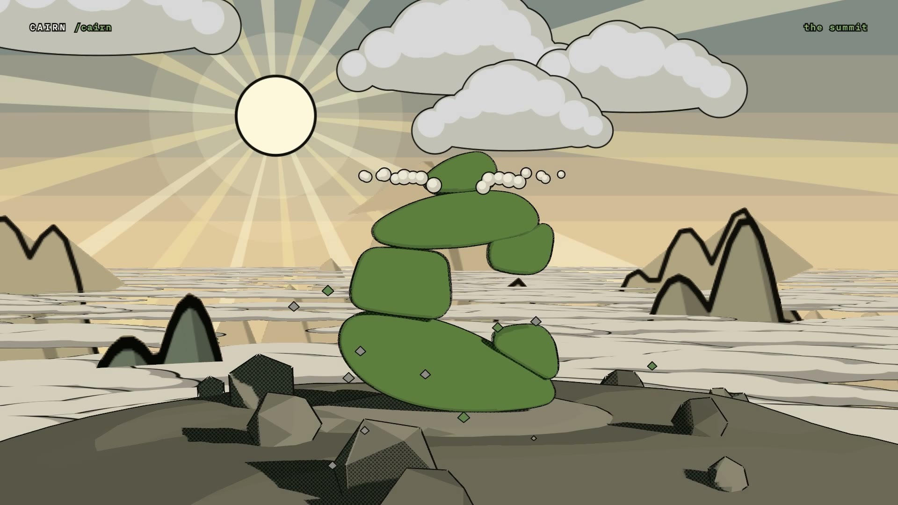

# Visions Recipes

Films made in code, with the prompt, a remix template, a breakdown and the complete source. By [João Queirós](https://www.joaoqueiros.com/), using HyperFrames, Three.js, WebGL, Canvas, SVG and GSAP.

[Watch the films](https://visions.joaoqueiros.com/recipes/) · [Full catalogue](docs/catalog.md) · [Contribute](CONTRIBUTING.md)

<a href="https://visions.joaoqueiros.com/recipes/"><picture><source media="(prefers-reduced-motion: reduce)" srcset="docs/media/visions-montage.png"></picture></a>

[Static montage](docs/media/visions-montage.png). These are creative films; the Scrollwork film includes stylised website imagery.

## Requirements

- Node.js 22 or newer and npm.
- Chrome or Edge with hardware acceleration for the 3D recipes.
- Python and additional packages only when rebuilding a recipe's score or baked data. See that recipe's instructions.

<a id="use-a-recipe"></a>

## First working example

Start with **Paper Terminal**, an HTML/CSS recipe, then explore the 3D projects.

```bash
git clone https://github.com/jqaisystems/visions-recipes.git
cd visions-recipes/recipes/r02-paper-terminal
npm run dev
```

The preview opens in your browser. In a second terminal, from the same recipe folder:

```bash
npm run check
npm run render
```

The MP4 is written to `renders/`. The scripts use the HyperFrames version pinned in that recipe's `package.json`; the first run downloads it through npm.

For a prompt-led remix, open [Paper Terminal's RECIPE.md](recipes/r02-paper-terminal/RECIPE.md), change the brief and use the supplied source as a reference. For the code route, edit the elements listed in the recipe README.

## Featured recipes

### Scrollwork

A web design studio translated into cel-shaded motion.

[](https://visions.joaoqueiros.com/recipes/scrollwork/?utm_source=github&utm_medium=referral&utm_campaign=recipes)

[Explore and remix](recipes/r23-scrollwork/) · [Watch](https://visions.joaoqueiros.com/recipes/scrollwork/?utm_source=github&utm_medium=referral&utm_campaign=recipes)

### Cairn

An SEO checkpoint method told through a mountain and its stones.

[](https://visions.joaoqueiros.com/recipes/cairn/?utm_source=github&utm_medium=referral&utm_campaign=recipes)

[Explore and remix](recipes/r24-cairn/) · [Watch](https://visions.joaoqueiros.com/recipes/cairn/?utm_source=github&utm_medium=referral&utm_campaign=recipes)

### Zoetrope

Optical toys and a galloping horse, built as a cinematic 3D experiment.

[](https://visions.joaoqueiros.com/recipes/zoetrope/?utm_source=github&utm_medium=referral&utm_campaign=recipes)

[Explore and remix](recipes/r22-zoetrope/) · [Watch](https://visions.joaoqueiros.com/recipes/zoetrope/?utm_source=github&utm_medium=referral&utm_campaign=recipes)

## Browse by direction

[Brand and web films](docs/catalog.md#brand-and-web-films) · [Creative experiments](docs/catalog.md#creative-experiments) · [Products and systems](docs/catalog.md#products-and-systems)

The [complete catalogue](docs/catalog.md) keeps every recipe, its intended use, stack and download together. For brand identity work, see [First Line](recipes/r25-first-line/).

## Credits and licences

Code, compositions and scores are MIT licensed. See [LICENSE](LICENSE). Fonts and libraries retain their own licences, listed in each recipe's **Credits and licences** section. Source recipes were made with Claude Code and HyperFrames; individual READMEs document their tools and assets.

The code licence does not grant rights to the João Queirós, JQ AI SYSTEMS, Scrollwork, Cairn, OutreachIQ, Tembr or Snapline names, marks or third-party work shown in source assets. Read each recipe's exclusions and replace those assets before publishing a remix.

## Support

[Report a reproducible issue](https://github.com/jqaisystems/visions-recipes/issues/new/choose) with the recipe, operating system, Node/browser versions and a redacted error. For remix contributions, read [CONTRIBUTING.md](CONTRIBUTING.md).

Want a film for your own product? [Product films by João Queirós](https://www.ai.joaoqueiros.com/services/product-films).
