# Visions Recipes

Films built entirely in code, shared as recipes: the prompt that started each one, a template to remix it,
how it's built, and the full source. Made by [João Queirós](https://www.joaoqueiros.com) with Claude Code,
[HyperFrames](https://github.com/heygen-com/hyperframes), Three.js, WebGL, Canvas, SVG, GSAP and a score composed in code.

Watch the films and read the recipes at **[visions.joaoqueiros.com/recipes](https://visions.joaoqueiros.com/recipes/?utm_source=github&utm_medium=referral&utm_campaign=recipes)**.

| | Recipe | Made for | Stack | Get it |
|---|---|---|---|---|
| 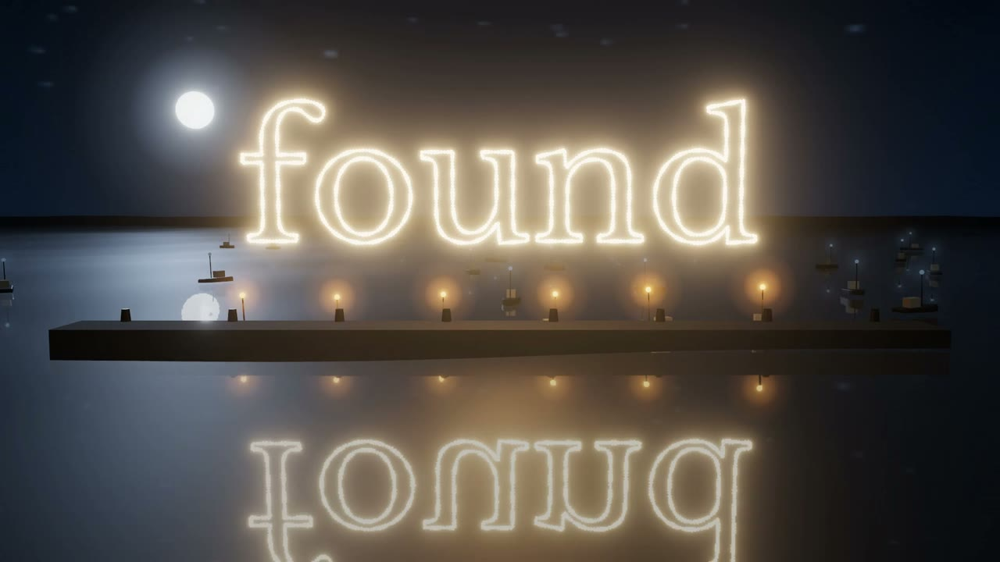 | **R16 · [Lighthouse](recipes/r16-lighthouse)** Lead generation as a lighthouse at night: the beam finds boats on a mirror sea, scores every one, a person pulls SEND, and the best ones' lights rise into one word. | AI Lead Generation & Outreach · JQ AI SYSTEMS | Three.js, TSL, GSAP, Python (table, word, score) | [watch](https://visions.joaoqueiros.com/recipes/lighthouse/?utm_source=github&utm_medium=referral&utm_campaign=recipes) · [zip](https://github.com/jqaisystems/visions-recipes/releases/tag/r16-lighthouse-v1) |
| 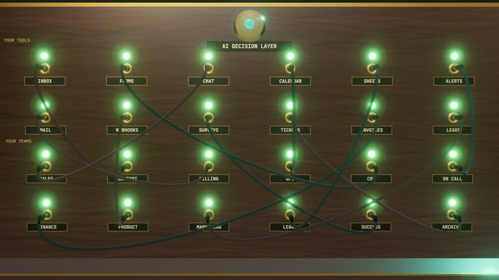 | **R15 · [Switchboard](recipes/r15-switchboard)** Workflow integration as a 1940s switchboard rebuilt in walnut and brass: patch cables fly and click into the right team, light runs down the wire, and the board ends up woven into one web. | AI Workflow Integration · JQ AI SYSTEMS | Three.js, TSL, GSAP, Python (word, score) | [watch](https://visions.joaoqueiros.com/recipes/switchboard/?utm_source=github&utm_medium=referral&utm_campaign=recipes) · [zip](https://github.com/jqaisystems/visions-recipes/releases/tag/r15-switchboard-v1) |
| 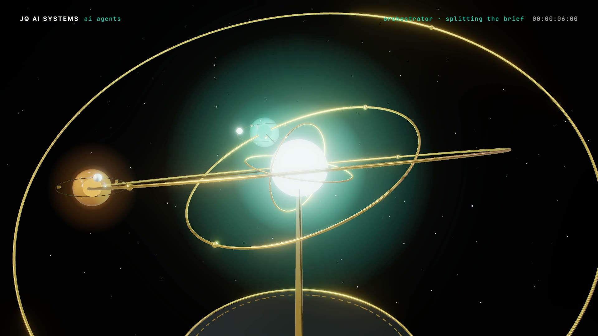 | **R14 · [Orrery](recipes/r14-orrery)** A multi-agent system as a brass-and-glass orrery: the orchestrator is the sun, each agent a glass planet with its own memory and skills; work travels as light until every ring snaps into one plane. | AI Agent Architecture · JQ AI SYSTEMS | Three.js, TSL, GSAP, Python (word, score) | [watch](https://visions.joaoqueiros.com/recipes/orrery/?utm_source=github&utm_medium=referral&utm_campaign=recipes) · [zip](https://github.com/jqaisystems/visions-recipes/releases/tag/r14-orrery-v1) |
| 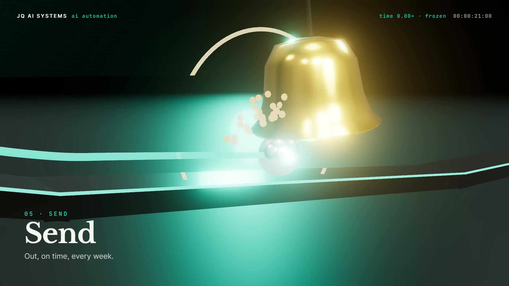 | **R13 · [Chain Reaction](recipes/r13-chain-reaction)** A cinematic 3D marble run built from a weekly report, with real physics baked once so the film can slow down and freeze time, then pull back into one line that becomes a word. | AI Automation Systems · JQ AI SYSTEMS | Three.js, TSL, Matter.js, GSAP, Python (word, score) | [watch](https://visions.joaoqueiros.com/recipes/chain-reaction/?utm_source=github&utm_medium=referral&utm_campaign=recipes) · [zip](https://github.com/jqaisystems/visions-recipes/releases/tag/r13-chain-reaction-v1) |
| 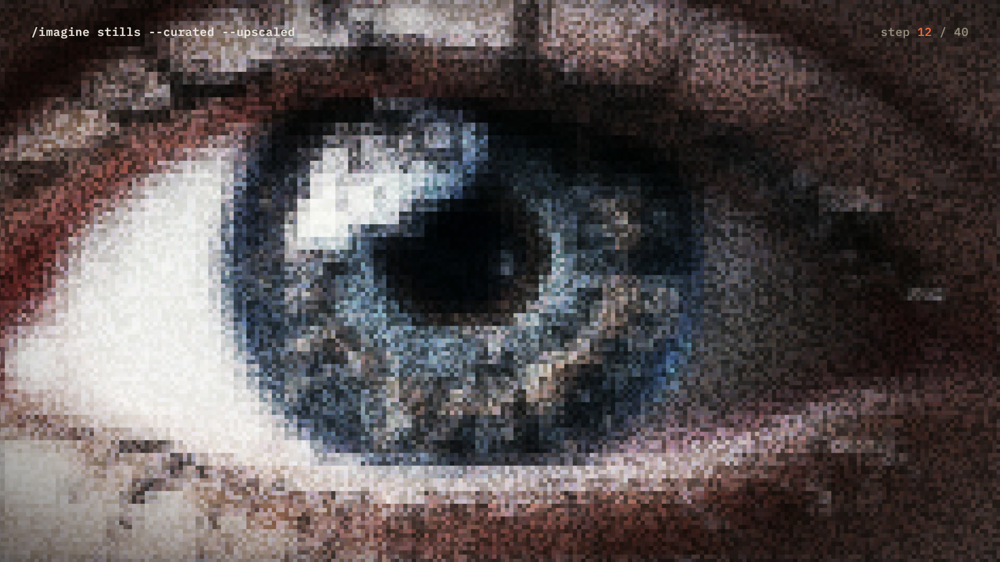 | **R12 · [Denoise](recipes/r12-denoise)** An image resolves out of noise in forty visible steps like a generation preview, the camera dives through it into a page that renders card by card, then pulls back into a wall of every image. | Stills · Imagined Worlds | Canvas 2D, HTML, GSAP, Python (score) | [watch](https://visions.joaoqueiros.com/recipes/stills-intro/?utm_source=github&utm_medium=referral&utm_campaign=recipes) · [zip](https://github.com/jqaisystems/visions-recipes/releases/tag/r12-denoise-v1) |
| 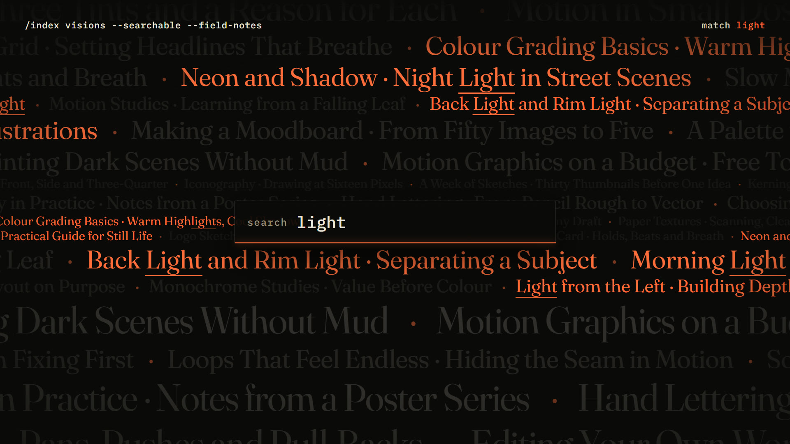 | **R11 · [Kinetic Index](recipes/r11-kinetic-index)** Rows of titles drift at four sizes, a search lands on the beat and lights up the matches, then the river tilts into a floor under the headline. | Blog · Imagined Worlds | HTML, CSS, GSAP, Python (titles, score) | [watch](https://visions.joaoqueiros.com/recipes/blog-intro/?utm_source=github&utm_medium=referral&utm_campaign=recipes) · [zip](https://github.com/jqaisystems/visions-recipes/releases/tag/r11-kinetic-index-v1) |
| 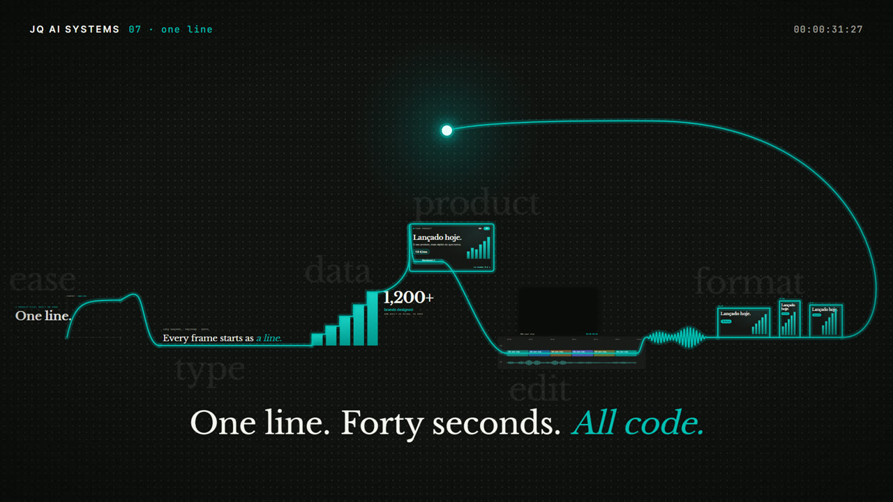 | **R10 · [One Line](recipes/r10-one-line)** One line never leaves the screen and the film never cuts: a camera rides its head through a curve, type, a chart, a product, an edit and three formats, then pulls back to show it was one stroke. | Product Films · JQ AI SYSTEMS | HTML, SVG, GSAP, Python (score) | [watch](https://visions.joaoqueiros.com/recipes/productfilms-reel/?utm_source=github&utm_medium=referral&utm_campaign=recipes) · [zip](https://github.com/jqaisystems/visions-recipes/releases/tag/r10-one-line-v1) |
| 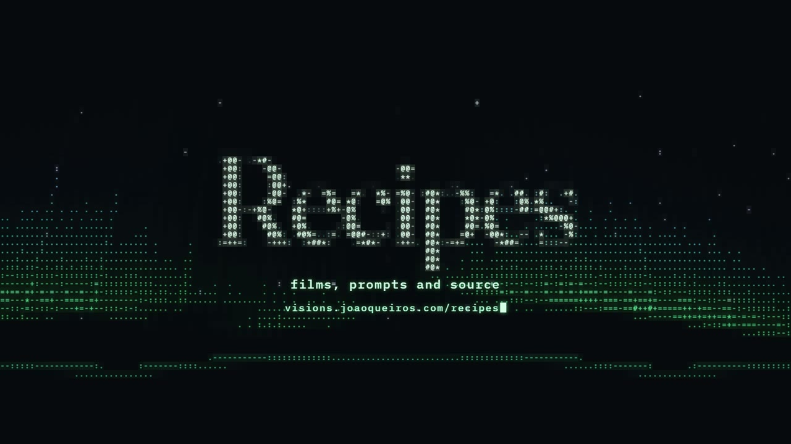 | **R09 · [Aurora in ASCII](recipes/r09-aurora-in-ascii)** A live 3D scene drawn only in text characters, like an old terminal: every cell picks a glyph by brightness and takes that spot's colour. | Recipes · Imagined Worlds | Three.js, TSL, GSAP, Canvas 2D, Python (score) | [watch](https://visions.joaoqueiros.com/recipes/aurora-in-ascii/?utm_source=github&utm_medium=referral&utm_campaign=recipes) · [zip](https://github.com/jqaisystems/visions-recipes/releases/tag/r09-aurora-in-ascii-v1) |
| 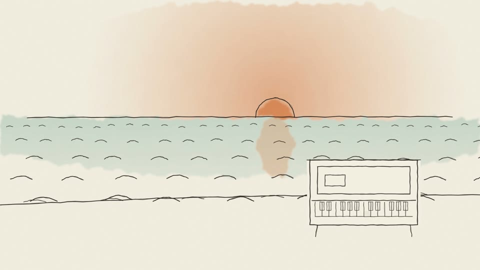 | **R08 · [Boiling Line](recipes/r08-boiling-line)** Everything looks drawn by hand: ink lines that wobble anew twelve times a second over warm paper, with one watercolour wash. | Music · Imagined Worlds | HTML, SVG, GSAP, Python (score) | [watch](https://visions.joaoqueiros.com/recipes/boiling-line/?utm_source=github&utm_medium=referral&utm_campaign=recipes) · [zip](https://github.com/jqaisystems/visions-recipes/releases/tag/r08-boiling-line-v1) |
| 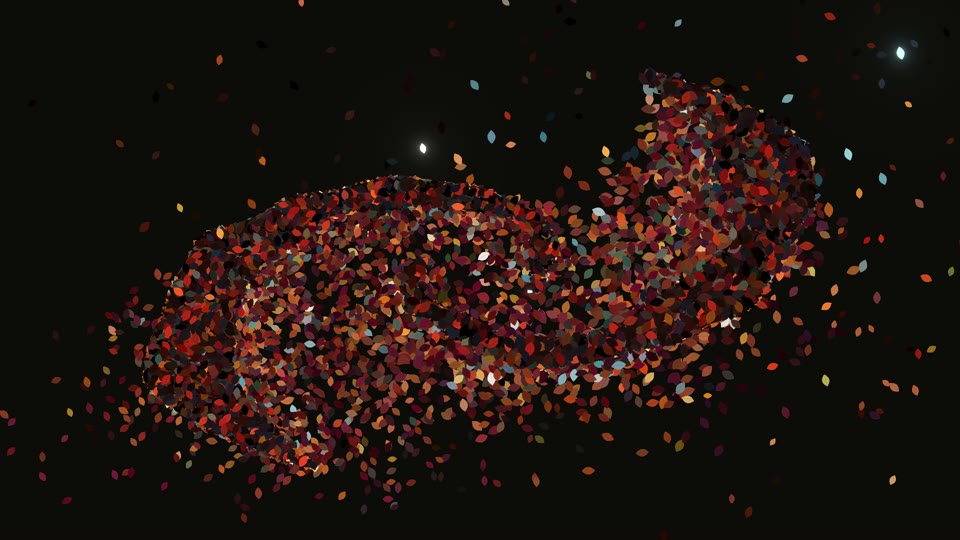 | **R07 · [Gommage](recipes/r07-gommage)** An image comes apart from one edge into thousands of leaves in its own colours, a wind gathers them into a cloud, and they settle into the next image. | Imagined Worlds · Stills | Three.js, TSL, GSAP, Python (score) | [watch](https://visions.joaoqueiros.com/recipes/gommage/?utm_source=github&utm_medium=referral&utm_campaign=recipes) · [zip](https://github.com/jqaisystems/visions-recipes/releases/tag/r07-gommage-v1) |
| 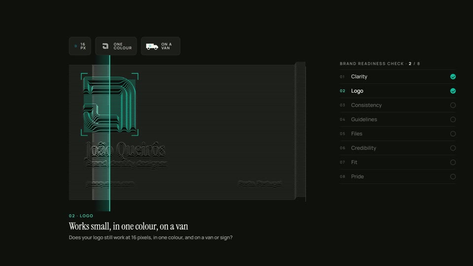 | **R06 · [Brand Readiness Scan](recipes/r06-brand-readiness-scan)** A scanner line raises an object into a relief of ridge lines and stops on one feature after another while a list ticks them off. | Brand Readiness Check · João Queirós | HTML, Canvas 2D, GSAP, Python (score) | [watch](https://visions.joaoqueiros.com/recipes/brand-readiness-scan/?utm_source=github&utm_medium=referral&utm_campaign=recipes) · [zip](https://github.com/jqaisystems/visions-recipes/releases/tag/r06-brand-readiness-scan-v1) |
| 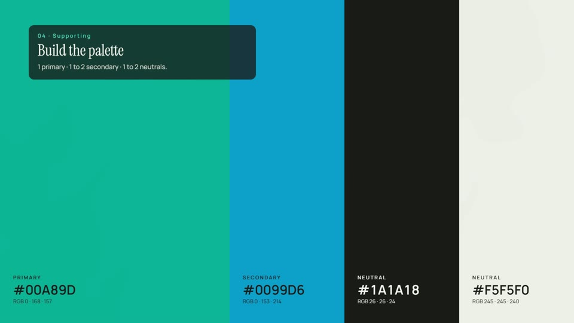 | **R05 · [Choosing a Colour](recipes/r05-choosing-a-colour)** Every colour at once swirls like marbled ink, then a method drains what doesn't fit, pools one colour and separates it into a few labelled swatches. | How to Choose Brand Colours · João Queirós | HTML, WebGL2 (one shader), GSAP, Python (score) | [watch](https://visions.joaoqueiros.com/recipes/choosing-a-colour/?utm_source=github&utm_medium=referral&utm_campaign=recipes) · [zip](https://github.com/jqaisystems/visions-recipes/releases/tag/r05-choosing-a-colour-v1) |
| 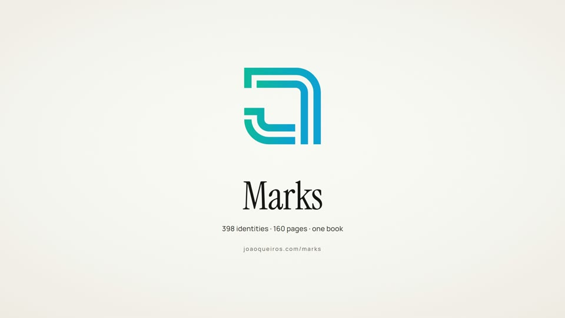 | **R04 · [One Hundred Marks, One Line](recipes/r04-one-hundred-marks)** One line that never lifts off the page closes into one shape after another, faster and faster, and settles on the last. Ships with demo shapes and the tracer for your own. | Marks · João Queirós | HTML, SVG, GSAP, Python (tracing and score) | [watch](https://visions.joaoqueiros.com/recipes/one-hundred-marks/?utm_source=github&utm_medium=referral&utm_campaign=recipes) · [zip](https://github.com/jqaisystems/visions-recipes/releases/tag/r04-one-hundred-marks-v1) |
| 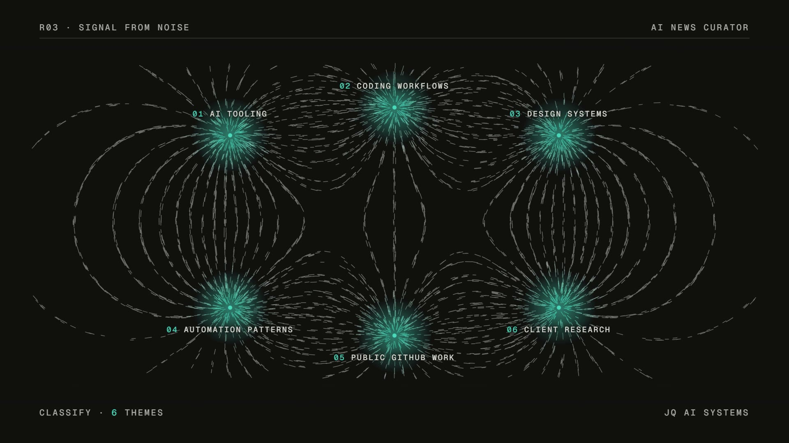 | **R03 · [Signal from Noise](recipes/r03-signal-from-noise)** Thousands of fragments line up like iron filings, gather around the poles that matter, and the strongest few are pulled out into one reviewed list. | AI News Curator · JQ AI SYSTEMS | HTML, Canvas 2D, GSAP, Python (score) | [watch](https://visions.joaoqueiros.com/recipes/signal-from-noise/?utm_source=github&utm_medium=referral&utm_campaign=recipes) · [zip](https://github.com/jqaisystems/visions-recipes/releases/tag/r03-signal-from-noise-v1) |
| 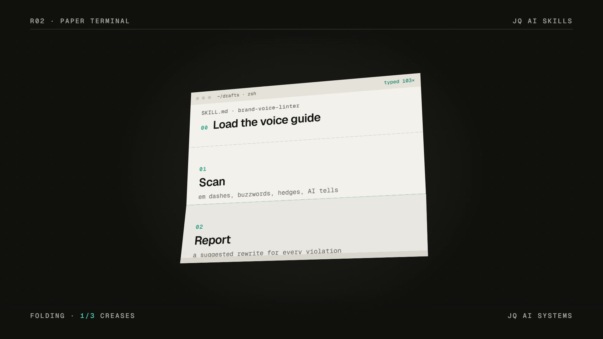 | **R02 · [Paper Terminal](recipes/r02-paper-terminal)** A terminal drawn as paper prints a document, folds along its sections into a card, and files the card on a shelf of many. | JQ AI Skills · JQ AI SYSTEMS | HTML, CSS 3D, GSAP, Python (score) | [watch](https://visions.joaoqueiros.com/recipes/paper-terminal/?utm_source=github&utm_medium=referral&utm_campaign=recipes) · [zip](https://github.com/jqaisystems/visions-recipes/releases/tag/r02-paper-terminal-v1) |
| 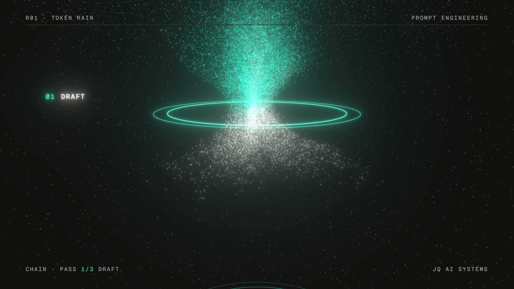 | **R01 · [Token Rain](recipes/r01-token-rain)** Text dissolves into particles sampled from its own letters, rains through a sequence of gates and recompiles as new text. | Prompt Engineering · JQ AI SYSTEMS | Three.js WebGPURenderer, TSL, GSAP, Canvas 2D, Python (score) | [watch](https://visions.joaoqueiros.com/recipes/token-rain/?utm_source=github&utm_medium=referral&utm_campaign=recipes) · [zip](https://github.com/jqaisystems/visions-recipes/releases/tag/r01-token-rain-v1) |

## Use a recipe

Each folder in [`recipes/`](recipes) is a complete HyperFrames project. You need Node 22+ and Chrome or Edge.

    cd recipes/r01-token-rain
    npx --yes hyperframes@0.8.184 preview     # live preview in the browser
    npm run render                            # MP4 to renders/

Or skip the code: copy the prompt from the recipe's `RECIPE.md`, change the words, and give it to Claude Code
with the HyperFrames skills installed.

## Licence

Code, compositions and scores are MIT (see [LICENSE](LICENSE)). Fonts and libraries keep their own licences,
listed in each recipe's README. The JQ AI SYSTEMS logo and the names JQ AI SYSTEMS and João Queirós are not
licensed: replace them with your own before you publish a remix.

Want a film like these for your own product? See
[Product Films](https://www.ai.joaoqueiros.com/services/product-films?utm_source=github&utm_medium=referral&utm_campaign=recipes).
