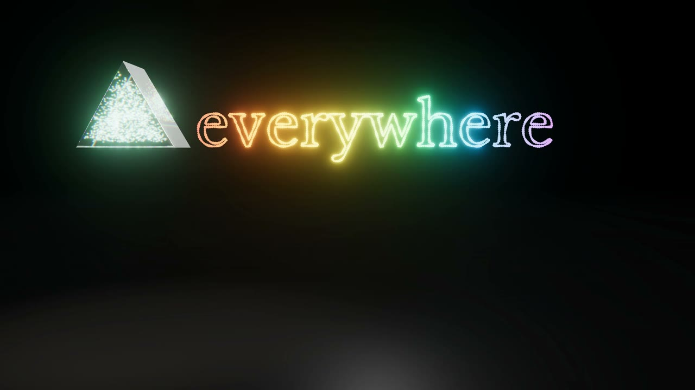

# R17 · Prism

Content systems as a glass prism. Lines of your best writing lift off the page as light and become the glass; stock
phrases fly at it and break. One brief goes in as white light and comes out as a spectrum, and every colour lands as a
finished piece in its own format: a post, a thread, a newsletter in three languages, a blog draft, a caption and a
short. A person approves each one, the pieces fill a month, and the month rises into the word "everywhere".
Made for AI Content Systems, a service of JQ AI SYSTEMS.

**Watch it:** [visions.joaoqueiros.com/recipes/prism](https://visions.joaoqueiros.com/recipes/prism/?utm_source=github&utm_medium=referral&utm_campaign=recipes)
· **Prompt, remix template and breakdown:** [RECIPE.md](RECIPE.md)

32 s · 1920×1080 · 30 fps · Three.js (WebGPU renderer on WebGL2, TSL glass and reflector floor), GSAP · score composed in code · €0 to make

## Run it

Needs Node 22+ and Chrome or Edge.

    npx --yes hyperframes@0.8.184 preview      # Studio preview in the browser
    npm run render                             # MP4 to renders/

## Make it yours

1. The pieces, pages, phrases and days are one table, written by `bake/pieces.py`: each piece's format, text,
   position, colour, landing time, approval time and day. Change it and run it:

        python bake/pieces.py

   It writes `assets/pieces.js` for the film and `bake/pieces.json` for the score. How each format is drawn is in
   `drawCard` in `index.html`.
2. The station titles, the HUD lines (`STATE`) and the end card are plain text in `index.html`.
3. To change the final word, edit `WORD` in `bake/word.py` and run it (needs `pip install fonttools brotli`).
4. Rebuild the score (needs `pip install numpy`):

        python score/compose.py

## Files

- `index.html`: the whole film. `renderAt(t)` poses the pages, the light, the prism, the shards, the rays, the cards,
  the month and the word from the clock; one painter draws the HUD, the titles, the stamps and the cursor.
- `bake/pieces.py`: the one table, seeded. `bake/word.py`: the word's outlines, from the film's own font.
- `score/compose.py`: the score, timed to the same table.
- `CONCEPT.md`: the concept card for this recipe.

## Licences

- Code, composition and score: MIT (see the repo [LICENSE](../../LICENSE)).
- Three.js, `BloomNode.js` and `RoomEnvironment.js` (`assets/vendor/`): MIT, © three.js authors.
- GSAP (`assets/vendor/gsap.min.js`): GSAP Standard License, free (gsap.com/standard-license).
- Inter, Libre Baskerville and JetBrains Mono: SIL Open Font License 1.1 (`assets/fonts/OFL-*.txt`).
- The pages, brief, pieces and phrases are made up: no real people or companies.
- **Not licensed:** the names JQ AI SYSTEMS and João Queirós, and the service name, line and URL on the end card.
  Replace them with your own before you publish a remix.
