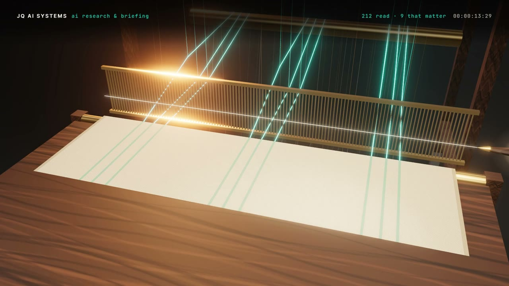

# R18 · Loom

## Purpose

Research and briefing as a Jacquard loom. Hundreds of sources stream in as threads of light; a brass card punched with
what you know is read before the news; the loom lifts only the threads that matter, and the rest fall away. The woven
cloth becomes the briefing, three stories each with the why, and a clock strikes Monday 09:00 as it is cut, folded and
carried to the table. The briefings stack up, and the threads draw the word "briefed".
Made for AI Research & Briefing Systems, a service of JQ AI SYSTEMS.

**Watch it:** [visions.joaoqueiros.com/recipes/loom](https://visions.joaoqueiros.com/recipes/loom/?utm_source=github&utm_medium=referral&utm_campaign=recipes)
· **Prompt, remix template and breakdown:** [RECIPE.md](RECIPE.md)

32 s · 1920×1080 · 30 fps · Three.js (WebGPU renderer on WebGL2, TSL bloom and reflector floor), GSAP · score composed in code · €0 to make

## Requirements and commands

Needs Node 22+ and Chrome or Edge.

    npm run dev       # browser preview, using the version pinned in package.json
    npm run check     # validate the composition
    npm run render                             # MP4 to renders/

## Editable elements

1. The threads, headlines, rules, picks and stories are one table, written by `bake/loom.py`: each thread's start,
   arrival, story and the moment it falls, the card's rules, the loom's picks and the briefing's text. Change it and
   run it:

        python bake/loom.py

   It writes `assets/loom.js` for the film and `bake/loom.json` for the score. How the card and the briefing are drawn
   is in `cardTex` and `clothMat` in `index.html`.
2. The station titles, the HUD lines (`STATE`) and the end card are plain text in `index.html`.
3. To change the final word, edit `WORD` in `bake/word.py` and run it (needs `pip install fonttools brotli`).
4. Rebuild the score (needs `pip install numpy`):

        python score/compose.py

## Source files

- `index.html`: the whole film. `renderAt(t)` poses the threads, the card, the loom, the cloth, the clock, the stack
  and the word from the clock; one painter draws the HUD, the titles and the end card.
- `bake/loom.py`: the one table, seeded. `bake/word.py`: the word's outlines, from the film's own font.
- `score/compose.py`: the score, timed to the same table.
- `CONCEPT.md`: the concept card for this recipe.

## Credits and licences

- Code, composition and score: MIT (see the repo [LICENSE](../../LICENSE)).
- Three.js, `BloomNode.js` and `RoomEnvironment.js` (`assets/vendor/`): MIT, © three.js authors.
- GSAP (`assets/vendor/gsap.min.js`): GSAP Standard License, free (gsap.com/standard-license).
- Inter, Libre Baskerville and JetBrains Mono: SIL Open Font License 1.1 (`assets/fonts/OFL-*.txt`).
- The sources, headlines, rules and stories are made up: no real people or companies.
- **Not licensed:** the names JQ AI SYSTEMS and João Queirós, and the service name, line and URL on the end card.
  Replace them with your own before you publish a remix.

[All recipes](../../docs/catalog.md) · [Setup and first example](../../README.md#first-working-example)
