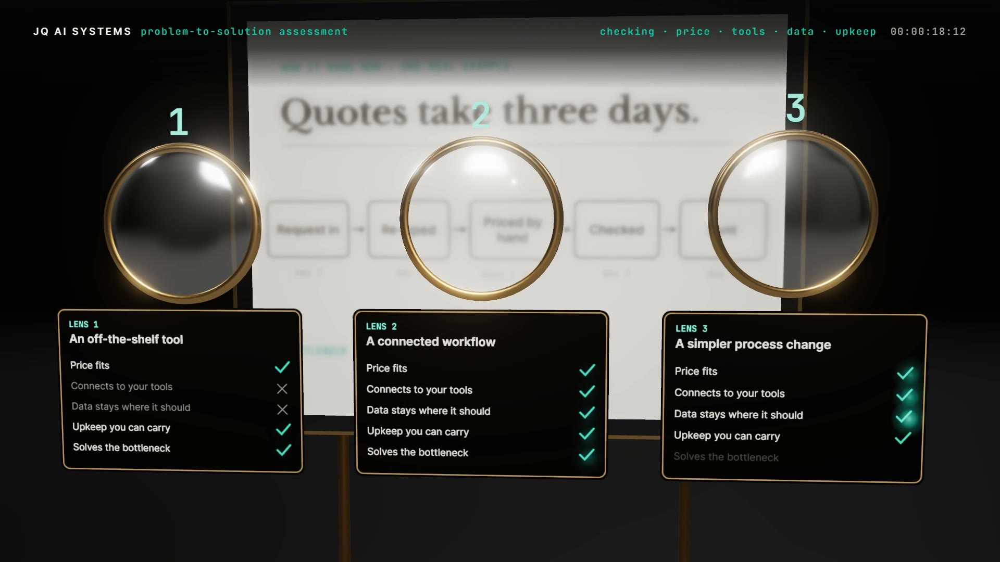

# R19 · Phoropter

## Purpose

Choosing a solution as an optician's phoropter. One problem sits on the eye chart, out of focus; the phoropter swings
in and the chart sharpens into a map of how the work runs now, with the bottleneck ringed. Three lenses click in, one
per option, and the chart redraws through each while the gauges swing. Each lens is checked row by row, two leave,
and the last one locks: the chart snaps sharp with one recommendation and a 30-day test, lands on the desk as the
brief stamped "Day 5", and the lens rings draw the word "clear".
Made for AI Problem-to-Solution Assessment, a service of JQ AI SYSTEMS.

**Watch it:** [visions.joaoqueiros.com/recipes/phoropter](https://visions.joaoqueiros.com/recipes/phoropter/?utm_source=github&utm_medium=referral&utm_campaign=recipes)
· **Prompt, remix template and breakdown:** [RECIPE.md](RECIPE.md)

32 s · 1920×1080 · 30 fps · Three.js (WebGPU renderer on WebGL2, TSL bloom and reflector floor), GSAP · score composed in code · €0 to make

## Requirements and commands

Needs Node 22+ and Chrome or Edge.

    npm run dev       # browser preview, using the version pinned in package.json
    npm run check     # validate the composition
    npm run render                             # MP4 to renders/

## Editable elements

1. The problem, the map, the three options and the brief are one table, written by `bake/table.py`: the film's
   clock, the chart's lines, each option's steps, gauge readings and checks, the wheel's detents and the 30 days of
   the test. Change it and run it:

        python bake/table.py

   It writes `assets/table.js` for the film and `bake/table.json` for the score. How each chart and check card is
   drawn is in `drawState`, `cardTex` and `briefTex` in `index.html`.
2. The station titles, the HUD lines (`STATE`) and the end card are plain text in `index.html`.
3. To change the final word, edit `WORD` in `bake/word.py` and run it (needs `pip install fonttools brotli`).
4. Rebuild the score (needs `pip install numpy`):

        python score/compose.py

## Source files

- `index.html`: the whole film. `renderAt(t)` poses the phoropter, the wheel, the gauges, the lenses, the chart's
  focus, the brief and the word from the clock; one painter draws the HUD, the titles and the end card.
- `bake/table.py`: the one table. `bake/word.py`: the word's outlines, from the film's own font.
- `score/compose.py`: the score, timed to the same table.
- `CONCEPT.md`: the concept card for this recipe.

## Credits and licences

- Code, composition and score: MIT (see the repo [LICENSE](../../LICENSE)).
- Three.js, `BloomNode.js` and `RoomEnvironment.js` (`assets/vendor/`): MIT, © three.js authors.
- GSAP (`assets/vendor/gsap.min.js`): GSAP Standard License, free (gsap.com/standard-license).
- Inter, Libre Baskerville and JetBrains Mono: SIL Open Font License 1.1 (`assets/fonts/OFL-*.txt`).
- The workflow, the options and the brief are made up: no real people or companies.
- **Not licensed:** the names JQ AI SYSTEMS and João Queirós, and the service name, line and URL on the end card.
  Replace them with your own before you publish a remix.

[All recipes](../../docs/catalog.md) · [Setup and first example](../../README.md#first-working-example)
