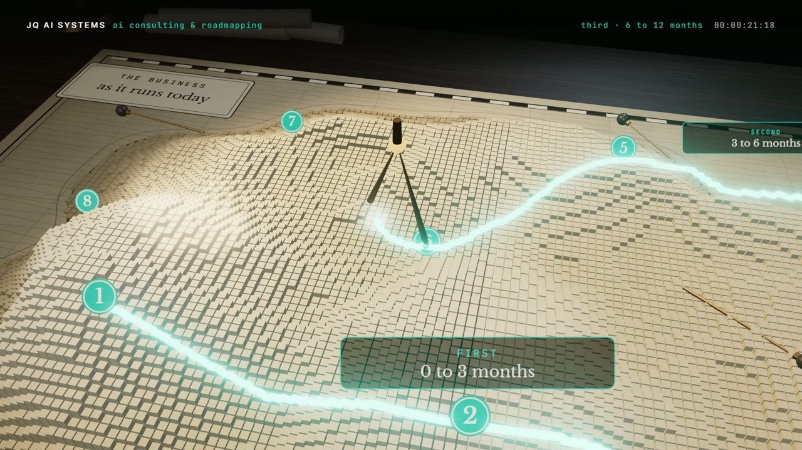

# R20 · Cartographer

## Purpose

A consulting engagement as a navigator's chart table. The map of one made-up business lies under fog; a brass survey
ring sweeps out and the land rises where the hours go, 8,586 small columns. The opportunities drop in as pins scored
on payoff, cost and risk, and four are knocked flat as not worth building. The rest line up along the table's edge in
rank order, each with its reason; brass dividers walk the route in three phases; the map rolls up into the roadmap and
the route lifts off the table to write the word "mapped".
Made for AI Consulting & Roadmapping, a service of JQ AI SYSTEMS.

**Watch it:** [visions.joaoqueiros.com/recipes/cartographer](https://visions.joaoqueiros.com/recipes/cartographer/?utm_source=github&utm_medium=referral&utm_campaign=recipes)
· **Prompt, remix template and breakdown:** [RECIPE.md](RECIPE.md)

32 s · 1920×1080 · 30 fps · Three.js (WebGPU renderer on WebGL2, TSL bloom), GSAP · score composed in code · €0 to make

## Requirements and commands

Needs Node 22+ and Chrome or Edge.

    npm run dev       # browser preview, using the version pinned in package.json
    npm run check     # validate the composition
    npm run render                             # MP4 to renders/

## Editable elements

1. The map, the pins and the route are one table, written by `bake/table.py`: the film's clock, the coast, the six
   regions and how many hours each one takes (relative), the relief, every opportunity with its payoff, cost, risk,
   rank and reason, the three phases and every stride of the dividers. Change it and run it:

        python bake/table.py

   It writes `assets/table.js` for the film and `bake/table.json` for the score. How the paper is printed is in
   `drawPaper` in `index.html`, and the ranked tags are drawn in `tagTex`.
2. The station titles, the HUD lines (`STATE`) and the end card are plain text in `index.html`.
3. To change the final word, edit `WORD` in `bake/word.py` and run it (needs `pip install fonttools brotli`).
4. Rebuild the score (needs `pip install numpy`):

        python score/compose.py

## Source files

- `index.html`: the whole film. `renderAt(t)` raises the relief, moves the fog, the ring, the pins, the tags, the
  dividers, the compass and the paper from the clock; one painter draws the HUD, the titles and the end card.
- `bake/table.py`: the one table. `bake/word.py`: the word's outlines, from the film's own font.
- `score/compose.py`: the score, timed to the same table.
- `CONCEPT.md`: the concept card for this recipe.

## Credits and licences

- Code, composition and score: MIT (see the repo [LICENSE](../../LICENSE)).
- Three.js, `BloomNode.js` and `RoomEnvironment.js` (`assets/vendor/`): MIT, © three.js authors.
- GSAP (`assets/vendor/gsap.min.js`): GSAP Standard License, free (gsap.com/standard-license).
- Inter, Libre Baskerville and JetBrains Mono: SIL Open Font License 1.1 (`assets/fonts/OFL-*.txt`).
- The business, its regions and its opportunities are made up: no real people or companies.
- **Not licensed:** the names JQ AI SYSTEMS and João Queirós, and the service name, line and URL on the end card.
  Replace them with your own before you publish a remix.

[All recipes](../../docs/catalog.md) · [Setup and first example](../../README.md#first-working-example)
