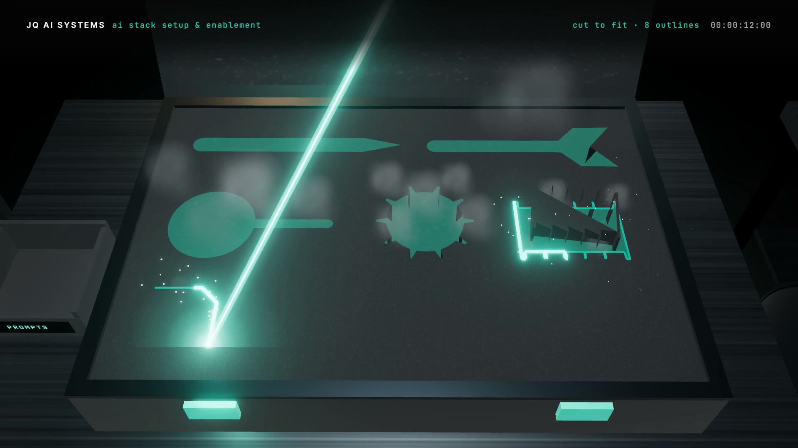

# R21 · Kitted

## Purpose

An AI stack setup as a precision tool kit. A pile of loose tools in clashing colours is audited: duplicates and
clutter slide off into a bin, and the seven tools the work needs rise and hover. A laser cuts a two-tone foam insert to
the exact outline of each one, and each clicks into its own cutout, its name engraved and its edge turned teal. A box
of prompt cards fills, the same kit opens at five benches, each running a real job, a playbook lands in the last slot,
and the laser engraves the word "equipped" into the lid.
Made for AI Stack Setup & Enablement, a service of JQ AI SYSTEMS.

**Watch it:** [visions.joaoqueiros.com/recipes/kitted](https://visions.joaoqueiros.com/recipes/kitted/?utm_source=github&utm_medium=referral&utm_campaign=recipes)
· **Prompt, remix template and breakdown:** [RECIPE.md](RECIPE.md)

32 s · 1920×1080 · 30 fps · Three.js (WebGPU renderer on WebGL2, TSL bloom), GSAP · score composed in code · €0 to make

## Requirements and commands

Needs Node 22+ and Chrome or Edge.

    npm run dev       # browser preview, using the version pinned in package.json
    npm run check     # validate the composition
    npm run render                             # MP4 to renders/

## Editable elements

1. The tools, the cut and the clock are one table, written by `bake/table.py`: each tool's outline (in the case's
   plane), the work it does, its colour in the pile and where it fits in the case, the clutter that gets binned, the
   prompt cards, the five benches and their jobs. Change it and run it:

        python bake/table.py

   It checks that every cutout keeps foam around it, then writes `assets/table.js` for the film and `bake/table.json`
   for the score. Where each name is engraved on its tool is `ENG` in `index.html`; the jobs over the benches are
   drawn in `drawJob`.
2. The station titles, the HUD lines (`STATE`) and the end card are plain text in `index.html`.
3. To change the final word, edit `WORD` in `bake/word.py` and run it (needs `pip install fonttools brotli`).
4. Rebuild the score (needs `pip install numpy`):

        python score/compose.py

## Source files

- `index.html`: the whole film. `renderAt(t)` moves the pile, the scan, the case, the laser, the plugs, the tools, the
  cards, the benches and the word from the clock; one painter draws the HUD, the titles and the end card.
- `bake/table.py`: the one table. `bake/word.py`: the word's outlines, from the film's own font.
- `score/compose.py`: the score, timed to the same table.
- `CONCEPT.md`: the concept card for this recipe.

## Credits and licences

- Code, composition and score: MIT (see the repo [LICENSE](../../LICENSE)).
- Three.js, `BloomNode.js` and `RoomEnvironment.js` (`assets/vendor/`): MIT, © three.js authors.
- GSAP (`assets/vendor/gsap.min.js`): GSAP Standard License, free (gsap.com/standard-license).
- Inter and JetBrains Mono: SIL Open Font License 1.1 (`assets/fonts/OFL-*.txt`).
- The team, the tools and the jobs are made up: no real people or companies.
- **Not licensed:** the names JQ AI SYSTEMS and João Queirós, and the service name, line and URL on the end card.
  Replace them with your own before you publish a remix.

[All recipes](../../docs/catalog.md) · [Setup and first example](../../README.md#first-working-example)
