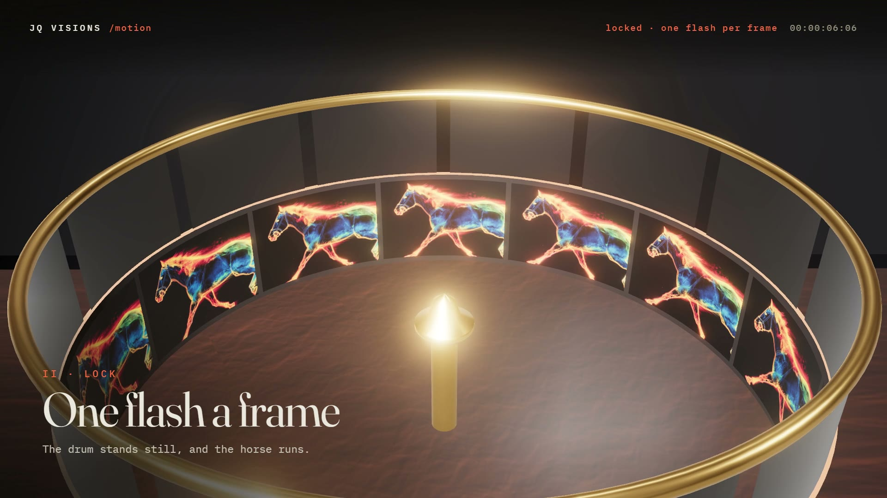

# R22 · Zoetrope

## Purpose

The oldest machines made to make pictures move, playing João Queirós' cinematic loops under a strobe. A lacquered drum
spins as a blur under a lamp; the strobe stutters on and locks to the spin, the drum stands still and a horse gallops
inside it. The camera dives into the loop itself, then pulls back to a cabinet of machines, a mirror drum, a spinning
disc and a flip book, each playing a loop. The strobe drifts out of phase, everything smears and slows, and one flash
locks it all again, before the title over a burning carousel.
Made for the Motion page of Imagined Worlds.

**Watch it:** [visions.joaoqueiros.com/recipes/zoetrope](https://visions.joaoqueiros.com/recipes/zoetrope/?utm_source=github&utm_medium=referral&utm_campaign=recipes)
· **Prompt, remix template and breakdown:** [RECIPE.md](RECIPE.md)

32 s · 1920×1080 · 30 fps · Three.js (WebGPU renderer on WebGL2, TSL bloom), GSAP · score composed in code · €0 to make

## Requirements and commands

Needs Node 22+ and Chrome or Edge.

    npm run dev       # browser preview, using the version pinned in package.json
    npm run check     # validate the composition
    npm run render                             # MP4 to renders/

## Editable elements

1. Put your own loops in a folder, name them in `LOOPS` in `bake/frames.py`, and cut them onto atlases (needs ffmpeg
   and `pip install numpy pillow`):

        python bake/frames.py path/to/your/loops

   Each machine gets 60 frames on `assets/frames/<id>.jpg`.
2. The clock, the strobe's flash frames and the spin are `T` and `omega` in `bake/table.py`. Change them and run
   `python bake/table.py`.
3. The two full-frame clips are in `assets/clips/`; swap them for yours and set `data-media-start` in `index.html`.
4. The station titles, the HUD lines (`STATE`), the plaques and the end card are plain text in `index.html`.
5. Rebuild the score (needs `pip install numpy`): `python score/compose.py`.

## Source files

- `index.html`: the whole film. `renderAt(t)` lights the frame, then renders the scene once under a flash or eight
  times averaged under the lamp; `setMachines` turns every machine and picks every slot's picture.
- `bake/frames.py`: the atlases. `bake/table.py`: the one table. `score/compose.py`: the score, timed to the table.
- `CONCEPT.md`: the concept card for this recipe.

## Credits and licences

- Code, composition and score: MIT (see the repo [LICENSE](../../LICENSE)).
- Three.js, `BloomNode.js` and `RoomEnvironment.js` (`assets/vendor/`): MIT, © three.js authors.
- GSAP (`assets/vendor/gsap.min.js`): GSAP Standard License, free (gsap.com/standard-license).
- Fraunces and IBM Plex Mono: SIL Open Font License 1.1 (`assets/fonts/OFL-*.txt`).
- **Not licensed:** the frame atlases in `assets/frames/` and the clips in `assets/clips/` (João Queirós' Midjourney
  video loops, included only so the film runs), and the names Imagined Worlds and João Queirós. Use your own loops in
  a remix.

[All recipes](../../docs/catalog.md) · [Setup and first example](../../README.md#first-working-example)
