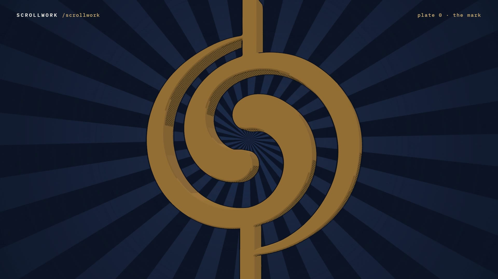

# R23 · Scrollwork

## Purpose

An anime transformation for a web design studio, in cel-shaded 3D. A dry brush paints down the dark and the mark's
rod slams in; the spiral unfurls out of it and spins into a pose; it becomes a paper scroll that unrolls through a
painted night sky with the studio's featured sites on it; it rides a rod as the scroll thumb while the page beside it
scrolls; a manga page of more sites slams in on the beat; and the flat lockup lands.
Made for Scrollwork, the web design studio of João Queirós.

**Watch it:** [visions.joaoqueiros.com/recipes/scrollwork](https://visions.joaoqueiros.com/recipes/scrollwork/?utm_source=github&utm_medium=referral&utm_campaign=recipes)
· **Prompt, remix template and breakdown:** [RECIPE.md](RECIPE.md)

32 s · 1920×1080 · 30 fps · Three.js (WebGPU renderer on WebGL2, TSL toon materials and outline pass), Canvas 2D, GSAP ·
score composed in code · €0 to make

## Requirements and commands

Needs Node 22+ and Chrome or Edge.

    npm run dev       # browser preview, using the version pinned in package.json
    npm run check     # validate the composition
    npm run render                             # MP4 to renders/

## Editable elements

1. Put your logo in `assets/brand/` as an SVG with one filled path (or a few) and point the `fetch` in `index.html`
   at it. It is extruded into 3D, toon-shaded and outlined.
2. Put your work in `assets/sites/` as `<slug>-hero.webp` (1440×900) and `<slug>-scroll.webp` (a full-page capture,
   900 wide), and list the slugs and names in `PLATES`, `NAMES`, `CABINET` and `CABNAMES` in `bake/table.py`.
3. The clock of every scene, the impact frames and the smear frames are in `bake/table.py`. Change them and run
   `python bake/table.py`.
4. The station titles, the HUD and the end card are plain text in `index.html`; the manga panels and the crops that
   pan down each page are `PANELS` and `PAN`.
5. Rebuild the score (needs `pip install numpy`): `python score/compose.py`.

## Source files

- `index.html`: the whole film. `renderAt(t)` poses every scene and renders it through the outline pass; `paintFx(t)`
  draws the 2D layer (brush, speed lines, sparks, stamps, the manga page); `paint(t)` adds the impact frames and the
  type.
- `bake/table.py`: the one table. `score/compose.py`: the score, timed to the table.
- `CONCEPT.md`: the concept card for this recipe.

## Credits and licences

- Code, composition and score: MIT (see the repo [LICENSE](../../LICENSE)).
- Three.js and `SVGLoader.js` (`assets/vendor/`): MIT, © three.js authors.
- GSAP (`assets/vendor/gsap.min.js`): GSAP Standard License, free (gsap.com/standard-license).
- Fraunces and IBM Plex Mono: SIL Open Font License 1.1 (`assets/fonts/OFL-*.txt`).
- **Not licensed:** the Scrollwork logo (`assets/brand/`), the site captures in `assets/sites/` (included only so the
  film runs; three are plain placeholders and the Thumbnail Studio pair is cut off below its headline), and the names
  Scrollwork and João Queirós. Use your own logo and work in a remix.

[All recipes](../../docs/catalog.md) · [Setup and first example](../../README.md#first-working-example)
