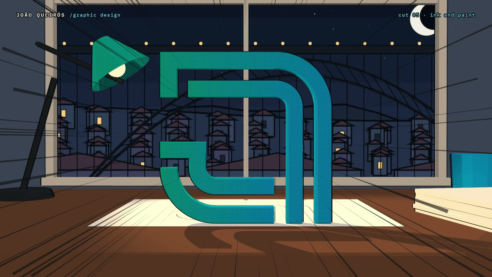

# R25 · First Line

## Purpose

An anime film for a brand identity studio, told the way an anime cut is made: in pencil, then ink, then colour.

- **The brief:** night in Porto, a blank sheet under a lamp, and a pencil draws one line.
- **Roughs:** the room turns to boiling blue pencil, marks pile up and a flip book of roughs riffles.
- **Ink and paint:** the mark's four strokes draw themselves, stand up off the paper and are wiped from pencil to ink
  to colour.
- **The system:** manga panels of a generic identity slam in on the beat.
- **Worldwide:** at dawn the strokes fly out of the window over the Douro as the studio's figures land.

Made for the brand identity studio of João Queirós.

**Source release:** [First Line source](https://github.com/jqaisystems/visions-recipes/releases/tag/r25-first-line-v1)
· **Prompt, remix template and breakdown:** [RECIPE.md](RECIPE.md)

32 s · 1920×1080 · 30 fps · Three.js (WebGPU renderer on WebGL2, TSL toon materials, outline pass, shadow maps),
Canvas 2D, GSAP · score composed in code · €0 to make

## Requirements and commands

Needs Node 22+ and Chrome or Edge.

    npm run dev       # browser preview, using the version pinned in package.json
    npm run check     # validate the composition
    npm run render                             # MP4 to renders/

## Editable elements

1. **Your mark.** The strokes are centrelines in `STROKES`, traced from the symbol in `assets/brand/`, each with its
   width and its own gradient. Trace your mark's strokes the same way; `ribbonGeo` grows a ribbon along any of them.
2. **The clock.** Every scene, the line, the roughs, the page flips, the strokes, the wipes, the panels, the figures,
   the impacts and the smears are in `bake/table.py`. Change them and run `python bake/table.py`.
3. **The world.** The painted city is `LAYERS`, drawn by the functions in `PAINT` in the colours of `PAL`; the sky
   is `drawSky`. The roughs are `roughShapes`, the flip book pages `PAGE_KINDS`.
4. **The work.** The applications live in `SET`, each framed by its `PANEL_CAM` entry and stamped with its word from
   the table.
5. **The words.** The station titles, the HUD and the end card are plain text in `index.html`.
6. **The score.** Rebuild it with `python score/compose.py` (needs `pip install numpy`).

## Source files

- `index.html`: the whole film.
  - `renderAt(t)` poses every scene and renders it, in colour, as line art, or both.
  - `compose(g, mode, t)` turns the line art into boiling pencil or clean ink; `wipeClip` and `wipeEdge` wipe
    between passes.
  - `paintFx(t)` draws the 2D layer: motion lines, trails, lettering and speed lines.
  - `paint(t)` adds the impact frames and the type.
- `bake/table.py`: the one table. `score/compose.py`: the score, timed to the table.
- `CONCEPT.md`: the concept card for this recipe.

## Credits and licences

- **Code, composition and score:** MIT (see the repo [LICENSE](../../LICENSE)).
- **Three.js** (`assets/vendor/`): MIT, © three.js authors.
- **GSAP** (`assets/vendor/gsap.min.js`): GSAP Standard License, free (gsap.com/standard-license).
- **Fonts:** Montserrat and IBM Plex Mono are under the SIL Open Font License 1.1 (`assets/fonts/OFL-*.txt`).
- **Not licensed:** the João Queirós logo and symbol (`assets/brand/`) and the name João Queirós. Use your own mark
  in a remix.

[All recipes](../../docs/catalog.md) · [Setup and first example](../../README.md#first-working-example)
