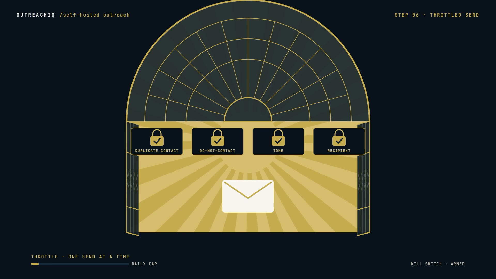

# R26 · The Gate

## Purpose

A film for a self-hosted outreach workspace, drawn entirely in 2D vector motion: most outreach is a flood, this one
is a gate.

- **The flood:** one envelope multiplies into a storm, and a gold kill switch freezes it.
- **Find:** the same gold line draws a street map, and pins drop and morph into shopfronts.
- **Score:** six sample leads pass a dial one at a time and file into HOT, WARM, COLD and SKIP.
- **Draft and check:** three drafts type themselves, and a tone audit strikes and repairs one line in each.
- **The gate:** a monumental gate draws itself, four locks click shut, and it opens only when a person clicks Approve.

Made for OutreachIQ. Every shop, name and address in it is generic sample data, and no result is claimed.

**Source release:** [The Gate source](https://github.com/jqaisystems/visions-recipes/releases/tag/r26-the-gate-v1)
· **Prompt, remix template and breakdown:** [RECIPE.md](RECIPE.md)

32 s · 1920×1080 · 30 fps · one SVG stage and GSAP, no canvas and no WebGL · score composed in code · €0 to make

## Requirements and commands

Needs Node 22+ and Chrome or Edge.

    npm run dev       # browser preview, using the version pinned in package.json
    npm run check     # validate the composition
    npm run render    # MP4 to renders/

## Editable elements

1. **Your mark.** The end tile is the image in `assets/brand/`, placed flat by `markImg`. Swap in your own file.
2. **The clock.** Every scene, the storm, the kill switch, the pins, the cards and their scores, the flags, the locks,
   Approve and the sends are in `bake/table.py`. Change them and run `python bake/table.py`.
3. **The shapes.** `PIN`, `SHOP` and `RECT` are plain SVG paths drawn about their own origin. `sample` and `align`
   turn any two closed outlines into matched points, and `morph` blends them.
4. **The world.** The map is `STREETS`, `BLOCKS` and `PINS`; the dial and lanes are `DX`, `DY`, `DR`, `LANES`; the
   drafts are `DRAFTS`; the gate is built by `gp` from `GX`, `GY`, `GR`, `GB`.
5. **The words.** The station titles, the HUD and the end card are plain text in `index.html`.
6. **The score.** Rebuild it with `python score/compose.py` (needs `pip install numpy`).

## Source files

- `index.html`: the whole film.
  - `paint(t)` sets the camera, the shake and the impact frames, then calls one painter per scene.
  - `camAt(t, sc)` frames each scene; the camera is one root group, translated and scaled.
  - `draw(e, u)` draws any stroke on by its dash offset.
- `bake/table.py`: the one table. `score/compose.py`: the score, timed to the table.
- `CONCEPT.md`: the concept card for this recipe.

## Credits and licences

- **Code, composition and score:** MIT (see the repo [LICENSE](../../LICENSE)).
- **GSAP** (`assets/vendor/gsap.min.js`): GSAP Standard License, free (gsap.com/standard-license).
- **Fonts:** Cormorant Garamond and JetBrains Mono are under the SIL Open Font License 1.1 (`assets/fonts/OFL-*.txt`).
- **Not licensed:** the OutreachIQ mark (`assets/brand/`) and the name OutreachIQ. Use your own mark in a remix.

[All recipes](../../docs/catalog.md) · [Setup and first example](../../README.md#first-working-example)
