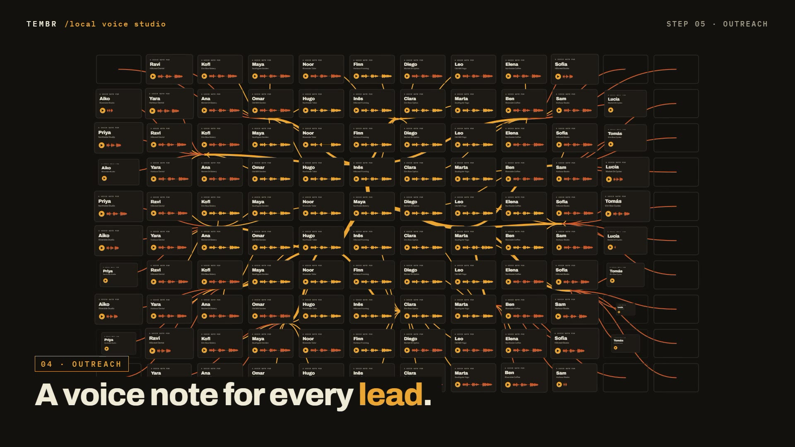

# R27 · Ten Seconds

## Purpose

A film for a local voice cloning studio, drawn entirely in 2D vector motion: a voice is a ribbon, the studio keeps the
best ten seconds, and from those the voice reaches every lead by name without leaving the machine.

- **Record:** a hairline breathes, then ninety seconds of voice race past as a ribbon behind a record head.
- **Keep:** a window weighs the whole take, locks on the strongest ten seconds, and the rest peels away.
- **Your machine:** a frame draws on around the voice, the clone locks on, and a cloud stops short and erases itself.
- **It speaks:** a line types itself as glyph outlines, and each letter melts into the ribbon of the voice speaking it.
- **Everywhere:** one lead's player page, then a wall of them, one ribbon branching to every page, and a quality check
  that flags three and redraws them clean.

Made for Tembr. Every name and business in it is generic sample data, and no result is claimed.

**Source release:** [Ten Seconds source](https://github.com/jqaisystems/visions-recipes/releases/tag/r27-ten-seconds-v1)
· **Prompt, remix template and breakdown:** [RECIPE.md](RECIPE.md)

32 s · 1920×1080 · 30 fps · one SVG stage and GSAP, no canvas and no WebGL · score composed in code · €0 to make

## The voice line

The film was made with one line spoken by a cloned voice. That recording is not in this source:
`assets/audio/clone-line.wav` is 3.6 s of silence, so the film still renders. To hear a voice, put your own WAV of about
the same length there, then set `WORDS` in `bake/table.py` to the start time of each word and run the bake. The ribbon's
shape comes from `ENV` in the same file, the loudness of the line at 30 samples a second; measure your own line to match.

## Requirements and commands

Needs Node 22+ and Chrome or Edge. The bake needs Python with `fontTools` and `brotli`.

    npm run dev       # browser preview, using the version pinned in package.json
    npm run check     # validate the composition
    npm run render    # MP4 to renders/

## Editable elements

1. **Your mark.** The end lockup is the image in `assets/brand/`, placed flat by `lockup`. Swap in your own file.
2. **The clock.** Every scene, the take, the window, the clone, the cloud, the typing, the voice, the names, the
   branches and the flags are in `bake/table.py`. Change them and run `python bake/table.py`.
3. **The take.** `take` in the table is ninety seconds of loudness at 20 samples a second; the strongest ten seconds are
   found from it, not set by hand.
4. **The line.** `WORDS` and `ROWS` in the table; the bake sets each letter in Archivo and writes its outline.
5. **The wall.** `FIRST`, `PLACE` and `STREET` build the sample names; `COLS`, `ROWS_W` and `HERO` lay out the pages.
6. **The words on screen.** The station titles, the HUD and the end card are plain text in `index.html`.
7. **The score.** Rebuild it with `python score/compose.py` (needs `pip install numpy`).

## Source files

- `index.html`: the whole film.
  - `paint(t)` sets the camera, then calls one painter per scene.
  - `ribbonD(xs, y, hs)` builds a ribbon from a centreline and its half-widths.
  - `sample`, `align` and `morph` turn a letter's outline and its slice of the ribbon into matched points.
  - `camAt(t, sc)` frames each scene; the camera is one root group, translated and scaled.
- `bake/table.py`: the one table, the glyph outlines and the sample leads. `score/compose.py`: the score, timed to the
  table.
- `CONCEPT.md`: the concept card for this recipe.

## Credits and licences

- **Code, composition and score:** MIT (see the repo [LICENSE](../../LICENSE)).
- **GSAP** (`assets/vendor/gsap.min.js`): GSAP Standard License, free (gsap.com/standard-license).
- **Fonts:** Archivo, Instrument Sans and IBM Plex Mono are under the SIL Open Font License 1.1
  (`assets/fonts/OFL-*.txt`).
- **Not licensed:** the Tembr mark (`assets/brand/`) and the name Tembr. Use your own mark in a remix.
- **Not included:** the cloned voice line heard in the film.

[All recipes](../../docs/catalog.md) · [Setup and first example](../../README.md#first-working-example)
