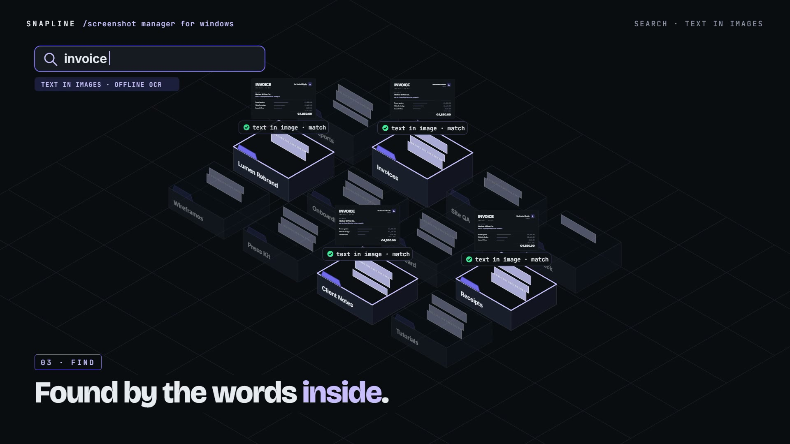

# R28 · Real Folders

## Purpose

A film for a screenshot and screen recording manager for Windows, drawn entirely in 2D vector motion: a screenshot is
only useful once it is filed, so every capture lands in a real folder, is found by the words inside it, and is made
ready to send.

- **Capture:** a desk of flat windows, the capture overlay with a crosshair and a loupe over a pixel grid, a
  marching-ants selection, a shutter, and the selection lifts off as a card.
- **File:** captures flood in on the beat, the floor tilts into an isometric city of folders, and every card is filed.
- **Find:** "invoice" is typed, a scan crosses the city, the words inside every card lift off, and only the matches
  rise.
- **Mark up:** an arrow, a box and step badges draw on, and an email snaps into solid pixel blocks.
- **Share:** a gradient backdrop floods in behind the card, then the card becomes a screen recording.

Made for Snapline. Every window, company and email address in it is fictional, and no result is claimed.

**Source release:** [Real Folders source](https://github.com/jqaisystems/visions-recipes/releases/tag/r28-real-folders-v1)
· **Prompt, remix template and breakdown:** [RECIPE.md](RECIPE.md)

32 s · 1920×1080 · 30 fps · one SVG stage and GSAP, no canvas and no WebGL · score composed in code · €0 to make

## Requirements and commands

Needs Node 22+ and Chrome or Edge. The bake and the score need Python; the score needs `pip install numpy`.

    npm run dev       # browser preview, using the version pinned in package.json
    npm run check     # validate the composition
    npm run render    # MP4 to renders/

## Editable elements

1. **Your mark.** The end card is the image in `assets/brand/`, placed flat as `logo`, with the wordmark set as text.
   Swap in your own file and name. The Store badge is the HTML image `#t-badge`; remove it if you have no Store listing.
2. **The clock.** Every scene, the shutters, the flood, the tilt, the filing, the search, the redaction and the
   recording are in `bake/table.py`. Change them and run `python bake/table.py`.
3. **The city.** `PROJECTS` names the twelve folders; `GX` and `GY` lay them out; `S`, `FW` and `FD` in `index.html`
   set the isometric scale and each folder's footprint.
4. **The search.** `QUERY` and `MATCH` (which cards contain the word, and which folder each is in) in the table.
5. **The desk and the invoice.** Plain SVG built in `index.html`: the windows under `I · a desk`, the invoice under
   `INV`. All of it is sample content; replace it with yours.
6. **The words on screen.** The station titles, the HUD and the end card are plain text in `index.html`.
7. **The score.** Rebuild it with `python score/compose.py`.

## Source files

- `index.html`: the whole film.
  - `paint(t)` calls one painter per layer: the shutter, the cards, the city, the big card, the title and the UI.
  - `selection(...)` drives the masked scrim, the marching ants, the handles and the px chip.
  - `P(gx, gy, z)` is the isometric projection; `folderShape` draws a folder's faces, tab and label from it.
  - `cardPose` and the filing step interpolate each card's matrix from flat to the folder floor.
  - `buildPixels` measures the email and lays the redaction squares over it.
- `bake/table.py`: the one table. `score/compose.py`: the score, timed to the table.
- `CONCEPT.md`: the concept card for this recipe.

## Credits and licences

- **Code, composition and score:** MIT (see the repo [LICENSE](../../LICENSE)).
- **GSAP** (`assets/vendor/gsap.min.js`): GSAP Standard License, free (gsap.com/standard-license).
- **Fonts:** Bricolage Grotesque, Inter and JetBrains Mono are under the SIL Open Font License 1.1
  (`assets/fonts/OFL-*.txt`).
- **Not licensed:** the Snapline mark (`assets/brand/snapline-logo.svg`) and the name Snapline. The Microsoft Store
  badge (`assets/brand/microsoft-store-badge-dark.svg`) belongs to Microsoft and is used under its own badge guidelines.
  Use your own mark in a remix.

[All recipes](../../docs/catalog.md) · [Setup and first example](../../README.md#first-working-example)
