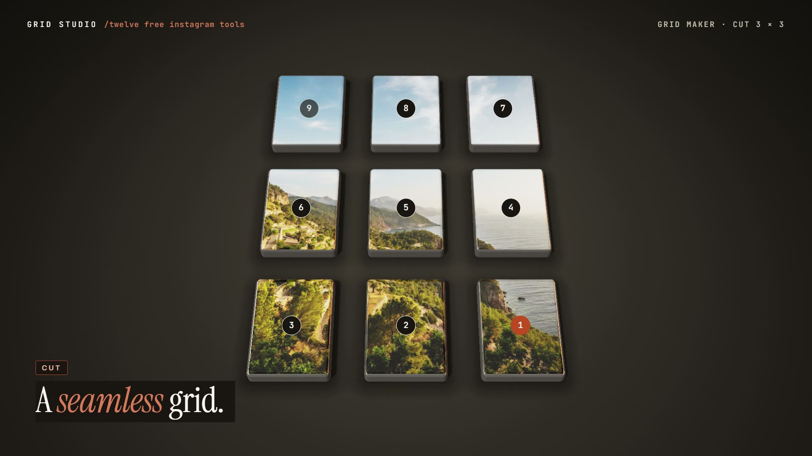

# R29 · Seamless

## Purpose

A film for Grid Studio, twelve free Instagram tools that run in the browser, drawn by one raymarched shader. Grid
Studio cuts a picture into tiles that line up perfectly on a profile; in the film the picture is a liquid, so the cut
is a tear and the profile is where it flows back into one.

- **The pour:** a chrome drop falls into a pool, rings run out, and the photo surfaces inside the liquid.
- **The cut:** seams draw a 3×3 and snap on the beat into nine liquid tiles, numbered in posting order.
- **Posted:** the tiles fall into a profile one by one and melt back into one picture.
- **The tools:** the liquid becomes a carousel, round covers, a palette, a resize and a QR code.
- **In your browser:** an upload tries to pull a drop out of the browser and it springs back.
- **Title:** the liquid gathers into the mark at exactly the official file's size.

Made for Grid Studio. The tool names are the app's own, "twelve" is the app's own number, and no result is claimed.

**Source release:** [Seamless source](https://github.com/jqaisystems/visions-recipes/releases/tag/r29-seamless-v1)
· **Prompt, remix template and breakdown:** [RECIPE.md](RECIPE.md)

32 s · 1920×1080 · 30 fps · one WebGL2 fragment shader, no meshes · score composed in code · €0 to make

## Requirements and commands

Needs Node 22+ and Chrome or Edge with hardware acceleration. Add an image first (see `assets/img/README.md`). The bake
and the score need Python; the score needs `pip install numpy`.

    npm run dev       # browser preview, using the version pinned in package.json
    npm run check     # validate the composition
    npm run render    # MP4 to renders/

## Editable elements

1. **Your picture.** `assets/img/demo-banner.jpg`, see `assets/img/README.md`.
2. **Your mark.** The end card is the image in `assets/brand/`, placed flat as `#t-mark`, with the name set as text.
   The liquid's last shape is nine tiles; change `MARK` in `index.html` to match your own mark's layout.
3. **The clock.** The fall, the seams and their snaps, the posting order, the tools, the upload pull and the title are
   in `bake/table.py`. Change them and run `python bake/table.py`.
4. **The shapes.** `scene(t)` in `index.html` lays out the bodies for each section; `slab`, `GRID` and `ONE` build the
   grid, and each tool is a block of `S.els` positions.
5. **The look.** `env()` in the shader is the studio; the palette is in the CSS and in `scene(t)`.
6. **The words on screen.** The station titles, the "No" lines, the HUD and the end card are plain text in
   `index.html`.
7. **The score.** Rebuild it with `python score/compose.py`.

## Source files

- `index.html`: the whole film.
  - `FS`: the fragment shader. `map(p)` is the world, `shadow` and `ao` read it again, `env` is the studio.
  - `scene(t)` returns every body, the camera and the effects for time `t`; `paint(t)` sends them as uniforms.
  - `slab`, `GRID` and `ONE` build the pool and its tiles; `groups` splits the pool along the seams that have snapped.
- `bake/table.py`: the one table. `score/compose.py`: the score, timed to the table.
- `CONCEPT.md`: the concept card for this recipe.

## Credits and licences

- **Code, composition and score:** MIT (see the repo [LICENSE](../../LICENSE)).
- **GSAP** (`assets/vendor/gsap.min.js`): GSAP Standard License, free (gsap.com/standard-license).
- **Fonts:** Archivo, Instrument Serif and JetBrains Mono are under the SIL Open Font License 1.1
  (`assets/fonts/OFL-*.txt`).
- **Not licensed:** the Grid Studio mark (`assets/brand/gridstudio-mark.svg`) and the name Grid Studio. Use your own
  mark in a remix.
- **Not included:** the photo in the published film is by Stefan Kunze (Unsplash License). Add your own image, see
  `assets/img/README.md`.

[All recipes](../../docs/catalog.md) · [Setup and first example](../../README.md#first-working-example)
