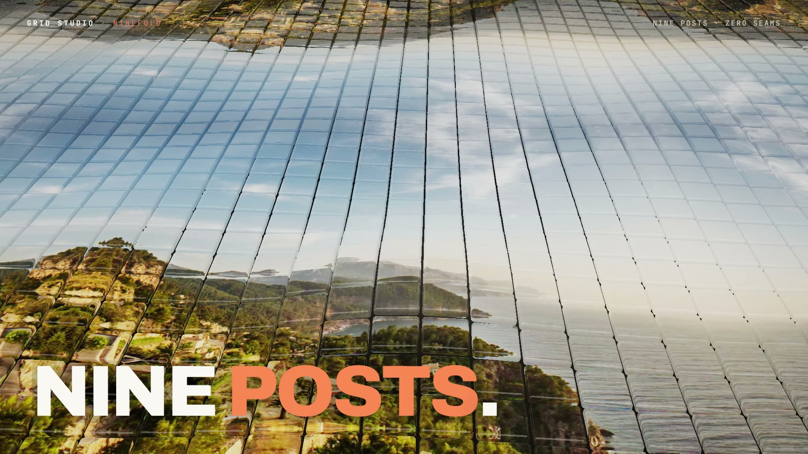

# R30 · Ninefold

## Purpose

A film for Grid Studio, twelve free Instagram tools that run in the browser, cut like a showreel and drawn by one
raymarched shader. One image becomes nine posts, nine become a whole feed, and twelve tools work on the same picture
without it leaving the browser.

- **Open:** one glass tile spins out of black with the photo split into colour through it, and bursts into nine.
- **Field:** the camera ramps back over an endless field of glass, with a wave on every beat.
- **Feed:** a dolly zoom down a profile column, then nine posts drop in order.
- **Tools:** ten hard cuts, each a new shape of the same field, from Grid Maker to Bio.
- **Browser:** a kaleidoscope folds the field into one tile, and three words fly at the glass and shatter.
- **Title:** nine tiles lock into the mark at exactly the official file's size.

Made for Grid Studio. The tool names are the app's own, "twelve" is the app's own number, and no result is claimed.

**Source release:** [Ninefold source](https://github.com/jqaisystems/visions-recipes/releases/tag/r30-ninefold-v1)
· **Prompt, remix template and breakdown:** [RECIPE.md](RECIPE.md)

32 s · 1920×1080 · 30 fps · one WebGL2 fragment shader, no meshes · score composed in code · €0 to make

## Requirements and commands

Needs Node 22+ and Chrome or Edge with hardware acceleration. Add an image first (see `assets/img/README.md`). The bake
and the score need Python; the score needs `pip install numpy`.

    npm run dev       # browser preview, using the version pinned in package.json
    npm run check     # validate the composition
    npm run render    # MP4 to renders/

## Editable elements

1. **Your picture.** `assets/img/demo-banner.jpg`, see `assets/img/README.md`.
2. **Your mark.** The end card is the image in `assets/brand/`, placed flat as `#t-mark`, with the name set as text.
3. **The clock.** The beat grid, the waves, the cuts, the posts, the ten tools, the flying words and the title are in
   `bake/table.py`. Change them and run `python bake/table.py`.
4. **The tools.** `TOOLS` in the table names them; `TOOLCFG` in `index.html` gives each its shape, window and camera.
5. **The words on screen.** The slams (`WORDS`), the flying words (`FLIES`), the HUD and the end card are plain text
   in `index.html`.
6. **The look.** The glass's index, the studio and the fog are in the shader; the palette is in the CSS and in
   `scene(t)`.
7. **The score.** Rebuild it with `python score/compose.py`.

## Source files

- `index.html`: the whole film.
  - `FS`: the fragment shader. `cellD` is one tile, `toField` the field's frame and the kaleidoscope, `photo` reads the
    picture, and the main loop marches, refracts and shades.
  - `scene(t)` sets every uniform for time `t`; `TOOLCFG`, `SINGLE` and `TITLECAM` hold the shots.
  - `WORDS` and `FLIES` are the type on the beat.
- `bake/table.py`: the one table. `score/compose.py`: the score, timed to the table.
- `CONCEPT.md`: the concept card for this recipe.

## Credits and licences

- **Code, composition and score:** MIT (see the repo [LICENSE](../../LICENSE)).
- **GSAP** (`assets/vendor/gsap.min.js`): GSAP Standard License, free (gsap.com/standard-license).
- **Fonts:** Archivo, Instrument Serif and JetBrains Mono are under the SIL Open Font License 1.1
  (`assets/fonts/OFL-*.txt`).
- **Not licensed:** the Grid Studio mark (`assets/brand/gridstudio-mark.svg`) and the name Grid Studio. Use your own
  mark in a remix.
- **Not included:** the photo in the published film is by Stefan Kunze (Unsplash License). Add your own image, see
  `assets/img/README.md`.

[All recipes](../../docs/catalog.md) · [Setup and first example](../../README.md#first-working-example)
