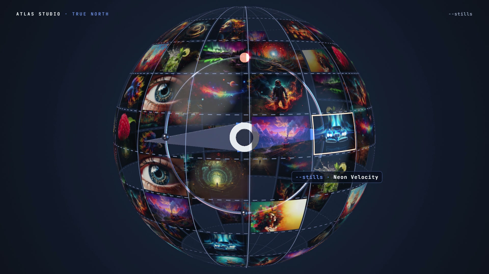

# R31 · True North

## Purpose

A film for Atlas Studio, João's visual prompt studio, cut like a showreel and drawn by one raymarched shader that
carries real images. Every image starts as a prompt, and the compass needle always points at the next one.

- **Open:** a needle and its ring spin up out of black while a prompt from the Atlas library types out.
- **Globe:** the camera pulls back to a glass globe tiled with stills that whips round and brakes on the beat, the
  needle pointing at one still after another.
- **Zoom:** an endless Droste zoom carries each still inside the compass ring of the last.
- **Tunnel:** the zoom opens into a tunnel of stills, smeared along the flight.
- **Motion:** three rings come alive with clips.
- **Title:** light gathers into the needle and the paper opens from its hub with the logo, flat.

Made for Atlas Studio. The opening prompt is quoted from the Atlas library as written. The stills and clips are João's
own and are not included, and no result is claimed.

**Source release:** [True North source](https://github.com/jqaisystems/visions-recipes/releases/tag/r31-true-north-v1)
· **Prompt, remix template and breakdown:** [RECIPE.md](RECIPE.md)

33 s · 1920×1080 · 30 fps · one WebGL2 shader in two passes, no meshes · score composed in code · €0 to make

## Requirements and commands

Needs Node 22+ and Chrome or Edge with hardware acceleration. Add twenty images and three clips first (see
`assets/img/README.md` and `assets/clips/README.md`). The bake and the score need Python; the score needs
`pip install numpy`.

    npm run dev       # browser preview, using the version pinned in package.json
    npm run check     # validate the composition
    npm run render    # MP4 to renders/

## Editable elements

1. **Your pictures.** `assets/img/s00.jpg` to `s19.jpg`, with their titles and prompts in `bake/table.json`.
2. **Your clips.** `assets/clips/`, see `assets/clips/README.md`.
3. **Your mark.** The end card is the image in `assets/brand/`, placed flat as `#t-logo`, with the line and URL set
   as text.
4. **The clock.** The beat grid, the globe's tiles (`GMAP`), the brakes, the zoom's order (`DROSTE`), the tunnel, the
   rings and the title are in `bake/table.py`. Change them and run `python bake/table.py`.
5. **The prompt.** `PROMPT` and `PROMPT_META` in `bake/table.py`.
6. **The words on screen.** The lines, the slam, the HUD and the end card are plain text in `index.html`.
7. **The look.** The needle, the globe, the zoom's factor and turn, the tunnel and the fog are in the shader; the
   palette is in the CSS and in the shader's constants.
8. **The score.** Rebuild it with `python score/compose.py`.

## Source files

- `index.html`: the whole film.
  - `FS1`: the scene shader. The needle and ring are signed distance fields; `globe` hits an analytic sphere twice and
    marches the needle between the hits; `droste` nests each still in the ring of the last; `tunnel` flies a cylinder
    of stills.
  - `FS2`: bloom from the scene's mip chain, the chromatic kick, the motion rings and the logo's light.
  - `paint(t)` sets every uniform and every line of type for time `t`.
- `bake/table.py`: the one table. `score/compose.py`: the score, timed to the table.
- `CONCEPT.md`: the concept card for this recipe.

## Credits and licences

- **Code, composition and score:** MIT (see the repo [LICENSE](../../LICENSE)).
- **GSAP** (`assets/vendor/gsap.min.js`): GSAP Standard License, free (gsap.com/standard-license).
- **Fonts:** Archivo, Instrument Serif and JetBrains Mono are under the SIL Open Font License 1.1
  (`assets/fonts/OFL-*.txt`).
- **Not licensed:** the Atlas Studio logo (`assets/brand/atlas-studio-logo-approved*.png`) and the name Atlas Studio.
  Use your own mark in a remix.
- **Not included:** the stills and clips in the published film are João Queirós's own artwork. Add your own, see
  `assets/img/README.md` and `assets/clips/README.md`.

[All recipes](../../docs/catalog.md) · [Setup and first example](../../README.md#first-working-example)
