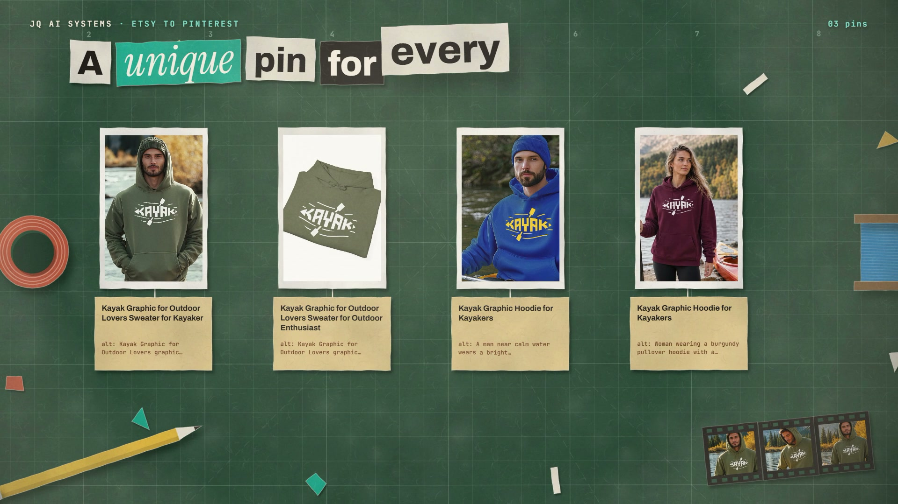

# R32 · Pinned

## Purpose

A film for Etsy to Pinterest, João's pipeline that turns Etsy listings into Pinterest-ready image and video pins,
made as paper cut-out stop motion on a craft table. Every step on the table is one the system really does.

- **Listing:** a paper listing slides onto the cutting mat with its photo, title, tags and gallery.
- **Filter:** the gallery fans out as prints, and scissors snip out the size chart and the colour chart.
- **Pins:** each photo's margin is trimmed to a 2:3 pin, and a tag unfolds with its title and alt text.
- **Boards:** a spread opens, two boards pop up, and pushpins press each pin onto its board.
- **Schedule:** a week of paper strips takes the pins with gaps between them.
- **Video:** the filmstrip folds into a 9:16 card playing the video, gets its cover and is filed for a manual upload.
- **Title:** a black sheet sweeps the table and the logo lands, flat.

Made for Etsy to Pinterest. The listing and its media are João's own and are not included; the pin text and boards are
the ones the system wrote, the schedule times are illustrative, and no result is claimed.

**Source release:** [Pinned source](https://github.com/jqaisystems/visions-recipes/releases/tag/r32-pinned-v1)
· **Prompt, remix template and breakdown:** [RECIPE.md](RECIPE.md)

33.6 s · 1920×1080 · 30 fps · one Canvas 2D, paper cut-out on twos · score composed in code · €0 to make

## Requirements and commands

Needs Node 22+ and Chrome or Edge. Add a listing's media first (see `assets/img/README.md`); without it the prints draw
as plain paper. The bake and the score need Python; the score needs `pip install numpy`.

    npm run dev       # browser preview, using the version pinned in package.json
    npm run check     # validate the composition
    npm run render    # MP4 to renders/

## Editable elements

1. **Your listing.** `assets/img/`, see `assets/img/README.md`.
2. **Its words.** The listing's title and tags, the two boards, and each pin's title, alt text and board are in
   `bake/table.py`. Change them and run `python bake/table.py`.
3. **Your mark.** The end card is the image in `assets/brand/`, placed flat as `#t-logo`, with the name, line and URL
   set as text in `index.html`.
4. **The clock.** The beat grid, every event (`E`), the schedule's slots, the lines of type and the HUD are in
   `bake/table.py`.
5. **The look.** The paper stocks (`STOCK`), the table and its props (`drawTable`), the camera's steps (`camAt`) and
   the light (`makePost`) are in `index.html`.
6. **The score.** Rebuild it with `python score/compose.py`.

## Source files

- `index.html`: the whole film.
  - `piece(P)`: one piece of paper, a torn outline, a stock, a shadow from its height and whatever is printed on it.
  - `makeStocks()`: the paper stocks, generated from noise once at load.
  - `drawListing`, `drawGallery`, `drawPins`, `drawBook`, `drawSchedule`, `drawVideo`: the scenes on the table.
  - `paint(t)` snaps `t` to a pose and draws the whole frame for it.
- `bake/table.py`: the one table. `score/compose.py`: the score, timed to the table.
- `CONCEPT.md`: the concept card for this recipe.

## Credits and licences

- **Code, composition and score:** MIT (see the repo [LICENSE](../../LICENSE)).
- **GSAP** (`assets/vendor/gsap.min.js`): GSAP Standard License, free (gsap.com/standard-license).
- **Fonts:** Archivo, Instrument Serif and JetBrains Mono are under the SIL Open Font License 1.1
  (`assets/fonts/OFL-*.txt`).
- **Not licensed:** the JQ AI SYSTEMS logo (`assets/brand/jqai-logo.png`) and the names JQ AI SYSTEMS and Etsy to
  Pinterest. Use your own mark in a remix. Etsy and Pinterest are their owners' names, used only to say what the
  system does.
- **Not included:** the listing photos, charts, video and cover in the published film are João Queirós's own. Add your
  own, see `assets/img/README.md`.

[All recipes](../../docs/catalog.md) · [Setup and first example](../../README.md#first-working-example)
