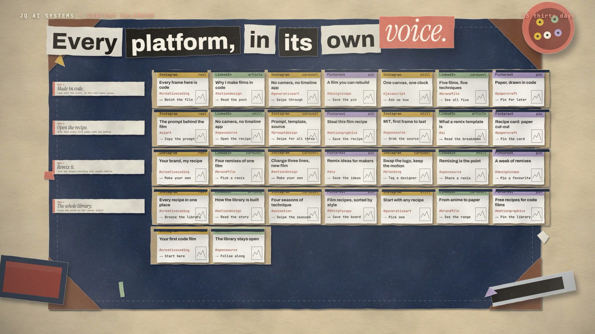

# R33 · Planner

## Purpose

A film for the Social Media Content Calendar, João's tool that turns one brand brief into a month of posts, made as
paper cut-out stop motion on a desk. Every step on the desk is one the system really does.

- **Brief:** a form slides onto a felt blotter and its fields pull out as tabs.
- **Themes:** a paper wheel clicks four times and a banner unrolls for each week, with the reason for it.
- **Thirty days:** an accordion of card unfolds into the month, and thirty flaps lift in a wave over the post cards.
- **Variety check:** rubber stamps throw out a repeated hook, a repeated CTA and a third post of one format in a week.
- **Export:** the month folds into a printer and a tractor-feed CSV rises out of it, one row per post.
- **Review:** a pencil ticks down the margin, the strip tears off and flies away as a paper plane.
- **Title:** a black sheet sweeps the desk and the logo lands, flat.

Made for the Social Media Content Calendar. The brief and the month are an illustrative sample for JQ VISIONS, not the
system's own output, and no result is claimed.

**Source release:** [Planner source](https://github.com/jqaisystems/visions-recipes/releases/tag/r33-planner-v1)
· **Prompt, remix template and breakdown:** [RECIPE.md](RECIPE.md)

33.3 s · 1920×1080 · 30 fps · one Canvas 2D, paper cut-out on twos · score composed in code · €0 to make

## Requirements and commands

Needs Node 22+ and Chrome or Edge. The bake and the score need Python; the score needs `pip install numpy`.

    npm run dev       # browser preview, using the version pinned in package.json
    npm run check     # validate the composition
    npm run render    # MP4 to renders/

## Editable elements

1. **Your brief and your month.** The brief's fields, the four themes and their reasons, the thirty posts (format,
   hook, hashtag, CTA, visual), the platform rotation and the three drafts the variety check throws out are in
   `bake/table.py`. The bake checks that no hook or CTA repeats and that no week has three posts of one format.
   Change them and run `python bake/table.py`.
2. **Your mark.** The end card is the image in `assets/brand/`, placed flat as `#t-logo`, with the name, line and URL
   set as text in `index.html`.
3. **The clock.** The beat grid, every event (`E`), the lines of type and the HUD are in `bake/table.py`.
4. **The look.** The paper stocks (`STOCK`), the platform colours (`PLAT`), the desk and its props (`drawDesk`), the
   layout constants, the camera's steps (`camAt`) and the light (`makePost`) are in `index.html`.
5. **The score.** Rebuild it with `python score/compose.py`.

## Source files

- `index.html`: the whole film.
  - `piece(P)`: one piece of paper, a torn outline, a stock, a shadow from its height and whatever is printed on it.
  - `makeStocks()`: the paper stocks, generated from noise once at load.
  - `drawBrief`, `drawWheel`, `drawBanners`, `drawMonth`, `drawStamps`, `drawStrip`, `drawPrinter`, `drawPlane`: the
    scenes on the desk.
  - `paint(t)` snaps `t` to a pose and draws the whole frame for it.
- `bake/table.py`: the one table. `score/compose.py`: the score, timed to the table.
- `CONCEPT.md`: the concept card for this recipe.

## Credits and licences

- **Code, composition and score:** MIT (see the repo [LICENSE](../../LICENSE)).
- **GSAP** (`assets/vendor/gsap.min.js`): GSAP Standard License, free (gsap.com/standard-license).
- **Fonts:** Archivo, Instrument Serif and JetBrains Mono are under the SIL Open Font License 1.1
  (`assets/fonts/OFL-*.txt`).
- **Not licensed:** the JQ AI SYSTEMS logo (`assets/brand/jqai-logo.png`) and the names JQ AI SYSTEMS and Social Media
  Content Calendar. Use your own mark in a remix. Instagram, LinkedIn and Pinterest are their owners' names, set as
  type only to say which platform a post is for.
- **Sample data:** the brief and the month are an illustrative sample written for this film.

[All recipes](../../docs/catalog.md) · [Setup and first example](../../README.md#first-working-example)
