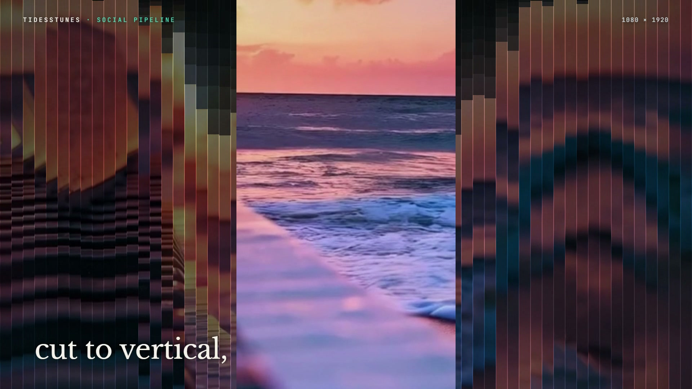

# R36 · Tideline

## Purpose

A film for the Tidesstunes Social Pipeline, João's system that turns a music video into vertical clips of its strongest
minute with a caption for each platform. It uses time as its material: real footage in one texture array, and one
fragment shader where every pixel picks its own moment.

- **One video in:** a slit crosses the playing video and writes the whole of it as one strip of time.
- **The strongest minute:** the track's loudness draws on, and a window leaves the first minute for the strongest one.
- **Cut to vertical:** the slits outside the 9:16 crop drift back in time and fall away with echoes.
- **One link:** the frame holds in a datamosh, then collapses into one bright line.
- **Three captions:** three phones show the same wave at three moments, each typing its own caption.
- **Queued:** the phones line up, spaced out, and dive through a tunnel whose depth is time.
- **Title:** the name in letters that each show a different second, then the mark, flat.

Made for the Tidesstunes Social Pipeline. The published film uses João's own Tidesstunes video and track; they are not
in this repo, and no counts or results are claimed.

**Source release:** [Tideline source](https://github.com/jqaisystems/visions-recipes/releases/tag/r36-tideline-v1)
· **Prompt, remix template and breakdown:** [RECIPE.md](RECIPE.md)

33.4 s · 1920×1080 · 30 fps · one WebGL2 fragment shader over 144 frames of real footage · €0 to make

## Requirements and commands

Needs Node 22+, Chrome or Edge with hardware acceleration (the frames take about 400 MB of GPU memory), FFmpeg on the
path, and Python with `pip install numpy`.

    python bake/demo.py                        # a demo clip, or skip it and use your own:
    python bake/prep.py [video] [audio]        # frames, the strip, the loudness and the soundtrack into assets/img/
    python bake/table.py                       # the table, with the strongest minute
    python score/compose.py                    # the soundtrack, from the strongest minute plus the sound marks
    npm run dev       # browser preview, using the version pinned in package.json
    npm run check     # validate the composition
    npm run render    # MP4 to renders/

## Editable elements

1. **Your footage and track.** Pass them to `bake/prep.py`. It takes the strongest 60 seconds by loudness, 144 frames
   at 12 fps from inside it, a slit-scan strip of the whole video, and the audio from the same moment.
2. **Your mark.** The end card is the image in `assets/brand/`, placed flat as `#c-logo`, with the name, line and URL
   set as text from the table.
3. **The clock and the words.** The beat grid, every section, the lines of type, the three captions and the title are
   in `bake/table.py`. Change them and run `python bake/table.py`.
4. **The look.** The slit's wake, the falling slits, the datamosh, the phones, the tunnel and the title mask are
   functions in the shader in `index.html`; the palette is in the CSS and the shader's constants.
5. **The sound.** The marks and the mix are in `score/compose.py`.

## Source files

- `index.html`: the whole film.
  - `FS`: one fragment shader. `F(uv, tau)` reads the footage at any moment, blending two frames and running time back
    and forth; `mOpen`, `mMinute`, `mVertical`, `mLink`, `mPhones`, `mQueue` and `mTitle` are the sections.
  - `overlay(t, S)`: the 2D canvas over it, with the loudness line, the window, the chips, the rail and the captions.
  - `paint(t)` sets every uniform and every line of type for time `t`.
- `bake/demo.py`: a demo clip. `bake/prep.py`: the media. `bake/table.py`: the one table. `score/compose.py`: the sound.
- `CONCEPT.md`: the concept card for this recipe.

## Credits and licences

- **Code and composition:** MIT (see the repo [LICENSE](../../LICENSE)).
- **GSAP** (`assets/vendor/gsap.min.js`): GSAP Standard License, free (gsap.com/standard-license).
- **Fonts:** Inter, Libre Baskerville and JetBrains Mono are under the SIL Open Font License 1.1
  (`assets/fonts/OFL-*.txt`).
- **Not included:** the Tidesstunes footage, music and mark used in the published film are João Queirós's own and are
  not part of this repo's licence. The name Tidesstunes is not licensed. Use your own clip, track and mark.
- **Not public:** the Tidesstunes Social Pipeline itself is private and is not in this repo; only the film's code is.

[All recipes](../../docs/catalog.md) · [Setup and first example](../../README.md#first-working-example)
