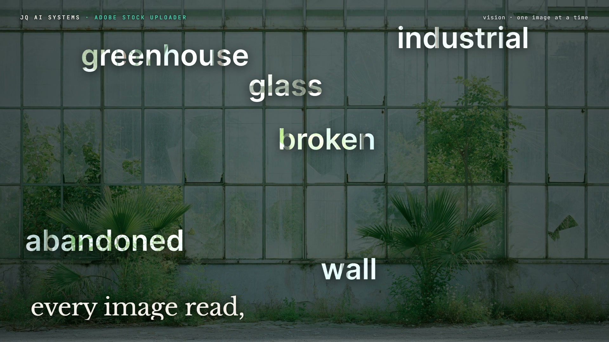

# R37 · Batch

## Purpose

A film for the Adobe Stock Uploader, João's system that reads a folder of images and writes a title, exactly 46
ordered keywords and a category for each, then validates the CSV before upload. It uses time as its material, applied
to stills: the whole batch in one texture array in the CSV's order, played like footage, and one fragment shader
where every pixel picks its own still.

- **One folder in:** the stills flick past as a flipbook until a slit freezes them into one image, a column for each.
- **Every image read:** a scan line reads the first still, and its first keywords lift out over what they name, their
  letters showing a later take of the same picture.
- **Forty-six keywords:** the title types on and the keywords fill a numbered grid, the first ten boxed.
- **Near-duplicates found:** the batch as one strip; each concept's takes melt into each other, the concepts cut hard.
- **Validated first:** the CSV as a wall of rows, each showing its own still, while the checks tick to 100 of 100.
- **A human checks:** the wall closes into one file, a tunnel of stills, and the two boxes ticked by hand.
- **Title:** the name in letters that each show a different still, then the mark, flat.

Made for the Adobe Stock Uploader. The published film uses João's own stills and their real CSV; they are not in this
repo, and no downloads, sales or other results are claimed.

**Source release:** [Batch source](https://github.com/jqaisystems/visions-recipes/releases/tag/r37-batch-v1)
· **Prompt, remix template and breakdown:** [RECIPE.md](RECIPE.md)

33.75 s · 1920×1080 · 30 fps · one WebGL2 fragment shader over a hundred stills · €0 to make

## Requirements and commands

Needs Node 22+, Chrome or Edge with hardware acceleration (a hundred stills take about 370 MB of GPU memory), FFmpeg on
the path, and Python with `pip install numpy`.

    python bake/demo.py                        # a demo batch, or skip it and use your own:
    python bake/prep.py [folder] [csv]         # the stills and the rows into assets/img/
    python bake/table.py                       # the table, with the checks re-run on the CSV
    python score/compose.py                    # the score, composed in code
    npm run dev       # browser preview, using the version pinned in package.json
    npm run check     # validate the composition
    npm run render    # MP4 to renders/

## Editable elements

1. **Your stills and CSV.** Pass the folder and the CSV to `bake/prep.py`. The CSV needs `Filename`, `Title` and
   `Keywords` (46, comma separated), and optionally `Category`. Keep it in batch order: takes of one concept next to
   each other, with filenames that share a prefix and end in a unique id, so they group into concepts.
2. **Your mark.** The end card is the image in `assets/brand/`, placed flat as `#c-logo`, with the name, line and URL
   set as text from the table.
3. **The words and the beats.** The beat grid, every section, the lines of type, where the six lifted words sit and
   the title are in `bake/table.py`. Change them and run `python bake/table.py`.
4. **The checks.** `checks()` in `bake/table.py` re-runs the rules on your CSV, and the film shows what it returns.
5. **The look.** The flipbook and slit, the read, the strip, the wall, the tunnel and the title are functions in the
   shader in `index.html`; the palette is in the CSS and the shader's constants.
6. **The sound.** The score is in `score/compose.py`.

## Source files

- `index.html`: the whole film.
  - `FS`: one fragment shader. `S(uv, k)` reads still `k`; `mFlip`, `mRead`, `mDupes`, `mWall`, `mTunnel` and
    `mTitle` are the sections, and `letters()` fills the offscreen mask's letters with stills.
  - `maskLetters(t, S)`: the offscreen canvas of letters, coverage in red, the still in green, a shadow in blue.
  - `overlay(t, S)`: the 2D canvas over it, with the grid, the chips, the wall's type and the checks.
  - `paint(t)` sets every uniform and every line of type for time `t`.
- `bake/demo.py`: a demo batch. `bake/prep.py`: the stills and rows. `bake/table.py`: the one table.
  `score/compose.py`: the score.
- `CONCEPT.md`: the concept card for this recipe.

## Credits and licences

- **Code, composition and score:** MIT (see the repo [LICENSE](../../LICENSE)).
- **GSAP** (`assets/vendor/gsap.min.js`): GSAP Standard License, free (gsap.com/standard-license).
- **Fonts:** Inter, Libre Baskerville and JetBrains Mono are under the SIL Open Font License 1.1
  (`assets/fonts/OFL-*.txt`).
- **Not included:** the stills and the CSV used in the published film are João Queirós's own and are not part of this
  repo's licence, nor are the JQ AI SYSTEMS logo and name. Use your own folder, CSV and mark.
- **Not public:** the Adobe Stock Uploader itself is private and is not in this repo; only the film's code is.

[All recipes](../../docs/catalog.md) · [Setup and first example](../../README.md#first-working-example)
