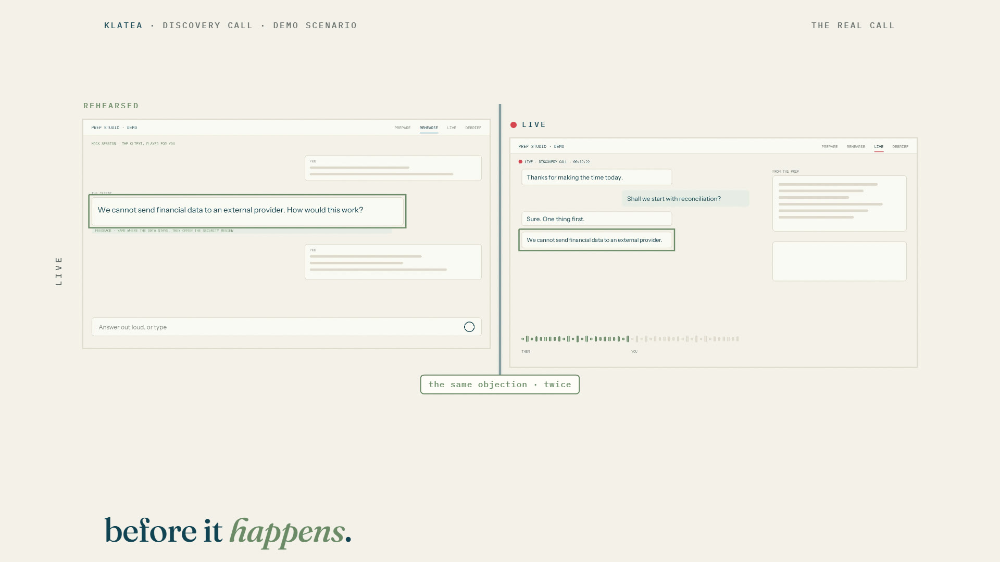

# R38 · Twice

## Purpose

A film for Klatea, João's private preparation studio and live meeting copilot, whose promise is that the hard
moment of a call happens twice: first in rehearsal, then for real. It uses time as its material, applied to a
conversation: the app's screens of a demo call in one texture array in the order the call happens, played like
footage, and one fragment shader where every pixel picks its own moment.

- **Prepare:** the prep form plays until a slit sweeps across it and the brief writes itself out of the line.
- **Rehearse:** the client's hard question is cut out of time and held while the screen moves on.
- **Twice:** rehearsal and live in two windows, the same objection on the same beat, then the slit sweeps it live.
- **Both sides:** each side of the transcript moves in time with its own speaker; a line is translated.
- **Debrief:** the whole call as one image, squeezed to a strip and unfolded into the debrief.
- **The next one:** a tunnel of the call's screens comes out on a new prep.
- **Title:** the name in letters that each show a different moment, then the mark, flat.

Made for Klatea. The published film uses Klatea's own screens of its fictional demo scenario; they are not in this
repo, which ships a procedural demo call instead. No real meeting is shown and no results are claimed.

**Source release:** [Twice source](https://github.com/jqaisystems/visions-recipes/releases/tag/r38-twice-v1)
· **Prompt, remix template and breakdown:** [RECIPE.md](RECIPE.md)

35.45 s · 1920×1080 · 30 fps · one WebGL2 fragment shader over 56 frames of a call · €0 to make

## Requirements and commands

Needs Node 22+, Chrome or Edge with hardware acceleration, FFmpeg on the path, and Python with
`pip install numpy pillow`.

    python bake/demo.py               # the demo call's screens, or skip it and use your own:
    python bake/prep.py [screens]     # the screens into 56 frames in assets/img/
    python bake/table.py              # the one table
    python score/compose.py           # the score, composed in code
    npm run dev       # browser preview, using the version pinned in package.json
    npm run check     # validate the composition
    npm run render    # MP4 to renders/

## Editable elements

1. **Your screens.** A folder with `prep.png`, `brief.png`, `objections.png`, `roleplay.png`, `debrief.png` and
   `next.png` (any height, scaled to 1600 wide), and the live call as `live/` (16 PNGs at 1600×900) or `live.mp4`.
   The shots, their frame counts and pans are `SHOTS_BEFORE` and `SHOTS_AFTER` in `bake/prep.py`.
2. **Where things sit.** The overlays outline rectangles in the 1600×900 frame: `bubbleR` and `feedbackY` (the
   rehearsal), `liveBubbleR` and `helpR` (the live call), `arabicR` (the translated line) and `dbItems` (the
   debrief), all in `bake/table.py`.
3. **Your mark.** The end card is the image in `assets/brand/`, placed flat as `#c-logo`, with the name, line, URL
   and the last line set as text from the table.
4. **The words and the beats.** The beat grid, every section, the two speakers' envelopes, the lines of type and
   the title are in `bake/table.py`. Change them and run `python bake/table.py`.
5. **The look.** The slit, the hold, the two windows, the sides, the strip, the tunnel and the title are functions
   in the shader in `index.html`; the palette is in the CSS and the shader's constants.
6. **The sound.** The score is in `score/compose.py`.

## Source files

- `index.html`: the whole film.
  - `FS`: one fragment shader. `F(uv, k)` reads frame `k`, mixing its neighbours by the fraction; `mOpen`,
    `mRehearse`, `mTwice`, `mSides`, `mDebrief`, `mLoop` and `mTitle` are the sections.
  - `overlay(t, S)`: the 2D canvas over it, with the hairlines, outlines, labels, chips and meters.
  - `paint(t)` sets every uniform and every line of type for time `t`.
- `bake/demo.py`: the demo call. `bake/prep.py`: the shots. `bake/table.py`: the one table.
  `score/compose.py`: the score.
- `CONCEPT.md`: the concept card for this recipe.

## Credits and licences

- **Code, composition and score:** MIT (see the repo [LICENSE](../../LICENSE)).
- **GSAP** (`assets/vendor/gsap.min.js`): GSAP Standard License, free (gsap.com/standard-license).
- **Fonts:** Fraunces, IBM Plex Mono and Instrument Sans are under the SIL Open Font License 1.1
  (`assets/fonts/OFL-*.txt`).
- **Not included:** Klatea's screens, its tutorial footage and its mark are not part of this repo or its licence.
  Use your own screens and mark.
- **Not public:** Klatea itself is proprietary and is not in this repo; only the film's code is.

[All recipes](../../docs/catalog.md) · [Setup and first example](../../README.md#first-working-example)
