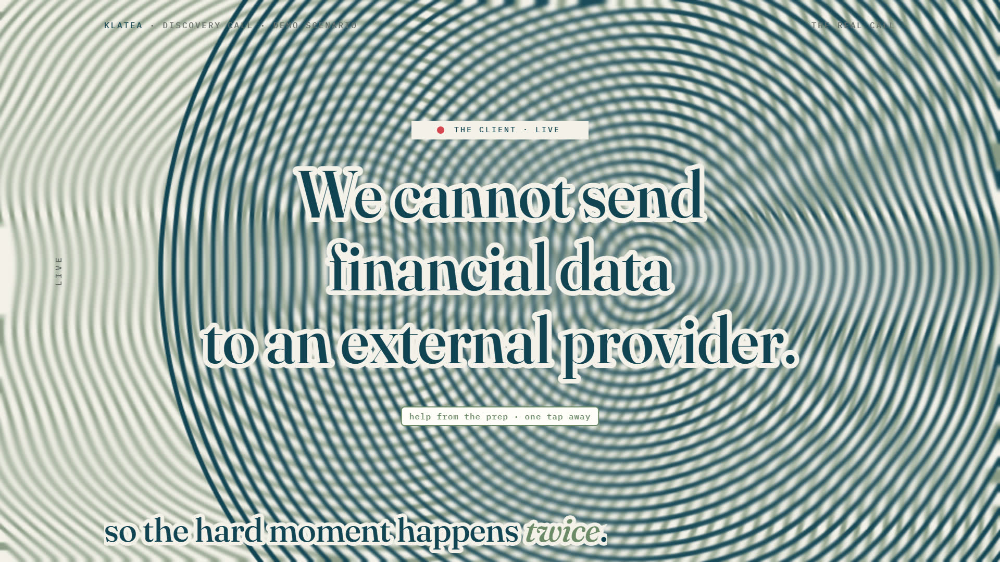

# R39 · Echo

## Purpose

A film for Klatea, João's private preparation studio and live meeting copilot, whose promise is that the hard
moment of a call happens twice: first in rehearsal, then for real. There are no screens in it: the whole film is one
page of ink that remembers where it has been, drawn by a WebGL2 feedback buffer.

- **A voice:** a pen draws a waveform and the page recedes into ridgelines.
- **The brief:** words slam in on the beat and leave trails as they fly into a list.
- **Rehearse:** the client's question lands and a sage ripple fills the page.
- **Twice:** the client's objection lands live, and its ink ripple meets the rehearsed one in a moiré.
- **Both sides:** two pens, one per speaker, wind into spirals inside a talk-time ring.
- **Debrief:** the page is pulled into one column and the score lands as ink.
- **The next one:** the ridgelines again, then the mark, flat.

Made for Klatea. Every word and figure comes from the app's demo scenario; no real meeting is shown and no results
are claimed.

**Source release:** [Echo source](https://github.com/jqaisystems/visions-recipes/releases/tag/r39-echo-v1)
· **Prompt, remix template and breakdown:** [RECIPE.md](RECIPE.md)

33.75 s · 1920×1080 · 30 fps · one WebGL2 feedback buffer · €0 to make

## Requirements and commands

Needs Node 22+, Chrome or Edge with hardware acceleration (float framebuffers), FFmpeg on the path, and Python with
`pip install numpy`.

    python bake/table.py              # the one table
    python score/compose.py           # the score, composed in code
    npm run dev       # browser preview, using the version pinned in package.json
    npm run check     # validate the composition
    npm run render    # MP4 to renders/

## Editable elements

1. **The words and the beats.** The beat grid, every section, the brief's words, the question, the objection, the
   two speakers' envelopes, the debrief's lines, the lines of type and the end card are in `bake/table.py`. Change
   them and run `python bake/table.py`.
2. **The ink.** `SIM_FS` in `index.html` is the step: the recession, the drift, the swirl, the pull and the fade.
   `flow(tau)` in the script sets them for each moment.
3. **The marks.** `simMarks(g, tau, n)` draws what the pen lays into the page each frame: the ridges, the words'
   trails, the rings, the two pens and the score.
4. **The type.** `overlay(t)` draws the crisp layer above the ink.
5. **Your mark.** The end card is the image in `assets/brand/`, placed flat as `#c-logo`.
6. **The sound.** The score is in `score/compose.py`.

## Source files

- `index.html`: the whole film.
  - `SIM_FS`: the step shader, two RGBA16F framebuffers in ping-pong. `DISP_FS`: the display pass.
  - `simTo(t)`: rebuilds the page from its anchor and steps it to the frame, so seeking is deterministic.
  - `paint(t)` draws the page, the crisp layer and every line of type for time `t`.
- `bake/table.py`: the one table. `score/compose.py`: the score.
- `CONCEPT.md`: the concept card for this recipe.

## Credits and licences

- **Code, composition and score:** MIT (see the repo [LICENSE](../../LICENSE)).
- **GSAP** (`assets/vendor/gsap.min.js`): GSAP Standard License, free (gsap.com/standard-license).
- **Fonts:** Fraunces, IBM Plex Mono and Instrument Sans are under the SIL Open Font License 1.1
  (`assets/fonts/OFL-*.txt`).
- **Not included:** Klatea's mark is not part of this repo or its licence. Use your own mark.
- **Not public:** Klatea itself is proprietary and is not in this repo; only the film's code is.

[All recipes](../../docs/catalog.md) · [Setup and first example](../../README.md#first-working-example)
