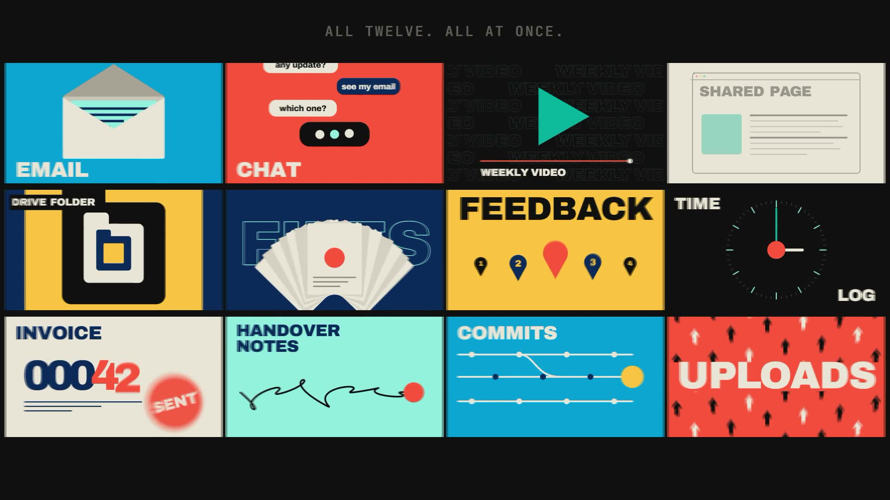

# R40 · One Take

## Purpose

A film for Client Portal Automation, a system João is still building, whose problem is that project status lives in
twelve places. So the camera flies through twelve worlds without a cut, then pulls back to show they were all tiles on
one wall.

- **The dot:** one dot falls, squashes, bounces and bursts into twelve.
- **Twelve worlds:** each with its own colours and motion, and the camera dives through a shape in one to land in the next.
- **The wall:** one beat of silence, a sub drop, and all twelve are tiles, still playing.
- **One record:** the tiles fall in turn into one sheet, a line for each.
- **New project:** one button deals five cards with 3D flips.
- **Friday:** the days riffle, FRIDAY slams, and three client updates slide up, each in its own format.
- **Close:** back to the dot, then the mark, flat.

The system is in development and the film says so. Only the onboarding half runs today, as a local prototype. All
client text is fictional demo text and no results are claimed.

**Source release:** [One Take source](https://github.com/jqaisystems/visions-recipes/releases/tag/r40-one-take-v1)
· **Prompt, remix template and breakdown:** [RECIPE.md](RECIPE.md)

33.75 s · 1920×1080 · 30 fps · one Canvas 2D stage · €0 to make

## Requirements and commands

Needs Node 22+, Chrome or Edge, FFmpeg on the path, and Python with `pip install numpy`.

    python bake/table.py              # the one table
    python score/compose.py           # the score, composed in code
    npm run dev       # browser preview, using the version pinned in package.json
    npm run check     # validate the composition
    npm run render    # MP4 to renders/

## Editable elements

1. **The worlds and the beats.** The beat grid, each world's name and length, the cards, the days, the client panels
   and the end card are in `bake/table.py`. Change them and run `python bake/table.py`.
2. **Each world.** `DRAW[k](g, u)` in `index.html` draws world `k` at its local beat time `u`, which can be negative.
3. **The doors.** `PORTALS[k]` sets the shape the camera dives through: its position, radius, shape and turn.
4. **The motion blur.** `SUB` and `SHUTTER` set the sub-frames and the shutter. Fewer sub-frames preview faster.
5. **Your mark.** The end card is the image in `assets/brand/`, placed flat as `#logo`.
6. **The sound.** The score is in `score/compose.py`.

## Source files

- `index.html`: the whole film.
  - `worlds(g, b)`: the dives. `drop()`: the wall tiles. `sheetRows()`, `newProject()`, `friday()` and `close()`: the later sections.
  - `scene(g, t)` picks the section for a time. `paint(t)` accumulates the sub-frames, so any frame is exact.
- `bake/table.py`: the one table. `score/compose.py`: the score.
- `CONCEPT.md`: the concept card for this recipe.

## Credits and licences

- **Code, composition and score:** MIT (see the repo [LICENSE](../../LICENSE)).
- **GSAP** (`assets/vendor/gsap.min.js`): GSAP Standard License, free (gsap.com/standard-license).
- **Fonts:** Archivo and JetBrains Mono are under the SIL Open Font License 1.1 (`assets/fonts/OFL-*.txt`).
- **Not included:** the JQ AI SYSTEMS mark is not part of this repo or its licence. Use your own mark.
- **Not public:** Client Portal Automation itself is not in this repo; only the film's code is.

[All recipes](../../docs/catalog.md) · [Setup and first example](../../README.md#first-working-example)
