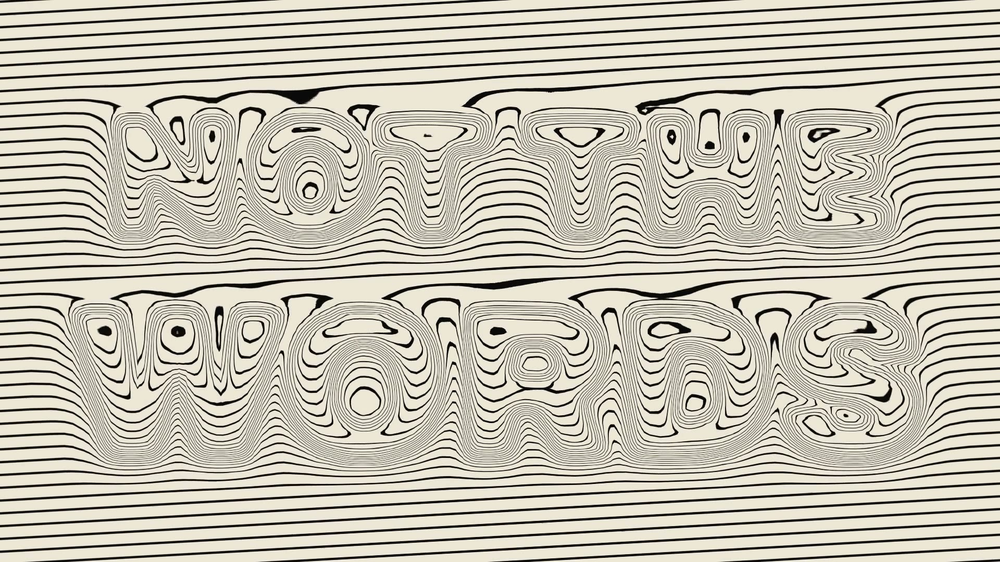

# R41 · Hatch

## Purpose

A film for Codex Control Center, whose promise is that it keeps the metadata of a session and not its words. So almost
the whole film is one field of engraved lines, and the showpiece is a sentence that loses its ink and can still be read.

- **The lines:** a sphere rises only by bending them, then takes ink on the first hit.
- **The log:** a demo log whose private words lose their ink.
- **Not the words:** NOT THE WORDS swells, loses all its ink and stays readable through the bends.
- **Observe:** raymarched bars and a ring, labelled demo data.
- **The gate:** it holds at APPROVE?, the score drops out and the doors burst into a tunnel of square lines.
- **Full access:** an X slams into FULL ACCESS. BLOCKED IN V1.
- **Publish check:** private words fall through a sieve as bends alone, then SOURCE, DOCS and DEMO stay.
- **Close:** every line collapses into one hairline, then the mark, flat.

All data on screen is fictional and labelled demo data, and no results are claimed.

**Source release:** [Hatch source](https://github.com/jqaisystems/visions-recipes/releases/tag/r41-hatch-v1)
· **Prompt, remix template and breakdown:** [RECIPE.md](RECIPE.md)

34.56 s · 1920×1080 · 30 fps · one fragment shader · €0 to make

## Requirements and commands

Needs Node 22+, Chrome or Edge, FFmpeg on the path, and Python with `pip install numpy`.

    python bake/table.py              # the beat grid
    python score/compose.py           # the score, composed in code
    npm run dev       # browser preview, using the version pinned in package.json
    npm run check     # validate the composition
    npm run render    # MP4 to renders/

## Editable elements

1. **The timing.** The beat grid is in `bake/table.py`; the sections, words and their beats are in `state()` in `index.html`.
2. **The forms.** The raymarched shapes are in the shader in `index.html`, selected by the `uS` uniform.
3. **The line fields.** `uM0` and `uM1` pick the field: rotated, concentric, radial, spiral or square tunnel.
4. **The colours.** `CUTS` in `index.html` lists each colour pair, the beat it starts on and where its ink front begins.
5. **The type channels.** On the type canvas, red swells the lines, blue only bends them, green is flat with a halo.
6. **Your mark.** The end card is the image in `assets/brand/`, placed flat as `#logo`.
7. **The sound.** The score is in `score/compose.py`.

## Source files

- `index.html`: the whole film: the shader, the type canvas and the sub-frame loop. Any frame is exact.
- `bake/table.py`: the beat grid. `score/compose.py`: the score.
- `CONCEPT.md`: the concept card for this recipe.

## Credits and licences

- **Code, composition and score:** MIT (see the repo [LICENSE](../../LICENSE)).
- **GSAP** (`assets/vendor/gsap.min.js`): GSAP Standard License, free (gsap.com/standard-license).
- **Fonts:** Archivo and JetBrains Mono are under the SIL Open Font License 1.1 (`assets/fonts/OFL-*.txt`).
- **Not included:** the JQ AI SYSTEMS mark is not part of this repo or its licence. Use your own mark.
- **Codex Control Center:** the system has its own public repo at github.com/jqaisystems/codex-control-center. Only the film's code is here.

[All recipes](../../docs/catalog.md) · [Setup and first example](../../README.md#first-working-example)
