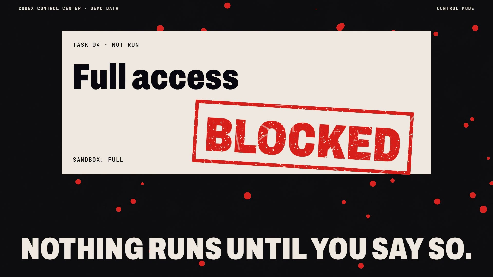

# R42 · Blackout

## Purpose

A film for Codex Control Center, made as blackout poetry. The system keeps the record and not the words, so ink floods
everything private and the picture is what it leaves behind.

- **The log:** a dense demo session log races up a newsprint page.
- **Blackout:** wet bars slam over each private line, bleed along the fibres and join until the page is black.
- **What survives:** times, event types and tool names, on islands of bare paper.
- **Observe:** the survivors become the dashboard.
- **Approve:** a vermilion stamp lands on one task and its splash ripples the wet page; BLOCKED lands on a full-access card.
- **The wash:** water lifts the ink, private words melt, and the page rinses back to bone.
- **Close:** one drop blooms to fill the frame, then the mark, flat.

Every log line, path and token is fictional. The wash shows a check, not a guarantee, and no results are claimed.

**Source release:** [Blackout source](https://github.com/jqaisystems/visions-recipes/releases/tag/r42-blackout-v1)
· **Prompt, remix template and breakdown:** [RECIPE.md](RECIPE.md)

33.6 s · 1920×1080 · 30 fps · one feedback buffer · €0 to make

## Requirements and commands

Needs Node 22+, Chrome or Edge, FFmpeg on the path, and Python with `pip install numpy`.

    python bake/table.py              # the fictional log and the bars
    python score/compose.py           # the score, composed in code
    npm run dev       # browser preview, using the version pinned in package.json
    npm run check     # validate the composition
    npm run render    # MP4 to renders/

## Editable elements

1. **The log.** `TEMPLATES` in `bake/table.py` holds the fictional lines; the same table decides where the bars land.
2. **The ink.** The feedback shader in `index.html` holds the spread and how strongly the fibres steer it.
3. **The anchors.** The page restarts from clean paper at beats 0 and 21.5. A new soak needs its own anchor.
4. **The stamps.** `makeStamp()` and `stampOn()` in `index.html` set the words, the placement and the splash.
5. **Your mark.** The end card is the image in `assets/brand/`, placed flat as `#logo`.
6. **The sound.** The score is in `score/compose.py`.

## Source files

- `index.html`: the whole film: the ink buffer, the overlay canvas and the anchors. Any frame is exact.
- `bake/table.py`: the fictional log and the bars. `score/compose.py`: the score.
- `CONCEPT.md`: the concept card for this recipe.

## Credits and licences

- **Code, composition and score:** MIT (see the repo [LICENSE](../../LICENSE)).
- **GSAP** (`assets/vendor/gsap.min.js`): GSAP Standard License, free (gsap.com/standard-license).
- **Fonts:** Archivo and JetBrains Mono are under the SIL Open Font License 1.1 (`assets/fonts/OFL-*.txt`).
- **Not included:** the JQ AI SYSTEMS mark is not part of this repo or its licence. Use your own mark.
- **Codex Control Center:** the system has its own public repo at github.com/jqaisystems/codex-control-center. Only the film's code is here.

[All recipes](../../docs/catalog.md) · [Setup and first example](../../README.md#first-working-example)
