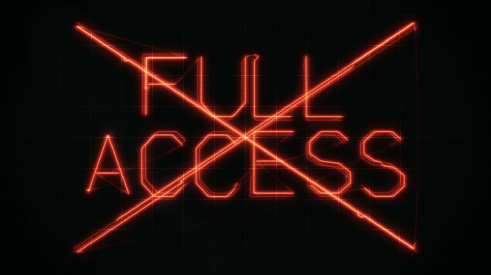

# R43 · Trace

## Purpose

A film for Codex Control Center, drawn by one beam of light on an oscilloscope. The soundtrack is the picture: an
oscilloscope shows a signal without knowing what it says, which is how the dashboard treats a session.

- **The dot:** a dot and a hum open into Lissajous figures and a wire sphere.
- **The log:** a demo log whose private words melt into waveform.
- **Observe:** a wire 3D dashboard turning in space, labelled demo data.
- **The gate:** at APPROVE? the beam collapses to a dot and the sound stops, then the gate opens into a tunnel.
- **Full access:** a red X and a harsh buzz.
- **Publish check:** words fall through a wire grid and scatter, and three stay and get ticked.
- **Close:** the tube switches off to a line and a dot, then the mark, flat and silent.

**What the claim covers.** The WAV's left and right channels are the beam's path. The colour is keyed by time, the mark is
a flat silent image, and the glass, graticule and exposure belong to the film, so none of those are in the audio.
Compressed copies only approximate the signal, so plot the WAV you compose here:

    ffmpeg -i assets/bgm/score.wav -filter_complex "[0:a]avectorscope=mode=lissajous_xy[v]" -map "[v]" scope.mp4

That plot's axes come out turned or flipped depending on its settings, and the beam's fast jumps show as thin lines.

All data on screen is fictional and labelled demo data, and no results are claimed.

**Source release:** [Trace source](https://github.com/jqaisystems/visions-recipes/releases/tag/r43-trace-v1)
· **Prompt, remix template and breakdown:** [RECIPE.md](RECIPE.md)

34 s · 1920×1080 · 30 fps · one beam · €0 to make

## Requirements and commands

Needs Node 22+, Chrome or Edge, FFmpeg on the path, and Python with `pip install numpy`.

    python bake/table.py              # the beat grid and the beam's colour
    python score/compose.py           # writes assets/bgm/score.wav and assets/beam.js, needed before anything else
    npm run dev       # browser preview, using the version pinned in package.json
    npm run check     # validate the composition
    npm run render    # MP4 to renders/

## Editable elements

1. **The scenes.** `SCORE` in `score/compose.py` lists each scene's beat, its drawing and its pitch multiple.
2. **The drawings.** `s_big("WORDS")` draws words, and the other `s_*` functions draw wire forms as strokes.
3. **The font.** The single-stroke letters are polylines at the top of `score/compose.py`.
4. **The notes.** `ROOT_HZ` sets the redraw rates. A faster redraw is a higher note with fewer samples per drawing.
5. **The colour.** `colour` in `bake/table.py`, keyed by beat. It isn't in the audio.
6. **Your mark.** The end card is the image in `assets/brand/`, placed flat as `#logo`.

## Source files

- `score/compose.py`: the heart of it. It builds the picture and the sound as one signal and writes both files.
- `index.html`: draws the samples as additive line segments with phosphor, bloom, glass and a graticule. Any frame is exact.
- `bake/table.py`: the beat grid and the colour keys.
- `CONCEPT.md`: the concept card for this recipe.

## Credits and licences

- **Code, composition and score:** MIT (see the repo [LICENSE](../../LICENSE)).
- **GSAP** (`assets/vendor/gsap.min.js`): GSAP Standard License, free (gsap.com/standard-license).
- **Not included:** the JQ AI SYSTEMS mark is not part of this repo or its licence. Use your own mark.
- **Codex Control Center:** the system has its own public repo at github.com/jqaisystems/codex-control-center. Only the film's code is here.

[All recipes](../../docs/catalog.md) · [Setup and first example](../../README.md#first-working-example)
