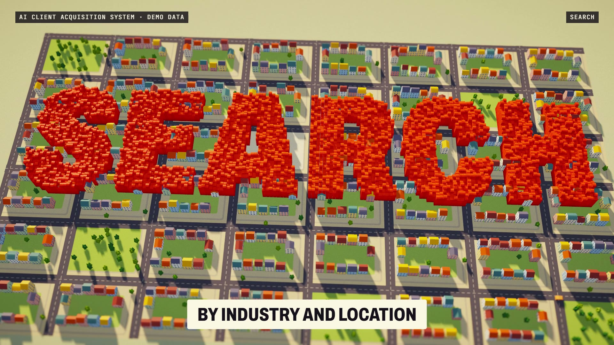

# R44 · Main Street

## Purpose

A film for the AI Client Acquisition System, set in a living miniature town of exactly 500 fictional businesses. A funnel
is hard to feel as a chart and easy to feel as a place: each lead is a building, and filtering is watching most of a town go.

- **One van:** an orange van in an empty town, and the first five shops open on the first five notes.
- **The search:** shops bounce up around it, each playing one marimba note, so the search is the tune.
- **Words:** SEARCH and SCORE rise from the streets as thousands of tiny blocks with real shadows.
- **The drop:** one held breath, then a shockwave, flying debris and night. 30 buildings stay lit and throw beacons.
- **One business:** sunrise on a fictional bakery with a queue outside, 87 / 100 and its written reason.
- **A person decides:** a demo email labelled NOT SENT. APPROVE on the bakery, REJECT on a neighbour, which sinks.
- **Never twice:** new shops open while six contacted buildings stay dark inside rings.
- **Close:** the sun sets, the town sinks from the edges inwards, then the mark, flat.

All businesses, scores and emails are fictional and labelled demo data, and no results are claimed.

**Source release:** [Main Street source](https://github.com/jqaisystems/visions-recipes/releases/tag/r44-main-street-v1)
· **Prompt, remix template and breakdown:** [RECIPE.md](RECIPE.md)

32 s · 1920×1080 · 30 fps · 500 buildings, one sun · €0 to make

## Requirements and commands

Needs Node 22+, Chrome or Edge, FFmpeg on the path, and Python with `pip install numpy pillow`.

    python bake/table.py              # the town, the scores and the words; writes assets/table.js, needed before anything else
    python score/compose.py           # the score, composed in code from that table
    npm run dev       # browser preview, using the version pinned in package.json
    npm run check     # validate the composition
    npm run render    # MP4 to renders/

## Editable elements

1. **The town.** `bake/table.py` places the blocks, the 500 buildings, their fictional names and scores.
2. **The words.** `words` in `bake/table.py` sets each word, its beats, its colour and its height. `word()` turns type into block cells.
3. **The camera.** `KEYS` in `index.html`: beat, position, distance, angles, roll and how strong the tilt-shift is.
4. **The light.** `SUN` in `index.html`: beat, sun angles, sun colour, ambient, fog and how lit the windows are.
5. **The shockwaves.** `PULSES` in `index.html` sets where and when the ground ripples.
6. **Your mark.** The end card is the image in `assets/brand/`, placed flat as `#logo`.
7. **The sound.** The score is in `score/compose.py`, and every shop's note comes from its time in the table.

## Source files

- `index.html`: the whole film: instanced buildings, the shadow map, the lens and the flat label layer. Any frame is exact.
- `bake/table.py`: the one table, read by the film and the score. `score/compose.py`: the score.
- `CONCEPT.md`: the concept card for this recipe.

## Credits and licences

- **Code, composition and score:** MIT (see the repo [LICENSE](../../LICENSE)).
- **GSAP** (`assets/vendor/gsap.min.js`): GSAP Standard License, free (gsap.com/standard-license).
- **Fonts:** Archivo and JetBrains Mono are under the SIL Open Font License 1.1 (`assets/fonts/OFL-*.txt`).
- **Not included:** the JQ AI SYSTEMS mark is not part of this repo or its licence. Use your own mark.
- **AI Client Acquisition System:** an internal system that isn't in this repo. Only the film's code is here.

[All recipes](../../docs/catalog.md) · [Setup and first example](../../README.md#first-working-example)
