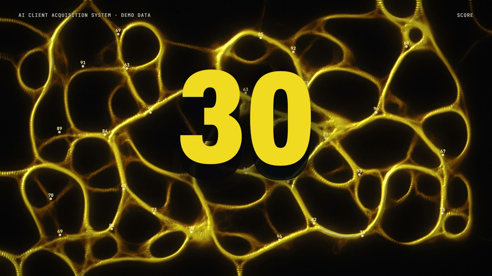

# R45 · Forage

## Purpose

A film for the AI Client Acquisition System, grown by a real agent simulation. Slime mould covers everything and then
keeps only what feeds it, which is the shape of a funnel. Nothing is animated by hand: the film only changes what feeds the agents.

- **One spore:** a point on the first kick and veins feeling their way out.
- **The search:** a living lace covers 500 fictional businesses, each flaring as it's found.
- **Words:** SEARCH and SCORE grow inside their own letters.
- **The contraction:** one held breath, then the weak food stops feeding and the network starves into 30 glowing arteries.
- **One business:** along an artery to a fictional bakery, 87 / 100 and its written reason.
- **A person decides:** a demo email labelled NOT SENT. APPROVE keeps a vein alive; REJECT cuts another, and it dies.
- **Never twice:** contacted businesses turn repellent and the network bends around them.
- **Close:** everything draws back to one point, then the mark, flat.

All businesses, scores and emails are fictional and labelled demo data, and no results are claimed.

**Source release:** [Forage source](https://github.com/jqaisystems/visions-recipes/releases/tag/r45-forage-v1)
· **Prompt, remix template and breakdown:** [RECIPE.md](RECIPE.md)

34.44 s · 1920×1080 · 30 fps · 409,600 agents · €0 to make

## Requirements and commands

Needs Node 22+, Chrome or Edge, FFmpeg on the path, and Python with `pip install numpy`.

    python bake/table.py              # the 500 fictional businesses and the beat grid
    python score/compose.py           # the score, composed in code
    npm run dev       # browser preview, using the version pinned in package.json
    npm run check     # validate the composition
    npm run render    # MP4 to renders/

## Editable elements

1. **The dish.** `bake/table.py` places the fictional businesses, their scores and the 30 that survive.
2. **The rules.** `params()` in `index.html` sets sensor reach, speed, decay and what food pays, by the beat. That's the direction.
3. **The food.** `mask()` in `index.html` redraws one canvas 12 times a beat: red feeds, green repels, blue is words.
4. **The words.** `drawWord()` feeds and clips the grown words. `line()` draws the crisp type, with its halo.
5. **The reach.** `reach()` in `index.html` sets how far the network has spread at each beat.
6. **Your mark.** The end card is the image in `assets/brand/`, placed flat as `#logo`.
7. **The sound.** The score is in `score/compose.py`.

## Source files

- `index.html`: the whole film: the agents, the trail, the mask and the overlay. It replays from one anchor on a back-seek.
- `bake/table.py`: the one table, written to `bake/table.json` and `assets/table.js`. `score/compose.py`: the score.
- `CONCEPT.md`: the concept card for this recipe.

## Credits and licences

- **Code, composition and score:** MIT (see the repo [LICENSE](../../LICENSE)).
- **GSAP** (`assets/vendor/gsap.min.js`): GSAP Standard License, free (gsap.com/standard-license).
- **Fonts:** Archivo and JetBrains Mono are under the SIL Open Font License 1.1 (`assets/fonts/OFL-*.txt`).
- **Not included:** the JQ AI SYSTEMS mark is not part of this repo or its licence. Use your own mark.
- **AI Client Acquisition System:** an internal system that isn't in this repo. Only the film's code is here.

[All recipes](../../docs/catalog.md) · [Setup and first example](../../README.md#first-working-example)
