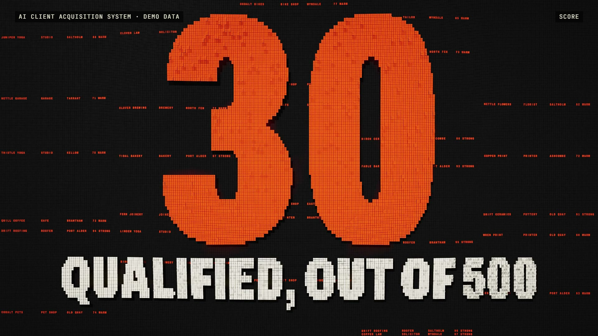

# R46 · Clatter

## Purpose

A film for the AI Client Acquisition System, set on a physical wall of split-flap tiles. A funnel is really a list being
rewritten, so the film makes the list physical: five boards of 100 rows make 500 rows, each one a fictional business.

- **One tile:** macro, one flap, one click. Then a sentence, tile by tile.
- **The search:** rows arrive from the middle out as the camera pulls back to all 500.
- **Words:** SEARCH and SCORE push out of the wall with the data still on their tiles.
- **Scores:** every score spins and settles.
- **The drop:** one held breath, then a wave flips the rows below 40 away and crosses the speakers as it goes, until 30 are left.
- **One business:** macro along a fictional bakery, its 87 and its written reason.
- **A person decides:** the wall types a demo email labelled NOT SENT. APPROVE lights up, and another row is marked REJECTED and flips away.
- **Never twice:** a fresh search crosses the wall, and six CONTACTED rows don't change.
- **Close:** the wall empties towards the first tile, the last flap falls, then the mark, flat.

All businesses, towns, scores and emails are fictional and labelled demo data, and no results are claimed. The towns are
invented names, and some may match real places by chance.

**Source release:** [Clatter source](https://github.com/jqaisystems/visions-recipes/releases/tag/r46-clatter-v1)
· **Prompt, remix template and breakdown:** [RECIPE.md](RECIPE.md)

34.29 s · 1920×1080 · 30 fps · 30,000 tiles · €0 to make

## Requirements and commands

Needs Node 22+, Chrome or Edge, FFmpeg on the path, and Python with `pip install numpy pillow`.

    python bake/table.py              # the schedule of every flap; writes assets/events.js and bake/flips.npz, needed before anything else
    python score/compose.py           # the score, built from that schedule
    npm run dev       # browser preview, using the version pinned in package.json
    npm run check     # validate the composition
    npm run render    # MP4 to renders/

## Editable elements

1. **The rows.** The top of `bake/table.py` writes the 500 fictional businesses, and `rowtext()` lays out each row.
2. **The schedule.** The numbered sections of `bake/table.py` write each scene's flaps with `put()`, `text()` and `mosaic()`.
3. **The words.** `word()` and `lines()` in `bake/table.py` turn type into masks of tiles. Check what fits your widest camera.
4. **The camera.** `KEYS` and `camera()` in `index.html`.
5. **The shockwaves.** `PULSE` in `index.html` sets where and when a wave lifts the wall.
6. **Your mark.** The end card is the image in `assets/brand/`, placed flat as `#logo`.
7. **The sound.** `score/compose.py` reads the schedule: each flap is a click, panned by its column, with resonators for the harmony.

## Source files

- `index.html`: the whole film: instanced tiles and the lens. Tile state comes from the schedule alone, so any frame is exact.
- `bake/table.py`: the fictional rows and the schedule of every flap. `score/compose.py`: the score, built from it.
- `CONCEPT.md`: the concept card for this recipe.

## Credits and licences

- **Code, composition and score:** MIT (see the repo [LICENSE](../../LICENSE)).
- **GSAP** (`assets/vendor/gsap.min.js`): GSAP Standard License, free (gsap.com/standard-license).
- **Fonts:** Archivo and JetBrains Mono are under the SIL Open Font License 1.1 (`assets/fonts/OFL-*.txt`).
- **Not included:** the JQ AI SYSTEMS mark is not part of this repo or its licence. Use your own mark.
- **AI Client Acquisition System:** an internal system that isn't in this repo. Only the film's code is here.

[All recipes](../../docs/catalog.md) · [Setup and first example](../../README.md#first-working-example)
