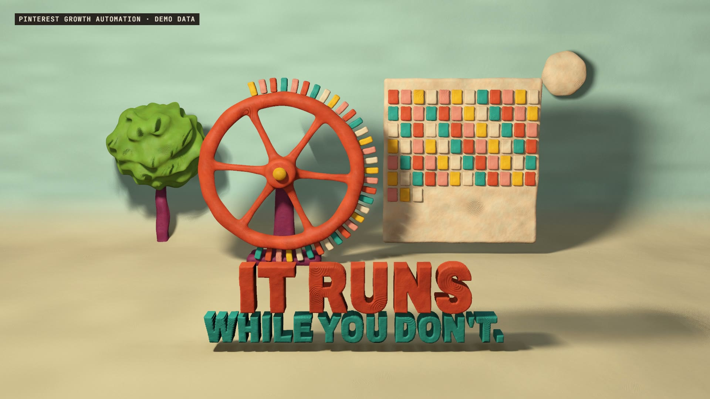

# R47 · Flywheel

## Purpose

A film for Pinterest Growth Automation, a service. Its page calls Pinterest a flywheel, not a faucet, so the film builds the flywheel and
lets it turn, out of a single lump of clay.

- **One lump:** a lump drops, settles with a heavy squash and takes a thumb dent.
- **The strategy:** it flattens and grows into labelled shelves.
- **The batch:** a roller lays a sheet, and a cutter stamps 108 pins, one tick each.
- **One stamp:** one huge stamp on the whole sheet. You approve the batch, not each post.
- **The wheel:** the pins fly up and load onto a heavy wheel beside an empty board.
- **One breath:** silence for a beat and a half.
- **Day one:** one notch, one pin, one note. The days speed up while the seasons pass behind it.
- **It runs:** the wheel turns alone, then the whole machine melts back into the lump, then the mark, flat.

Every pin is invented and labelled demo data. No views, followers, saves or sales are claimed, and the board filling up shows pins posted, not reach.

**Source release:** [Flywheel source](https://github.com/jqaisystems/visions-recipes/releases/tag/r47-flywheel-v1)
· **Prompt, remix template and breakdown:** [RECIPE.md](RECIPE.md)

32 s · 1920×1080 · 30 fps · one lump, 108 pins, 75 days · €0 to make

## Requirements and commands

Needs Node 22+, Chrome or Edge, FFmpeg on the path, and Python with `pip install numpy`.

    python bake/table.py              # the beat grid, the pins and the day of every click; writes assets/table.js, needed before anything else
    python score/compose.py           # the score, composed in code from that table
    npm run dev       # browser preview, using the version pinned in package.json
    npm run check     # validate the composition
    npm run render    # MP4 to renders/

## Editable elements

1. **The table.** `bake/table.py` sets the tempo, the number of pins, the number of days and when each one clicks.
2. **The words.** `WORDS` in `index.html` sets each line, its beats, its place, its size and its colour.
3. **The camera.** `KEYS` in `index.html`: beat, position, target and lens.
4. **The story.** `pose()` in `index.html` turns each pose number into the state of every form.
5. **The clay.** `surf()` and `thumbs()` in the shader set the lumps, thumbprints and tool marks, and the clay colours are named at the top of it.
6. **Your mark.** The end card is the image in `assets/brand/`, placed flat as `#logo`.
7. **The sound.** The score is in `score/compose.py`, and every day's click and note comes from the table.

## Source files

- `index.html`: the shader, the pose logic and the flat 2D layer.
- `bake/table.py`: the one table.
- `score/compose.py`: the score. Needs only NumPy.
- `assets/brand/your-mark.svg`: a placeholder for your own mark.

## Credits and licences

- **Code, composition and score:** MIT (see the repo [LICENSE](../../LICENSE)).
- **GSAP** (`assets/vendor/gsap.min.js`): GSAP Standard License, free (gsap.com/standard-license).
- **Fonts:** Archivo and JetBrains Mono are under the SIL Open Font License 1.1 (`assets/fonts/OFL-*.txt`).
- **Not included:** the JQ AI SYSTEMS mark is not part of this repo or its licence. Use your own mark.
- **Pinterest Growth Automation:** a service that isn't in this repo. Only the film's code is here. Pinterest is a trademark of its owner, and this film isn't affiliated with it.

[All recipes](../../docs/catalog.md) · [Setup and first example](../../README.md#first-working-example)
