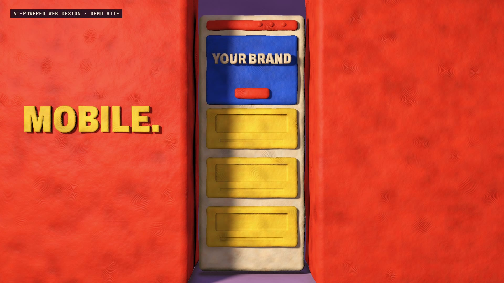

# R48 · Reflow

## Purpose

A film for AI-Powered Web Design, a service. Reflow is the web term for what a layout does when its screen changes, and it's also what clay does, so the
film builds a website out of clay and squeezes it.

- **The brand:** three lumps of colour land, one by one.
- **Not a template:** a mould stamps out nine identical grey sites, and one lump knocks them down like dominoes.
- **Wireframes:** grey coils draw the page on a blank slab.
- **The colour:** blobs land and flood each part with colour.
- **The squeeze:** one held breath, then two walls slam in, and three columns become two, then one, in one take. It springs back with a wobble.
- **The real thing:** a clay cursor presses a clay button, and a ripple runs through the page.
- **The plumbing:** the slab turns round to show pipes running to SCHEMA, SITEMAP and META.
- **Yours:** the site goes into a folder, the flap shuts, then the mark, flat.

The site says only YOUR BRAND and is labelled a demo. No client sites appear, and no speed, scores or results are claimed.

**Source release:** [Reflow source](https://github.com/jqaisystems/visions-recipes/releases/tag/r48-reflow-v1)
· **Prompt, remix template and breakdown:** [RECIPE.md](RECIPE.md)

32.14 s · 1920×1080 · 30 fps · one page, three layouts · €0 to make

## Requirements and commands

Needs Node 22+, Chrome or Edge, FFmpeg on the path, and Python with `pip install numpy`.

    python bake/table.py              # the beat grid and every event; writes assets/table.js, needed before anything else
    python score/compose.py           # the score, composed in code from that table
    npm run dev       # browser preview, using the version pinned in package.json
    npm run check     # validate the composition
    npm run render    # MP4 to renders/

## Editable elements

1. **The layouts.** `LAY` in `index.html` sets the slab and every part of the page for desktop, tablet and phone.
2. **The words.** `WORDS` in `index.html` sets each line, its beats, its place, its size and its colour. `LINES` lists them all, including YOUR BRAND.
3. **The camera.** `KEYS` in `index.html`: beat, position, target and lens.
4. **The story.** `pose()` in `index.html` turns each pose number into the state of every form, and `bake/table.py` holds when things happen.
5. **The backdrop.** `grade()` in `index.html` sets its colours through the film.
6. **Your mark.** The end card is the image in `assets/brand/`, placed flat as `#logo`.
7. **The sound.** The score is in `score/compose.py`, and every event in it comes from the table.

## Source files

- `index.html`: the shader, the pose logic and the flat 2D layer.
- `bake/table.py`: the one table.
- `score/compose.py`: the score. Needs only NumPy.
- `assets/brand/your-mark.svg`: a placeholder for your own mark.

## Credits and licences

- **Code, composition and score:** MIT (see the repo [LICENSE](../../LICENSE)).
- **GSAP** (`assets/vendor/gsap.min.js`): GSAP Standard License, free (gsap.com/standard-license).
- **Fonts:** Archivo and JetBrains Mono are under the SIL Open Font License 1.1 (`assets/fonts/OFL-*.txt`).
- **Not included:** the JQ AI SYSTEMS mark is not part of this repo or its licence. Use your own mark.
- **AI-Powered Web Design:** a service that isn't in this repo. Only the film's code is here.

[All recipes](../../docs/catalog.md) · [Setup and first example](../../README.md#first-working-example)
