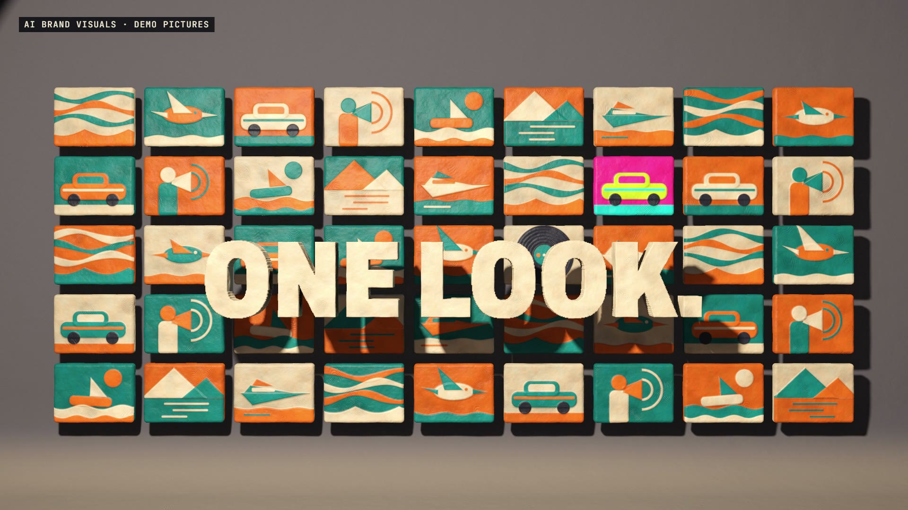

# R49 · Mould

## Purpose

A film for AI Brand Visuals, a service. A style system is hard to picture, and a mould isn't, so the film squashes mismatched pictures into one lump, builds a press from the
four parts of the system, and presses out a wall that belongs together.

- **The mismatch:** six clay pictures land in six clashing colour schemes, each with a wrong note.
- **The lump:** they're squashed into one marbled ball, and its colours twist as it's kneaded.
- **The press:** REFERENCES, RECIPES, RULES and DO-NOT slide onto a screw and lock, and the marbling settles into one palette.
- **The first set:** one slow press, six pictures, and a thumb marks each one.
- **The run:** the press is the kick, and more pictures fly to the wall on every slam, until the camera has pulled back to all 45.
- **The do-not:** one picture is hot pink. The band stops, and a heavy stamp flattens it.
- **It moves:** a boat rocks, a bird flaps and a record spins.
- **Yours:** the press slides to the camera, then the mark, flat.

The clay pictures are demos, and a label on screen says so. This film is code and the service makes AI visuals. No client work appears, and no prices or results are claimed.

**Source release:** [Mould source](https://github.com/jqaisystems/visions-recipes/releases/tag/r49-mould-v1)
· **Prompt, remix template and breakdown:** [RECIPE.md](RECIPE.md)

32.88 s · 1920×1080 · 30 fps · 45 pictures on one shape · €0 to make

## Requirements and commands

Needs Node 22+, Chrome or Edge, FFmpeg on the path, and Python with `pip install numpy`.

    python bake/table.py              # the beat grid and every event; writes assets/table.js, needed before anything else
    python score/compose.py           # the score, composed in code from that table
    npm run dev       # browser preview, using the version pinned in package.json
    npm run check     # validate the composition
    npm run render    # MP4 to renders/

## Editable elements

1. **The pictures.** `pic()` in `index.html` draws each one as layers of 2D distance fields, and `pal()` holds the colours.
2. **The words.** `WORDS` in `index.html` sets each line, its beats, its place, its size and its colour.
3. **The camera and the light.** `KEYS` and `SPOTS` in `index.html`: beat, position, target and lens, then beat, target and cone angle.
4. **The story.** `bake/table.py` holds when things happen, and the pose logic in `index.html` turns each pose number into the state of every form.
5. **The wall.** `COLS`, `ROWS` and `PINK` in `index.html`. The shader's wall scene has the same grid written into it, so change both.
6. **Your mark.** The end card is the image in `assets/brand/`, placed flat as `#logo`.
7. **The sound.** The score is in `score/compose.py`, and every event in it comes from the table.

## Source files

- `index.html`: the shader, the pose logic and the flat 2D layer.
- `bake/table.py`: the one table.
- `score/compose.py`: the score. Needs only NumPy.
- `assets/brand/your-mark.svg`: a placeholder for your own mark.

## Credits and licences

- **Code, composition and score:** MIT (see the repo [LICENSE](../../LICENSE)).
- **GSAP** (`assets/vendor/gsap.min.js`): GSAP Standard License, free (gsap.com/standard-license).
- **Fonts:** Archivo and JetBrains Mono are under the SIL Open Font License 1.1 (`assets/fonts/OFL-*.txt`).
- **Not included:** the JQ AI SYSTEMS mark is not part of this repo or its licence. Use your own mark.
- **AI Brand Visuals:** a service that isn't in this repo. Only the film's code is here.

[All recipes](../../docs/catalog.md) · [Setup and first example](../../README.md#first-working-example)
