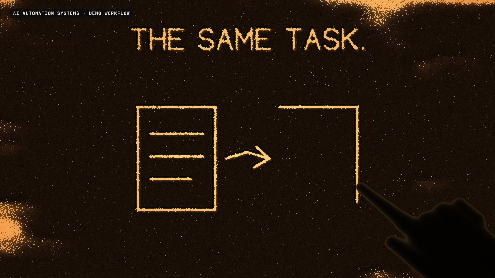

# R51 · Hands Off

## Purpose

A film for AI Automation Systems, a service. A sand artist has to draw everything by hand, wipe it and draw it again, which is what a repetitive task is. So a fingertip does exactly that, then lifts off the table, and the sand carries on without it.

- **Light on:** a click, amber light, and sand pours in.
- **The same task:** drawn, wiped and drawn again, faster each time.
- **Plain English:** IF YOU CAN DESCRIBE IT...
- **The map:** boxes and handoffs, pressed in deep. MAPPED BEFORE ANY CODE.
- **The code:** a short demo script, written faster than a hand should go.
- **Hands off:** one last dot, the hand lifts away, and the music nearly stops.
- **The wall:** a sweep nobody made, then 32 copies that land whole on one downbeat.
- **On your schedule:** the light cools to night, and the copies keep redrawing.
- **Yours:** morning, a folder laid in dark sand, and the light clicks off.

The workflow and the script are demos, and a label on screen says so. No client work appears, and no prices or results are claimed.

**Source release:** [Hands Off source](https://github.com/jqaisystems/visions-recipes/releases/tag/r51-hands-off-v1)
· **Prompt, remix template and breakdown:** [RECIPE.md](RECIPE.md)

33.6 s · 1920×1080 · 30 fps · one height per pixel · €0 to make

## Requirements and commands

Needs Node 22+, Chrome or Edge, FFmpeg on the path, and Python with `pip install numpy`.

    python bake/table.py              # the one table: every stroke, written to assets/table.js
    python score/compose.py           # the score, composed in code from that table
    npm run dev       # browser preview, using the version pinned in package.json
    npm run check     # validate the composition
    npm run render    # MP4 to renders/

## Editable elements

1. **The timing and every stroke.** `bake/table.py` holds the beat grid and every mark. The film and the score both read what it writes.
2. **The words.** Single-stroke letters are drawn by hand in the `F` table in `bake/table.py`, and `draw(fit(...))` calls place them.
3. **What's drawn.** `task` in `bake/table.py` is the drawing that repeats. Change it and the wall changes with it.
4. **The lift.** `lift`, `offF` and `alone` in `bake/table.py` set when the finger leaves and when the sand carries on.
5. **The sand.** `STROKES` and `SLUMP` in `index.html` move it, and `SHADE` is the light through it.
6. **Your mark.** The end card is the image in `assets/brand/`, placed flat as `#logo`.
7. **The sound.** The score is in `score/compose.py`, and every stroke in it comes from the table.

## Source files

- `index.html`: the stage, the shaders, the audio and the timeline.
- `bake/table.py`: the one table, standard library only.
- `score/compose.py`: the score. Needs only NumPy.
- `assets/brand/your-mark.svg`: a placeholder for your own mark.

## Credits and licences

- **Code, composition and score:** MIT (see the repo [LICENSE](../../LICENSE)).
- **GSAP** (`assets/vendor/gsap.min.js`): GSAP Standard License, free (gsap.com/standard-license).
- **Fonts:** Archivo and JetBrains Mono are under the SIL Open Font License 1.1 (`assets/fonts/OFL-*.txt`).
- **Not included:** the JQ AI SYSTEMS mark is not part of this repo or its licence. Use your own mark.
- **AI Automation Systems:** a service that isn't in this repo. Only the film's code is here.

[All recipes](../../docs/catalog.md) · [Setup and first example](../../README.md#first-working-example)
