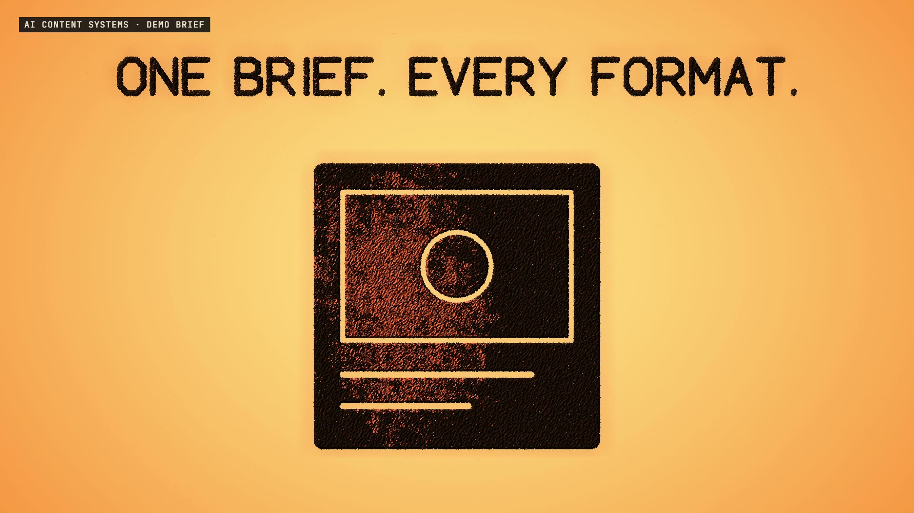

# R52 · Same Sand

## Purpose

A film for AI Content Systems, a service. A sand animator never brings in new sand for the next picture: they push the same sand into a new shape. So once the voice is poured in, no grain is added or taken away, and the same sand becomes every format.

- **Light on:** a click, amber light, and a stream of sand builds one pile.
- **One brief:** the pile flows into a card with the brief cut into it.
- **In your voice:** terracotta sand pours in and is pulled through the card.
- **Anti-patterns out:** a stock phrase forms in sand and is struck through.
- **Every format:** a post, an email, a caption and a carousel, each landing on a downbeat.
- **Four languages:** one line in sand, in four languages.
- **The review:** a fingertip ticks two drafts and strikes the third, which flows back out rewritten.
- **A month at a time:** a calendar fills row by row out of one shrinking pile.
- **Yours:** a document, and the light clicks off.

The brand, the brief and the drafts are demos, and a label on screen says so. No client work appears, and no prices or results are claimed.

**Source release:** [Same Sand source](https://github.com/jqaisystems/visions-recipes/releases/tag/r52-same-sand-v1)
· **Prompt, remix template and breakdown:** [RECIPE.md](RECIPE.md)

36.25 s · 1920×1080 · 30 fps · 240,000 grains · €0 to make

## Requirements and commands

Needs Node 22+, Chrome or Edge, FFmpeg on the path, and Python with `pip install numpy`.

    python bake/table.py              # the one table: every picture and flow, written to assets/table.js
    python score/compose.py           # the score, composed in code from that table
    npm run dev       # browser preview, using the version pinned in package.json
    npm run check     # validate the composition
    npm run render    # MP4 to renders/

## Editable elements

1. **The timing and every picture.** `bake/table.py` holds the beat grid, every picture and every flow. The film and the score both read what it writes.
2. **The words.** Letters are drawn by hand in the `F` table in `bake/table.py`, and the mark helpers `block`, `cut`, `sand` and `bar` place them.
3. **The pictures.** `pic()` and `flow()` in `bake/table.py` define each shape and when the sand flows into it.
4. **The grains.** `ND` and `NT` in `index.html` set how many dark and tinted grains there are, and `ITERS` how many transport directions.
5. **The light.** `SHADE` in `index.html` is the light through the sand, including the terracotta tint.
6. **Your mark.** The end card is the image in `assets/brand/`, placed flat as `#logo`.
7. **The sound.** The score is in `score/compose.py`, and every flow in it comes from the table.

## Source files

- `index.html`: the stage, the grain engine, the shaders, the audio and the timeline.
- `bake/table.py`: the one table, standard library only.
- `score/compose.py`: the score. Needs only NumPy.
- `assets/brand/your-mark.svg`: a placeholder for your own mark.

## Credits and licences

- **Code, composition and score:** MIT (see the repo [LICENSE](../../LICENSE)).
- **GSAP** (`assets/vendor/gsap.min.js`): GSAP Standard License, free (gsap.com/standard-license).
- **Fonts:** Archivo and JetBrains Mono are under the SIL Open Font License 1.1 (`assets/fonts/OFL-*.txt`).
- **Not included:** the JQ AI SYSTEMS mark is not part of this repo or its licence. Use your own mark.
- **AI Content Systems:** a service that isn't in this repo. Only the film's code is here.

[All recipes](../../docs/catalog.md) · [Setup and first example](../../README.md#first-working-example)
