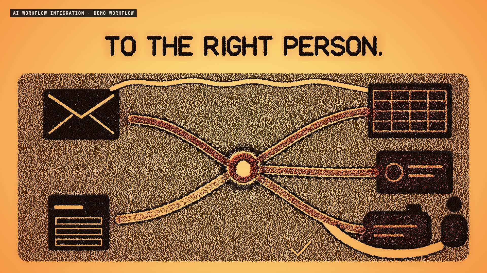

# R53 · Channels

## Purpose

A film for AI Workflow Integration, a service. The tools stay where they are, and the connections between them get smart: on a sand table, that's a riverbed. What the hand draws decides where the sand goes.

- **Your tools:** five islands of sand, with the work piled up between them.
- **The map:** a fingertip draws every route as a thin line, and a tick approves it.
- **Connected:** the lines widen into channels and the work starts to run.
- **The decision layer:** every stream runs into one basin and leaves split, with a fork to a person.
- **When it fails:** a bank slips into a channel, the work backs up, and a mark lights beside it until it's cleared.
- **Shadow run:** the old furrow and the new channel run side by side, then the old one is swept away.
- **Yours:** the streams keep running, and the light clicks off.

The workflow, the requests and the reply are demos, and a label on screen says so. The tools are shapes with no names. No client work appears, and no prices or results are claimed.

**Source release:** [Channels source](https://github.com/jqaisystems/visions-recipes/releases/tag/r53-channels-v1)
· **Prompt, remix template and breakdown:** [RECIPE.md](RECIPE.md)

36.25 s · 1920×1080 · 30 fps · 436,000 grains · €0 to make

## Requirements and commands

Needs Node 22+, Chrome or Edge, FFmpeg on the path, and Python with `pip install numpy`.

    python bake/table.py              # the one table: islands, cuts, streams and captions, written to assets/table.js
    python score/compose.py           # the score, composed in code from that table
    npm run dev       # browser preview, using the version pinned in package.json
    npm run check     # validate the composition
    npm run render    # MP4 to renders/

## Editable elements

1. **The timing.** `bake/table.py` holds the beat grid and every time in the film. The film and the score both read what it writes.
2. **The islands.** `ISL` and `island_marks()` in `bake/table.py` place each tool as a plain shape, and `PERSON` the small figure.
3. **The routes.** `ROUTE_IN`, `ROUTE_OUT` and `FURROW` in `bake/table.py` are the channels; `chan()` gives each cut its draw, widen and erase times.
4. **The words.** Captions are drawn by hand in the `F` table in `bake/table.py` and listed in `CAPS`.
5. **The grains.** `NL`, `NC` and `NT` in `index.html` set how many grains make the sheet, the captions and the work, and `GV` pushes the sheet aside along every cut.
6. **The light.** `SHADE` in `index.html` is the light through the sand, including the terracotta.
7. **Your mark.** The end card is the image in `assets/brand/`, placed flat as `#logo`.
8. **The sound.** The score is in `score/compose.py`, and every stream in it comes from the table.

## Source files

- `index.html`: the stage, the grain engine, the shaders, the audio and the timeline.
- `bake/table.py`: the one table, standard library only.
- `score/compose.py`: the score. Needs only NumPy.
- `assets/brand/your-mark.svg`: a placeholder for your own mark.

## Credits and licences

- **Code, composition and score:** MIT (see the repo [LICENSE](../../LICENSE)).
- **GSAP** (`assets/vendor/gsap.min.js`): GSAP Standard License, free (gsap.com/standard-license).
- **Fonts:** Archivo and JetBrains Mono are under the SIL Open Font License 1.1 (`assets/fonts/OFL-*.txt`).
- **Not included:** the JQ AI SYSTEMS mark is not part of this repo or its licence. Use your own mark.
- **AI Workflow Integration:** a service that isn't in this repo. Only the film's code is here.

[All recipes](../../docs/catalog.md) · [Setup and first example](../../README.md#first-working-example)
