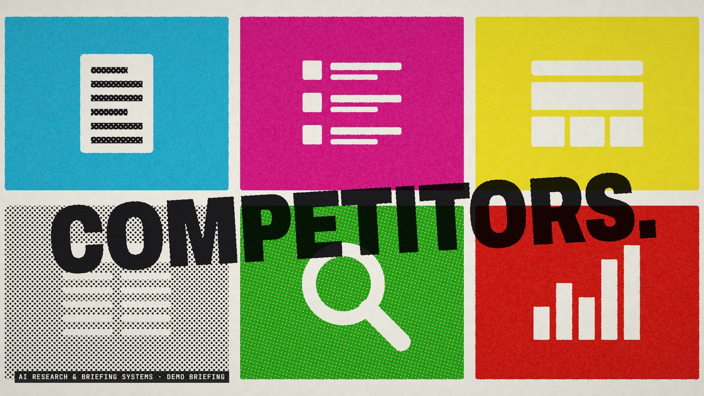

# R54 · Register

## Purpose

A film for AI Research & Briefing Systems, a service. It watches the sources that matter and writes up only what changed, and why. On a press, that's registration: out of register the world is noise, and in register it's sharp.

- **Out of one dot:** the film opens inside a single cyan dot and pulls back to the words, the plates locking into register.
- **Everything at once:** six source tiles slam in on the beat, then the plates slide apart and the noise rises.
- **The key plate:** black ink only, and the knowledge document draws itself line by line.
- **The roller:** a roller wipes the noise away, and what matters locks into register on three clacks.
- **The press:** a whip down to a running press that stops on the briefing, printed one line and one ink at a time.
- **On schedule:** sheets are dealt onto a grid of days, daily or weekly.
- **Yours:** a folder, the plates fan apart into their separations, and black ink floods the sheet.

The sources, the field and the briefing are demos, and a label on screen says so. The sources are shapes with no names. No client work appears, and no prices or results are claimed.

**Source release:** [Register source](https://github.com/jqaisystems/visions-recipes/releases/tag/r54-register-v1)
· **Prompt, remix template and breakdown:** [RECIPE.md](RECIPE.md)

37 s · 1920×1080 · 30 fps · four plates, one shader · €0 to make

## Requirements and commands

Needs Node 22+, Chrome or Edge, FFmpeg on the path, and Python with `pip install numpy`.

    python bake/table.py              # the one table: scenes, slams, locks and words, written to assets/table.js
    python score/compose.py           # the score, composed in code from that table
    npm run dev       # browser preview, using the version pinned in package.json
    npm run check     # validate the composition
    npm run render    # MP4 to renders/

## Editable elements

1. **The timing.** `bake/table.py` holds the beat grid, the scenes (`SC`) and every slam, lock, whip and deal. The film and the score both read what it writes.
2. **The words.** `WORDS` in `bake/table.py`: each line's beats in and out, its ink mix and where it sits. `BRIEF` is the demo briefing.
3. **The sources.** `TILES` and `icon()` in `index.html` are the six source tiles as plain shapes, and `KEEP` picks the ones that matter.
4. **The screen.** `CELL` and the `plate()` function in the shader in `index.html` set the dot size, the screen angles, the dot gain and the noise.
5. **The inks and the paper.** The four ink colours and the paper are at the end of the shader's `main()`.
6. **Registration.** `DIRS` and `offsets()` in `index.html` set which way and how far each plate is out of register over time.
7. **Your mark.** The end card is the image in `assets/brand/`, placed flat as `#logo`.
8. **The sound.** The score is in `score/compose.py`, and every hit in it comes from the table.

## Source files

- `index.html`: the stage, the two ink canvases, the halftone shader, the audio and the timeline.
- `bake/table.py`: the one table, standard library only.
- `score/compose.py`: the score. Needs only NumPy.
- `assets/brand/your-mark.svg`: a placeholder for your own mark.

## Credits and licences

- **Code, composition and score:** MIT (see the repo [LICENSE](../../LICENSE)).
- **GSAP** (`assets/vendor/gsap.min.js`): GSAP Standard License, free (gsap.com/standard-license).
- **Fonts:** Archivo and JetBrains Mono are under the SIL Open Font License 1.1 (`assets/fonts/OFL-*.txt`).
- **Not included:** the JQ AI SYSTEMS mark is not part of this repo or its licence. Use your own mark.
- **AI Research & Briefing Systems:** a service that isn't in this repo. Only the film's code is here.

[All recipes](../../docs/catalog.md) · [Setup and first example](../../README.md#first-working-example)
