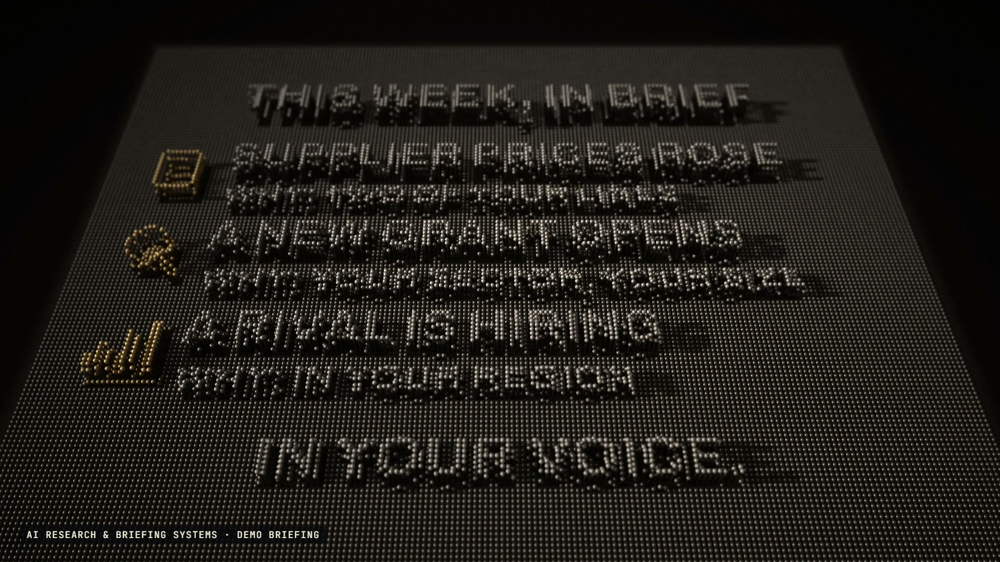

# R55 · Overview

## Purpose

A film for AI Research & Briefing Systems, a service. It watches the sources that matter and writes up only what changed, and why. That's perspective: from the ground the sources are noise, and from above they're a briefing.

- **Ground level:** a lamp comes on over the pins at head height, and the camera lifts off to the first words.
- **The flight:** words rise out of the field just ahead of the camera on the beat, each with a ripple, the sources rising alongside.
- **Down here:** the camera drops into the noise while the sources slam up all around.
- **From above:** a crane straight up while the noise settles from the middle out, and the knowledge document rises.
- **The filter:** everything that doesn't matter drops, and what's left turns brass.
- **Written up:** a dive down to the briefing as it rises line by line, then a pull back to read it whole.
- **On schedule and yours:** the briefing rises on a grid of days, a brass folder rises, and the camera pulls out to the whole field.

The sources, the field and the briefing are demos, and a label on screen says so. The sources are shapes with no names. No client work appears, and no prices or results are claimed.

**Source release:** [Overview source](https://github.com/jqaisystems/visions-recipes/releases/tag/r55-overview-v1)
· **Prompt, remix template and breakdown:** [RECIPE.md](RECIPE.md)

36 s · 1920×1080 · 30 fps · 61,440 pins, one shader · €0 to make

## Requirements and commands

Needs Node 22+, Chrome or Edge, FFmpeg on the path, and Python with `pip install numpy`. The shader traces every pixel, so a GPU helps.

    python bake/table.py              # the one table: every word, source, ripple, light and camera key, written to assets/table.js
    python bake/table.py -v           # the same, and where each caption lands on screen
    python score/compose.py           # the score, composed in code from that table
    npm run dev       # browser preview, using the version pinned in package.json
    npm run check     # validate the composition
    npm run render    # MP4 to renders/

## Editable elements

1. **The words.** The `cap()` calls in `bake/table.py`: each caption's text, where it sits on the field, its size and its beats in and out. `BRIEF` is the demo briefing.
2. **The sources.** `page()`, `feed()`, `site()`, `lens()` and `chart()` in `bake/table.py` are the source shapes, drawn as reliefs in pin units.
3. **The camera.** `CAM` in `bake/table.py`: each key is a beat and a position, or `aim()`, which frames a caption from a yaw and a pitch. The camera is baked per frame.
4. **The field.** `NX`, `NZ` and `EXT` in `bake/table.py` set how many pins and how far they rise. `NOISE`, `FLAT` and `RINGS` are the noise, the settling and the ripples.
5. **The metal and the light.** The shader in `index.html` holds the steel, the brass, the room they reflect and the shadows. `LIGHT` in `bake/table.py` moves the lamp.
6. **Your mark.** The end card is the image in `assets/brand/`, placed flat as `#logo`.
7. **The sound.** The score is in `score/compose.py`, and every hit in it comes from the table.

## Source files

- `index.html`: the stage, the pin heights per frame, the ray-tracing shader, the depth of field pass, the audio and the timeline.
- `bake/table.py`: the one table, standard library only.
- `score/compose.py`: the score. Needs only NumPy.
- `assets/brand/your-mark.svg`: a placeholder for your own mark.

## Credits and licences

- **Code, composition and score:** MIT (see the repo [LICENSE](../../LICENSE)).
- **GSAP** (`assets/vendor/gsap.min.js`): GSAP Standard License, free (gsap.com/standard-license).
- **Fonts:** Archivo and JetBrains Mono are under the SIL Open Font License 1.1 (`assets/fonts/OFL-*.txt`).
- **Not included:** the JQ AI SYSTEMS mark is not part of this repo or its licence. Use your own mark.
- **AI Research & Briefing Systems:** a service that isn't in this repo. Only the film's code is here.

[All recipes](../../docs/catalog.md) · [Setup and first example](../../README.md#first-working-example)
