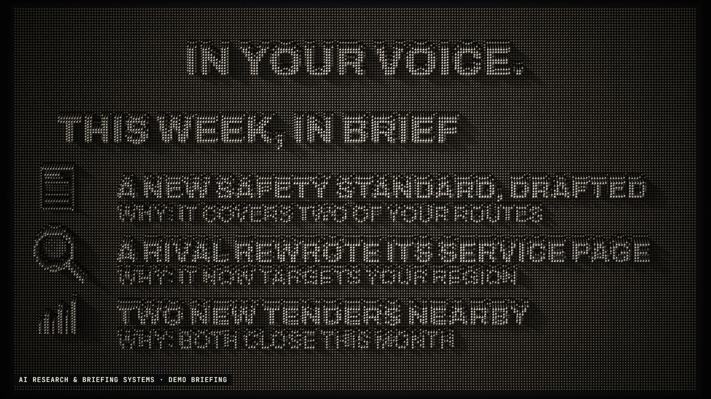

# R56 · Pressed

## Purpose

A film for AI Research & Briefing Systems, a service. It watches the sources that matter and writes up only what changed, and why. On a pin screen that's literal: the world presses in from every side, and the system decides what leaves a mark.

- **The wall:** a lamp comes on across a flat wall of steel pins, and a ripple runs through it.
- **Pressed in:** the sources push in from behind, one after another and then all at once, until the wall is noise.
- **What you know:** one structured page is pressed in softly underneath and stays.
- **The filter:** one wave rolls across the wall and flattens everything that doesn't matter.
- **Written up:** what's left slides into a column and becomes the bullets of a briefing, pushed up out of the wall line by line.
- **On schedule and yours:** the briefing presses up on a grid of days, a folder presses up, and the lamp slides off.

The sources, the field and the briefing are demos, and a label on screen says so. The sources are shapes with no names. No client work appears, and no prices or results are claimed.

**Source release:** [Pressed source](https://github.com/jqaisystems/visions-recipes/releases/tag/r56-pressed-v1)
· **Prompt, remix template and breakdown:** [RECIPE.md](RECIPE.md)

38 s · 1920×1080 · 30 fps · 36,864 pins, one shader · €0 to make

## Requirements and commands

Needs Node 22+, Chrome or Edge, FFmpeg on the path, and Python with `pip install numpy`. The shader checks a few pins for every pixel, so a GPU helps.

    python bake/table.py              # the one table: every relief, the noise, the wave, the light and the captions, written to assets/table.js
    python score/compose.py           # the score, composed in code from that table
    npm run dev       # browser preview, using the version pinned in package.json
    npm run check     # validate the composition
    npm run render    # MP4 to renders/

## Editable elements

1. **The words.** `CAPS` in `bake/table.py`: each caption's text and its beats in and out. `BRIEF` is the demo briefing.
2. **The sources.** `page()`, `feed()`, `site()`, `lens()`, `chart()` and `knowledge()` in `bake/table.py` are the reliefs, drawn in screen pixels.
3. **The timing.** Every `L()` call is a layer: its marks, its keys (beat and weight), which way the pins follow (`x`, `y`, `r` or `n`) and how spread out they are. `move` slides and shrinks a relief.
4. **The wall.** `NX`, `NY`, `PITCH` and `EXT` in `bake/table.py` set how many pins, how far apart and how far they slide out. `NOISE` and `WAVE` are the noise and the filter.
5. **The metal and the light.** The shader in `index.html` holds the steel, the holes and the shadows. `LIGHT` in `bake/table.py` moves the lamp, and `CAM` sets the perspective.
6. **Your mark.** The end card is the image in `assets/brand/`, placed flat as `#logo`.
7. **The sound.** The score is in `score/compose.py`, and every hit in it comes from the table.

## Source files

- `index.html`: the stage, the pin heights per frame, the shader, the audio and the timeline.
- `bake/table.py`: the one table, standard library only.
- `score/compose.py`: the score. Needs only NumPy.
- `assets/brand/your-mark.svg`: a placeholder for your own mark.

## Credits and licences

- **Code, composition and score:** MIT (see the repo [LICENSE](../../LICENSE)).
- **GSAP** (`assets/vendor/gsap.min.js`): GSAP Standard License, free (gsap.com/standard-license).
- **Fonts:** Archivo and JetBrains Mono are under the SIL Open Font License 1.1 (`assets/fonts/OFL-*.txt`).
- **Not included:** the JQ AI SYSTEMS mark is not part of this repo or its licence. Use your own mark.
- **AI Research & Briefing Systems:** a service that isn't in this repo. Only the film's code is here.

[All recipes](../../docs/catalog.md) · [Setup and first example](../../README.md#first-working-example)
