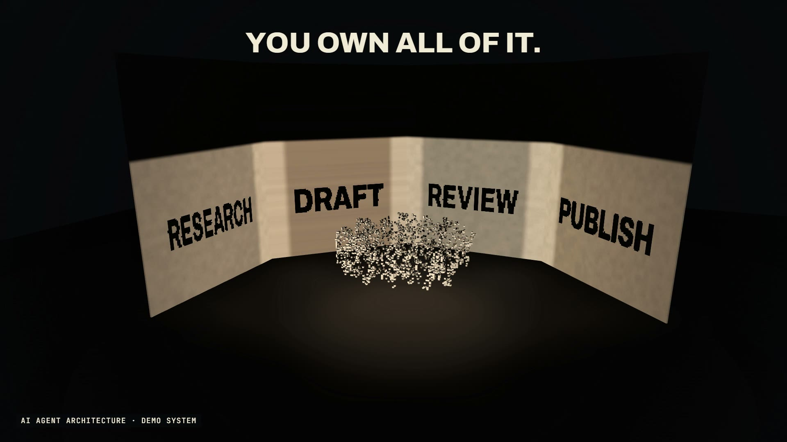

# R58 · Casting

## Purpose

A film for AI Agent Architecture, a service. Its idea: one system and one shared memory, with each agent casting its own output. A shadow sculpture does exactly that: one object, and every lamp throws a different shadow.

- **One system:** a lattice of small blocks turns in a dark room. From every side it's a tangle.
- **One role each:** three lamps light in turn, and RESEARCH, DRAFT and REVIEW land on three walls, all from the same blocks.
- **One shared memory:** the camera moves into each lamp's line and the tangle locks into its word.
- **Handoffs:** each lamp in turn, a thin line of light running along the walls from word to word, then a head and shoulders steps into REVIEW's light.
- **A new agent:** a fourth lamp swings in, and the lattice rebuilds itself block by block until PUBLISH lands.
- **The honest turn:** every block slides into one plain cube with one plain shadow, because sometimes one prompt is enough. Then back out to four words.

The system is a demo, and a label on screen says so. Research, draft and review are the service page's own example roles. No client work appears, no tools or models are named, and no prices or results are claimed.

**Source release:** [Casting source](https://github.com/jqaisystems/visions-recipes/releases/tag/r58-casting-v1)
· **Prompt, remix template and breakdown:** [RECIPE.md](RECIPE.md)

40 s · 1920×1080 · 30 fps · one carved lattice, four real shadow maps · €0 to make

## Requirements and commands

Needs Node 22+, Chrome or Edge, FFmpeg on the path, and Python with `pip install numpy pillow`. Every block is real geometry and every lamp has its own shadow map, with 4x antialiasing, so a GPU helps.

    python bake/carve.py              # the carving: the lattices that cast the words, written to assets/blocks.js (and proof sheets to work/)
    python bake/table.py              # the one table: the lamps, the turn, the rebuild, the collapse, the camera and the captions, written to assets/table.js
    python score/compose.py           # the score, composed in code from that table
    npm run dev       # browser preview, using the version pinned in package.json
    npm run check     # validate the composition
    npm run render    # MP4 to renders/

## Editable elements

1. **The words the shadows cast.** `LAMPS` in `bake/carve.py`: each lamp's word, its direction across the floor and how wide the word sits on its wall. Keep the lamps level; `python bake/carve.py --dry` prints how many pixels each word loses before you write anything.
2. **The lattice.** `N` and `H` in `bake/carve.py` set the grid, and the seed passed to `carve()` sets which tangle you get. `WGHT` and `WDTH` set the font's weight and width.
3. **The captions.** `CAPS` in `bake/table.py`: each line's text and its beats in and out. `RUNS` is the small teal line, and `BEAM` the handoffs.
4. **The lamps.** `ON`, `HAND` and `lamp_keys()` in `bake/table.py` say when each lamp lights, dims and goes out; `LAMP_COL` is each lamp's warm white, and `SWING` how the fourth one swings in.
5. **The motion.** `TURN`, `REBUILD`, `COLLAPSE`, `EXPAND` and `SHARED` in `bake/table.py` time the lattice's turn, the rebuild, the collapse into one cube and the warm glow on shared blocks.
6. **The person.** `HUMAN` in `bake/table.py` places the head and shoulders, and `BUST` in `index.html` draws its profile.
7. **The camera.** `CAM` in `bake/table.py` holds the camera keys; `along()` puts the camera back along a lamp's line.
8. **Your mark.** The end card is the image in `assets/brand/`, placed flat as `#logo`.
9. **The sound.** The score is in `score/compose.py`: `NOTE` is each lamp's hum.

## Source files

- `index.html`: the stage, every block and lamp per frame, the WebGL2 renderer with its shadow maps, the overlay, the audio and the timeline.
- `bake/carve.py`: the carving. Needs NumPy and Pillow.
- `bake/table.py`: the one table, standard library only.
- `score/compose.py`: the score. Needs only NumPy.
- `assets/brand/your-mark.svg`: a placeholder for your own mark.

## Credits and licences

- **Code, composition and score:** MIT (see the repo [LICENSE](../../LICENSE)).
- **GSAP** (`assets/vendor/gsap.min.js`): GSAP Standard License, free (gsap.com/standard-license).
- **Fonts:** Archivo and JetBrains Mono are under the SIL Open Font License 1.1 (`assets/fonts/OFL-*.txt`).
- **Not included:** the JQ AI SYSTEMS mark is not part of this repo or its licence. Use your own mark.
- **AI Agent Architecture:** a service that isn't in this repo. Only the film's code is here.

[All recipes](../../docs/catalog.md) · [Setup and first example](../../README.md#first-working-example)
