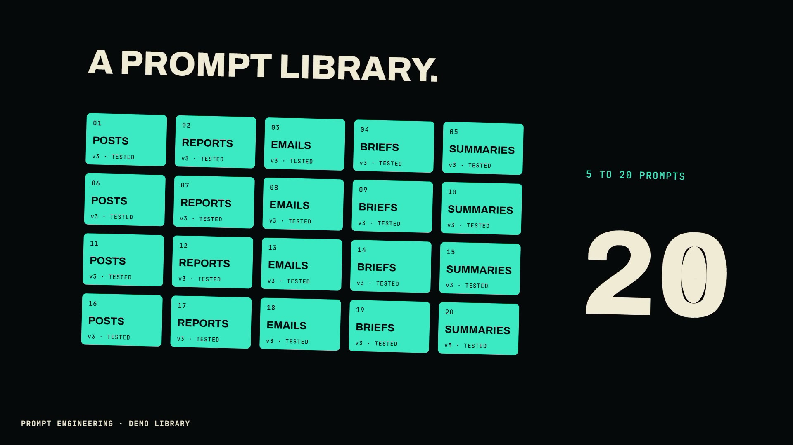

# R59 · Counter

## Purpose

A film for Prompt Engineering, a service. Its idea: look inside one good prompt and there's a whole library behind it. So every scene lives inside a hole in the scene before, and the camera dives through six of them without a cut.

- **The prompt:** "WRITE IT IN OUR VOICE." is typed, and the O of VOICE opens.
- **A voice spec:** three dials turn to PLAIN, SHORT and OURS, and a sample sentence answers them. The last knob opens.
- **An anti-pattern library:** eight clichés are struck out in red, then "CAUGHT AT PROMPT LEVEL", whose full stop opens.
- **Domain knowledge:** a network grows round one node, and the node opens.
- **A prompt library:** twenty cards are dealt while a count runs to 20, then flip to tested. The 0 of 20 opens.
- **Multi-step chains:** draft, critique, rewrite, and the rewrite's full stop opens onto the close.

The library is a demo, and a label on screen says so. The clichés, the sample sentences and the network labels are demo content. No client work appears, no tools or models are named, and no prices or results are claimed.

**Source release:** [Counter source](https://github.com/jqaisystems/visions-recipes/releases/tag/r59-counter-v1)
· **Prompt, remix template and breakdown:** [RECIPE.md](RECIPE.md)

42 s · 1920×1080 · 30 fps · one camera move through six counters · €0 to make

## Requirements and commands

Needs Node 22+, Chrome or Edge, FFmpeg on the path, and Python with `pip install numpy` for the score. It's all Canvas 2D, so no GPU is needed, but the 12-sample motion blur on each dive makes those frames slower to render.

    python bake/table.py              # the one table: the beat grid, the dives, the turns and every event, written to assets/table.js
    python score/compose.py           # the score, composed in code from that table
    npm run dev       # browser preview, using the version pinned in package.json
    npm run check     # validate the composition
    npm run render    # MP4 to renders/

## Editable elements

1. **The dives.** `DIVES` in `bake/table.py`: the beat each dive starts and lands. `TURN` is how far each scene is turned inside its counter, and `LEAD` how early each scene starts so the dive shows it.
2. **The prompt.** `PROMPT`, `TYPE0` and `TYPE_STEP` in `bake/table.py`. If you change it, move the first door in `initPorts()` in `index.html` to the letter whose hole you want.
3. **The scenes.** `S[0]` to `S[6]` in `index.html`, one function each, every one drawn in its own full frame from its own time in beats. `BG` is each scene's ground colour.
4. **The doors.** `initPorts()` in `index.html`: where each scene's counter is. `counterOf()` finds the hole in any glyph; dots and knobs are given as a centre and a radius.
5. **The content.** `KNOBS`, `CLICHES`, `NODES`, `KINDS`, `CHAIN` and `CLOSE` in `bake/table.py`.
6. **The finish.** `paintBlur()` in `index.html` sets the motion blur samples and shutter, and `frameAt()` the punch on each landing.
7. **Your mark.** The end card is the image in `assets/brand/`, placed flat as `#logo`.
8. **The sound.** The score is in `score/compose.py`: `PROG` is the chord progression, and each scene has its own part.

## Source files

- `index.html`: the stage, every scene, the counters, the spiral camera, the motion blur, the audio and the timeline.
- `bake/table.py`: the one table, standard library only.
- `score/compose.py`: the score. Needs only NumPy.
- `assets/brand/your-mark.svg`: a placeholder for your own mark.

## Credits and licences

- **Code, composition and score:** MIT (see the repo [LICENSE](../../LICENSE)).
- **GSAP** (`assets/vendor/gsap.min.js`): GSAP Standard License, free (gsap.com/standard-license).
- **Fonts:** Archivo and JetBrains Mono are under the SIL Open Font License 1.1 (`assets/fonts/OFL-*.txt`).
- **Not included:** the JQ AI SYSTEMS mark is not part of this repo or its licence. Use your own mark.
- **Prompt Engineering:** a service that isn't in this repo. Only the film's code is here.

[All recipes](../../docs/catalog.md) · [Setup and first example](../../README.md#first-working-example)
