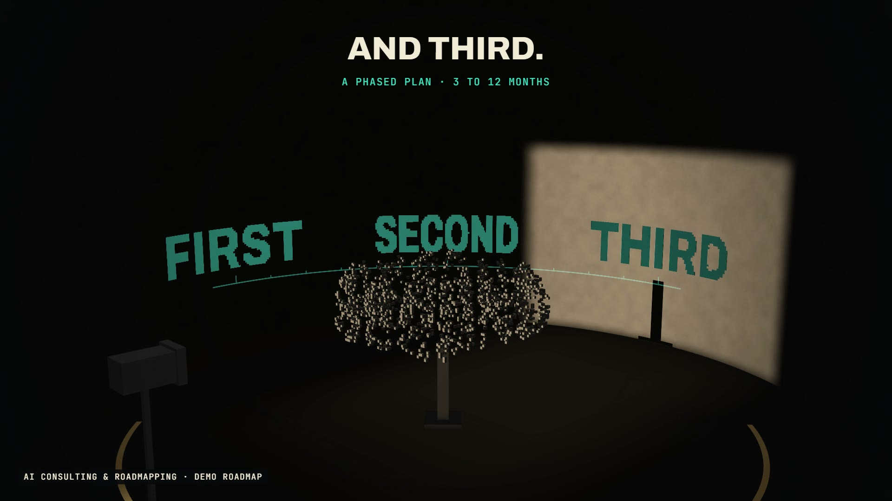

# R60 · Sightline

## Purpose

A film for AI Consulting & Roadmapping, a service. Its idea: a business looks like a tangle from most angles, and the work is finding the few angles where it reads clearly. So one lamp travels round a sculpture of blocks, and its shadow only reads from three exact angles.

- **A tangle:** a lamp on a curved rail slides round a lattice of blocks, and the shadow on the wall churns.
- **The question:** the shadow snaps into WHERE, then DOES, then AI FIT?, one at each angle.
- **The work:** the blocks slide in a wave and AI FIT? becomes AUDIT. The lamp sweeps back through RANK and PLAN.
- **The roadmap:** PLAN rebuilds into FIRST, and on the third sweep FIRST, SECOND and THIRD land and stay on the wall.
- **The honest stop:** the lamp goes on to an angle where nothing reads and stops there.
- **Direction:** the three marks light together. No code, just direction.

The roadmap is a demo, and a label on screen says so. The words on the wall are the service page's own words. No client work appears, no tools or models are named, and no prices or results are claimed.

**Source release:** [Sightline source](https://github.com/jqaisystems/visions-recipes/releases/tag/r60-sightline-v1)
· **Prompt, remix template and breakdown:** [RECIPE.md](RECIPE.md)

40.8 s · 1920×1080 · 30 fps · three carved lattices, one moving lamp · €0 to make

## Requirements and commands

Needs Node 22+, Chrome or Edge, FFmpeg on the path, and Python with `pip install numpy pillow`. Every block is real geometry and the lamp is taken at four instants a frame, each with its own shadow map, with 4x antialiasing, so a GPU helps.

    python bake/carve.py              # the carving: three lattices and how each block moves between them, written to assets/blocks.js (and proof sheets to work/)
    python bake/table.py              # the one table: the lamp's moves, the stations, the rebuilds, the marks, the camera and the captions, written to assets/table.js
    python score/compose.py           # the score, composed in code from that table
    npm run dev       # browser preview, using the version pinned in package.json
    npm run check     # validate the composition
    npm run render    # MP4 to renders/

## Editable elements

1. **The words the shadow casts.** `SETS` in `bake/carve.py`: three words for each lattice, cast at 0°, 45° and 90°. `python bake/carve.py --dry` prints how many pixels each word loses before you write anything. If a short word fills in its own gaps, move a word across, as WHERE / DOES / AI FIT? does.
2. **The letters.** `SQUEEZE` sets every word's proportions, `MAXW` the widest a word may sit, and `WGHT` and `WDTH` the font's weight and width. `N` and `H` set the grid, and the seed passed to `carve()` sets which tangle you get.
3. **The lamp.** `MOVES` in `bake/table.py`: each sweep's beats and angles. `LANDS` says when each word lands (the score reads it), `STOP` is the angle where nothing reads, and `SHUTTER` how many frames the shadow is exposed over.
4. **The rebuilds.** `REBUILD` in `bake/table.py`: each rebuild's beats and the direction its wave runs; `SLIDE` is how long each block takes.
5. **The roadmap.** `MARKS`, `MARK_KEEP`, `MARK_GLOW` and `TIMELINE` in `bake/table.py` time the words the wall keeps and the line under them.
6. **The captions.** `CAPS` in `bake/table.py`: each line's text and its beats in and out. `RUNS` is the small teal line.
7. **The camera.** `CAM` in `bake/table.py`: with follow at 1 its bearings are measured from the lamp's own angle, so 180 is over the lamp's shoulder.
8. **Your mark.** The end card is the image in `assets/brand/`, placed flat as `#logo`.
9. **The sound.** The score is in `score/compose.py`: `NOTES` is the note each word lands on.

## Source files

- `index.html`: the stage, every block and the lamp per frame, the WebGL2 renderer with its shadow maps, the wall's marks, the overlay, the audio and the timeline.
- `bake/carve.py`: the carving. Needs NumPy and Pillow.
- `bake/table.py`: the one table, standard library only.
- `score/compose.py`: the score. Needs only NumPy.
- `assets/brand/your-mark.svg`: a placeholder for your own mark.

## Credits and licences

- **Code, composition and score:** MIT (see the repo [LICENSE](../../LICENSE)).
- **GSAP** (`assets/vendor/gsap.min.js`): GSAP Standard License, free (gsap.com/standard-license).
- **Fonts:** Archivo and JetBrains Mono are under the SIL Open Font License 1.1 (`assets/fonts/OFL-*.txt`).
- **Not included:** the JQ AI SYSTEMS mark is not part of this repo or its licence. Use your own mark.
- **AI Consulting & Roadmapping:** a service that isn't in this repo. Only the film's code is here.

[All recipes](../../docs/catalog.md) · [Setup and first example](../../README.md#first-working-example)
