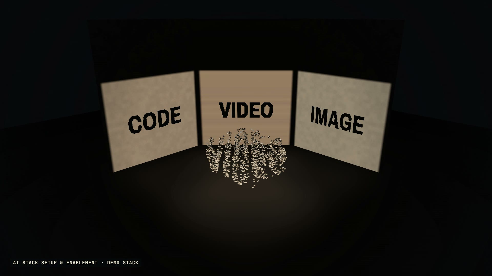

# R61 · Stacked

## Purpose

A film for AI Stack Setup & Enablement, a service. Its idea: most teams already use AI, scattered across personal accounts and pasted prompts. Everything is there and nothing reads. Setting up the stack is the same pieces put in order. So a heap of blocks builds itself into a shadow sculpture, and three words write themselves on three walls.

- **Scattered:** three lamps click on over a heap of blocks, and the walls show only noise.
- **Installed:** the blocks rise and lock row by row, and CODE, VIDEO and IMAGE write themselves on three walls at once, from the bottom up.
- **Configured:** the blocks slide in a wave into SKILLS, PROMPTS and PLAYBOOK.
- **Onboarding:** three heads and shoulders step into the light, one beside each word.
- **Handover:** a last rebuild leaves YOUR, OWN and STACK.

The stack is a demo, and a label on screen says so. The words on the walls are the service page's own words. No client work appears, no tools or models are named, and no prices or results are claimed.

**Source release:** [Stacked source](https://github.com/jqaisystems/visions-recipes/releases/tag/r61-stacked-v1)
· **Prompt, remix template and breakdown:** [RECIPE.md](RECIPE.md)

39.2 s · 1920×1080 · 30 fps · three carved lattices, three lamps, one heap · €0 to make

## Requirements and commands

Needs Node 22+, Chrome or Edge, FFmpeg on the path, and Python with `pip install numpy pillow`. Every block is real geometry and every lamp has its own shadow map, with 4x antialiasing, so a GPU helps.

    python bake/carve.py              # the carving: three lattices and how each block moves between them, written to assets/blocks.js (and proof sheets to work/)
    python bake/table.py              # the one table: the lamps, the heap and the rows, the rebuilds, the team, the camera and the captions, written to assets/table.js
    python score/compose.py           # the score, composed in code from that table
    npm run dev       # browser preview, using the version pinned in package.json
    npm run check     # validate the composition
    npm run render    # MP4 to renders/

## Editable elements

1. **The words the shadows cast.** `SETS` in `bake/carve.py`: three words for each lattice, cast at 0°, 45° and 90°. `python bake/carve.py --dry` prints how many pixels each word loses before you write anything; word order matters, so try a few.
2. **The letters.** `SQUEEZE` sets every word's proportions, `MAXW` the widest a word may sit, and `WGHT` and `WDTH` the font's weight and width. `N` and `H` set the grid, and the seed passed to `carve()` sets which tangle you get.
3. **The heap and the build.** `HEAP` in `bake/table.py` is the mound's radius and height, `ASSEMBLE` when the build starts, `ROW_STEP` the beats between rows and `LIFT` how long each row takes to fly.
4. **The rebuilds.** `REBUILD` in `bake/table.py`: each rebuild's beats and the direction its wave runs; `SLIDE` is how long each block takes.
5. **The lamps.** `ON`, `LAMP_COL` and `lamp_keys()` in `bake/table.py`: when each lamp lights and its warm white. `BEAM` is the half-width of each beam.
6. **The team.** `TEAM`, `TEAM_SCALE`, `TEAM_ALONG` and `TEAM_SIDE` in `bake/table.py` place each figure in its own lamp's beam; `BUST` in `index.html` draws the profile.
7. **The captions.** `CAPS` in `bake/table.py`: each line's text and its beats in and out.
8. **The camera.** `CAM` in `bake/table.py` holds the camera keys; `along()` puts the camera back along a lamp's line.
9. **Your mark.** The end card is the image in `assets/brand/`, placed flat as `#logo`.
10. **The sound.** The score is in `score/compose.py`: `SCALE` is the scale the rows climb.

## Source files

- `index.html`: the stage, every block and figure per frame, the heap, the WebGL2 renderer with its shadow maps, the overlay, the audio and the timeline.
- `bake/carve.py`: the carving. Needs NumPy and Pillow.
- `bake/table.py`: the one table, standard library only.
- `score/compose.py`: the score. Needs only NumPy.
- `assets/brand/your-mark.svg`: a placeholder for your own mark.

## Credits and licences

- **Code, composition and score:** MIT (see the repo [LICENSE](../../LICENSE)).
- **GSAP** (`assets/vendor/gsap.min.js`): GSAP Standard License, free (gsap.com/standard-license).
- **Fonts:** Archivo and JetBrains Mono are under the SIL Open Font License 1.1 (`assets/fonts/OFL-*.txt`).
- **Not included:** the JQ AI SYSTEMS mark is not part of this repo or its licence. Use your own mark.
- **AI Stack Setup & Enablement:** a service that isn't in this repo. Only the film's code is here.

[All recipes](../../docs/catalog.md) · [Setup and first example](../../README.md#first-working-example)
