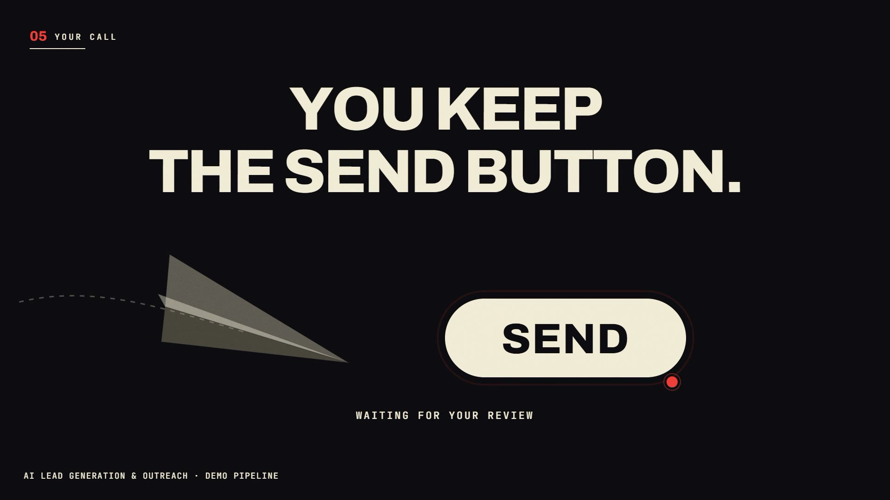

# R62 · Pinpoint

## Purpose

A film for AI Lead Generation & Outreach, a service. Its idea: lead generation is a pipeline, and one prospect moving through it is easier to follow than a diagram of it. So the film never cuts away from one coral dot, and it stops where the service stops: at the send button, which stays with a person.

- **Found:** the dot drops into a reticle, bounces and bursts into a field of 2,304 prospects.
- **Find:** a lens sweeps the field, the fits light up, and it locks on the coral dot; the camera dives into it.
- **Score:** the dot becomes a gauge's needle and swings to 87; the needle becomes a bar and the bars sort, warm ones first.
- **Enrich:** the top bar becomes a record card, and every detail slams in and is ticked.
- **Draft:** the card flips into a message the dot types, then folds into a paper plane.
- **Your call:** the plane freezes short of SEND, the music stops, and the dot rests beside the button without pressing it.

The pipeline is a demo, and a label on screen says so. Halden Studio, Ana and the message are made up. No client work appears, no sources, tools or models are named, and no prices or results are claimed.

**Source release:** [Pinpoint source](https://github.com/jqaisystems/visions-recipes/releases/tag/r62-pinpoint-v1)
· **Prompt, remix template and breakdown:** [RECIPE.md](RECIPE.md)

38.7 s · 1920×1080 · 30 fps · one dot, six scenes, eight sub-frames a frame · €0 to make

## Requirements and commands

Needs Node 22+, Chrome or Edge, FFmpeg on the path, and Python with `pip install numpy scipy`. Everything is drawn on one Canvas 2D stage, eight times a frame for the motion blur, so a render takes a minute or two.

    python bake/table.py              # the one table: every cue, the big words and the beat each letter lands, the bars, the record and the message with the beat each key is typed, written to assets/table.js
    python score/compose.py           # the score, composed in code from that table
    npm run dev       # browser preview, using the version pinned in package.json
    npm run check     # validate the composition
    npm run render    # MP4 to renders/

## Editable elements

1. **The cues.** `Q` in `bake/table.py`: the beat of every move, from the drop to the close. `BPM` sets the tempo; everything follows it.
2. **The big words.** `HEADS` in `bake/table.py`: each word's lines, beats in and out, size, height, colour and whether it slams in or types itself. `STAG` is the gap between letters.
3. **The lines under each scene.** `SUBS` in `bake/table.py`: text, beats and height. `CHAPTERS` are the numbered marks top left.
4. **The prospects.** `COLS` and `ROWS` in `index.html` set the field; `LP` is the lens's path, which ends on the hero dot.
5. **The scores.** `BARS`, `HERO_BAR` and `BAR_IDS` in `bake/table.py`: the bars that sort themselves.
6. **The record.** `ROWS` in `bake/table.py`: the details that slam into the card.
7. **The message.** `HDR`, `MSG` and `MARKS` in `bake/table.py`: the header, the body and the words underlined as coming from the record. Each character's beat is worked out for you.
8. **The colours.** `INK`, `BONE`, `CORAL`, `TEAL` and `AMBER` at the top of the script in `index.html`.
9. **The motion blur.** `SUBN` (sub-frames per frame) and `SHUT` (the shutter, as a share of a frame) in `index.html`.
10. **Your mark.** The end card is the image in `assets/brand/`, placed flat as `#logo`.
11. **The sound.** The score is in `score/compose.py`: `CH` holds the chords, and every hit, tick and key click is read from the table.

## Source files

- `index.html`: the stage, every scene as a function of the beat, the paper plane, the motion blur, the audio and the timeline.
- `bake/table.py`: the one table, standard library only.
- `score/compose.py`: the score. Needs NumPy and SciPy.
- `assets/brand/your-mark.svg`: a placeholder for your own mark.

## Credits and licences

- **Code, composition and score:** MIT (see the repo [LICENSE](../../LICENSE)).
- **GSAP** (`assets/vendor/gsap.min.js`): GSAP Standard License, free (gsap.com/standard-license).
- **Fonts:** Archivo and JetBrains Mono are under the SIL Open Font License 1.1 (`assets/fonts/OFL-*.txt`).
- **Not included:** the JQ AI SYSTEMS mark is not part of this repo or its licence. Use your own mark.
- **AI Lead Generation & Outreach:** a service that isn't in this repo. Only the film's code is here.
