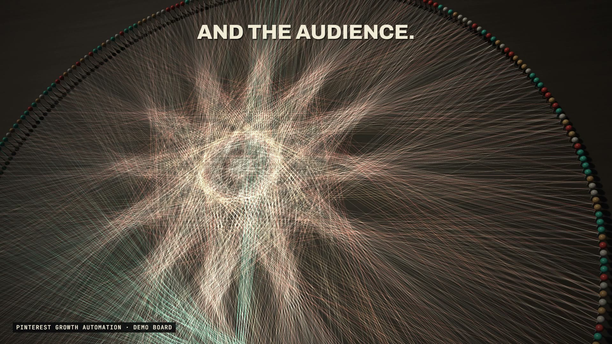

# R63 · Compound

## Purpose

A film for Pinterest Growth Automation, a service. Its idea: a pin a day doesn't look like much, and the service's whole point is that it compounds. String art is that, literally. One pass of thread is a meaningless straight line; hundreds of them, none taken back, become a picture. The pins round the ring are the batch, the thread is the daily pipeline, and the picture is what builds up.

- **The batch:** 300 pins press into a dark board in a ring, a mallet on every beat.
- **Approved:** one light runs round the ring and every pin flashes as it passes.
- **Day one:** the thread ties on and lays a pass a day, DAY 1, 2 and 3, each a single note.
- **It compounds:** the passes speed up to hundreds a second and a flower comes out of straight lines.
- **In your brand:** coral, amber and teal threads wind over it and the flower blooms in colour.
- **Yours:** the thread ties off and the camera glides low across the finished piece.

The board is a demo, and a label on screen says so. The flower is drawn in code and is nobody's pin or brand. No client work appears, no tools or models are named, and no figures, prices or results are claimed.

**Source release:** [Compound source](https://github.com/jqaisystems/visions-recipes/releases/tag/r63-compound-v1)
· **Prompt, remix template and breakdown:** [RECIPE.md](RECIPE.md)

40 s · 1920×1080 · 30 fps · 300 pins, four threads, 1,783 passes · €0 to make

## Requirements and commands

Needs Node 22+, Chrome or Edge, FFmpeg on the path, and Python with `pip install numpy pillow` (Pillow only draws the proof sheet). Every pin and pass is real geometry with a 4096 shadow map and 4x antialiasing, so a GPU helps.

    python bake/wind.py               # the winding: the flower, drawn in code, and every pass of the four threads, written to assets/wind.js (and a proof sheet to work/)
    python bake/table.py              # the one table: the pins, the approval, how fast each thread lays its passes, the camera and the captions, written to assets/table.js
    python score/compose.py           # the score, composed in code from both
    npm run dev       # browser preview, using the version pinned in package.json
    npm run check     # validate the composition
    npm run render    # MP4 to renders/

## Editable elements

1. **The picture.** The flower is built from shapes at the top of `bake/wind.py` (`petal`, `disc`, `seeds`, `stem`, `leaf`), and `MAPS` splits it into one brightness map per thread. Swap in any shapes, or load an image and use its channels.
2. **The threads.** `THREADS` in `bake/wind.py`: each thread's colour, how many passes it may lay and how much light one pass carries. Less light per pass means more, finer passes.
3. **The haze.** `PEN` in `bake/wind.py` is what a pass pays for crossing empty board. Raise it to keep colour on the picture; too high and a colour hardly winds.
4. **The ring.** `N` (nails), `R` (radius) and `GAP` (the nearest nail a pass may reach) in `bake/wind.py`.
5. **The pace.** `DAYS` and `WIND` in `bake/table.py`: the first passes timed by hand, then each thread's beats and ease. `THICK` draws the first passes thick enough to follow.
6. **The brightness.** `TALPHA` in `bake/table.py` sets each thread's brightness; `TW` in `index.html` is the thread's true width.
7. **The pins.** `LAND` (when they go in) and `APPROVE` (the light) in `bake/table.py`; the pin colours are in the nail shader in `index.html`.
8. **The captions.** `CAPS` in `bake/table.py`: each line's text and its beats in and out.
9. **The camera.** `CAM` in `bake/table.py` holds the camera keys.
10. **Your mark.** The end card is the image in `assets/brand/`, placed flat as `#logo`.
11. **The sound.** The score is in `score/compose.py`: `PENTA` is the scale and `BASE` each thread's register.

## Source files

- `index.html`: the stage, every pin and pass per frame, the WebGL2 renderer with its shadow map, the overlay, the audio and the timeline.
- `bake/wind.py`: the picture and the winding. Needs NumPy, and Pillow for the proof sheet.
- `bake/table.py`: the one table, standard library only.
- `score/compose.py`: the score. Needs only NumPy.
- `assets/brand/your-mark.svg`: a placeholder for your own mark.

## Credits and licences

- **Code, composition and score:** MIT (see the repo [LICENSE](../../LICENSE)).
- **GSAP** (`assets/vendor/gsap.min.js`): GSAP Standard License, free (gsap.com/standard-license).
- **Fonts:** Archivo and JetBrains Mono are under the SIL Open Font License 1.1 (`assets/fonts/OFL-*.txt`).
- **Not included:** the JQ AI SYSTEMS mark is not part of this repo or its licence. Use your own mark.
- **Pinterest Growth Automation:** a service that isn't in this repo. Only the film's code is here.
