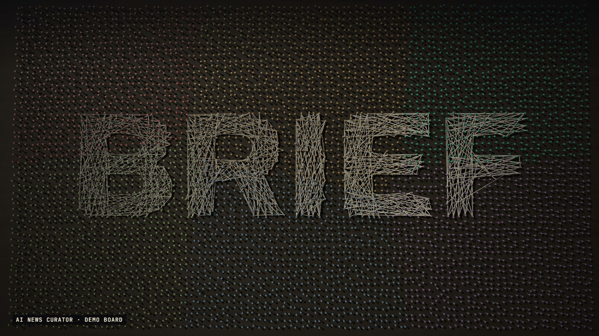

# R64 · Gist

## Purpose

A film for AI News Curator, a research briefing workflow. Its idea: the problem isn't collecting signals, it's turning a few of them into something useful. A board full of nails is that: every nail is a saved signal, and one thread joins only the ones that matter, so a word comes out of the board because the thread skips everything else. Then a person decides, and the day goes into an archive you can see.

- **Scattered:** nails land in waves at every angle, a few tagged with a source type.
- **Every link a record:** a ripple lifts every nail onto one grid and taps it in.
- **Topic and date:** a band of light crosses the board and each head takes its theme's colour.
- **The brief:** the thread winds BRIEF, slowly then in a rush, and the rest of the board stays bare.
- **A person decides:** the last pass waits, marked in amber, until a reviewer's lamp crosses. Only then is it laid.
- **The archive:** the camera pulls back to a wall of earlier days, today's marked TODAY.

The board is a demo, and a label on screen says so. The tags show source types only, never real links, headlines or sources, and the theme colours carry no labels. No client work appears, no tools or models are named, and no results are claimed.

**Source release:** [Gist source](https://github.com/jqaisystems/visions-recipes/releases/tag/r64-gist-v1)
· **Prompt, remix template and breakdown:** [RECIPE.md](RECIPE.md)

40 s · 1920×1080 · 30 fps · 5,184 nails, one thread, 634 passes · €0 to make

## Requirements and commands

Needs Node 22+, Chrome or Edge, FFmpeg on the path, and Python with `pip install numpy scipy pillow` (Pillow sets the word, SciPy finds the letters). Every nail is real geometry, and the wall at the end draws fifteen boards of them with a shadow map and 4x antialiasing, so a GPU helps.

    python bake/wind.py               # the winding: the word on the nail grid, every pass of the thread and the theme patches, written to assets/wind.js (and a proof sheet to work/)
    python bake/table.py              # the one table: the landing, the ripple, the light, the pace of the winding, the held pass, the wall, the camera and the captions, written to assets/table.js
    python score/compose.py           # the score, composed in code from both
    npm run dev       # browser preview, using the version pinned in package.json
    npm run check     # validate the composition
    npm run render    # MP4 to renders/

## Editable elements

1. **The word.** `WORDS` and `FIT` at the top of `bake/wind.py`: the word the thread winds and how much of the board it may fill. More than one word sets them as lines.
2. **The board.** `GAP` (nail spacing) and `JITTER` (how far each nail sits off the grid) in `bake/wind.py`.
3. **The winding.** `GROW`, `EDGE_OUT` and `EDGE_IN` in `bake/wind.py` decide how far a pass may stray outside a letter and which nails carry thread; `MAX_PASSES` and `STOP` decide when a letter is done.
4. **The themes.** `THEMES` in `bake/wind.py` is the number of patches; their colours are `TH` in the nail shader in `index.html`.
5. **The tags.** `TAGS` in `bake/wind.py` is how many nails show a tag, and `tags` in `bake/table.py` is what they say. Keep them to types of source.
6. **The scatter.** `WAVES`, `SCATTER` and `NORM` in `bake/table.py`: how the nails land, how far off and how leaning, and how the ripple carries them home.
7. **The pace.** `SWEEP`, `WIND`, `LOOSE`, `LAMP` and `APPROVE` in `bake/table.py`: the light, the winding's beats and ease, and how long the last pass waits.
8. **The wall.** `ARCHIVE`, `WALL`, `PITCH` and `DAYS` in `bake/table.py`: when the camera pulls back, how many boards and their weekday labels.
9. **The captions.** `CAPS` in `bake/table.py`: each line's text and its beats in and out. `label` is the demo label.
10. **The camera.** `CAM` holds the keys; `FOLLOW` and `HOLD` blend in the cameras that follow the thread's tip and hold on its loose end.
11. **Your mark.** The end card is the image in `assets/brand/`, placed flat as `#logo`, with `endTitle`, `endUrl` and `endLine` in `bake/table.py`.
12. **The sound.** The score is in `score/compose.py`: `PENTA` is the scale, and every pass is a pluck pitched by its length.

## Source files

- `index.html`: the stage, every nail and pass per frame, the WebGL2 renderer with its shadow map, the overlay, the audio and the timeline.
- `bake/wind.py`: the word, the winding and the theme patches. Needs NumPy, SciPy and Pillow.
- `bake/table.py`: the one table, standard library only.
- `score/compose.py`: the score. Needs only NumPy.
- `assets/brand/your-mark.svg`: a placeholder for your own mark.

## Credits and licences

- **Code, composition and score:** MIT (see the repo [LICENSE](../../LICENSE)).
- **GSAP** (`assets/vendor/gsap.min.js`): GSAP Standard License, free (gsap.com/standard-license).
- **Fonts:** Archivo and JetBrains Mono are under the SIL Open Font License 1.1 (`assets/fonts/OFL-*.txt`).
- **Not included:** the JQ AI SYSTEMS mark is not part of this repo or its licence. Use your own mark.
- **AI News Curator:** a system that isn't in this repo. Only the film's code is here.
